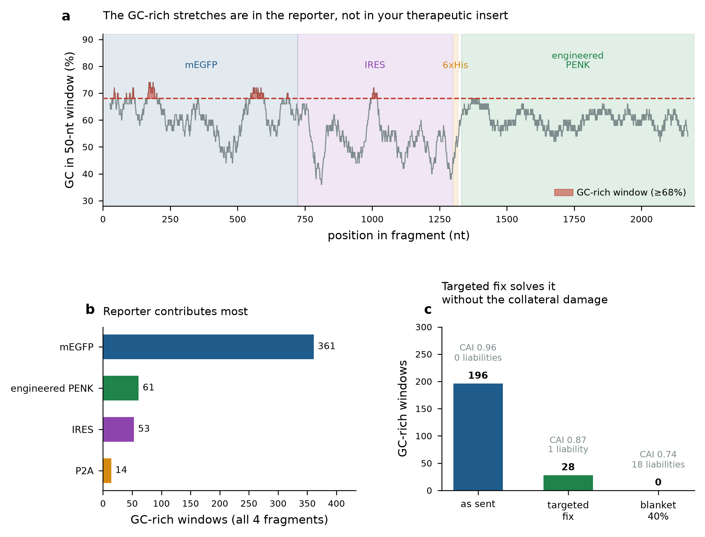
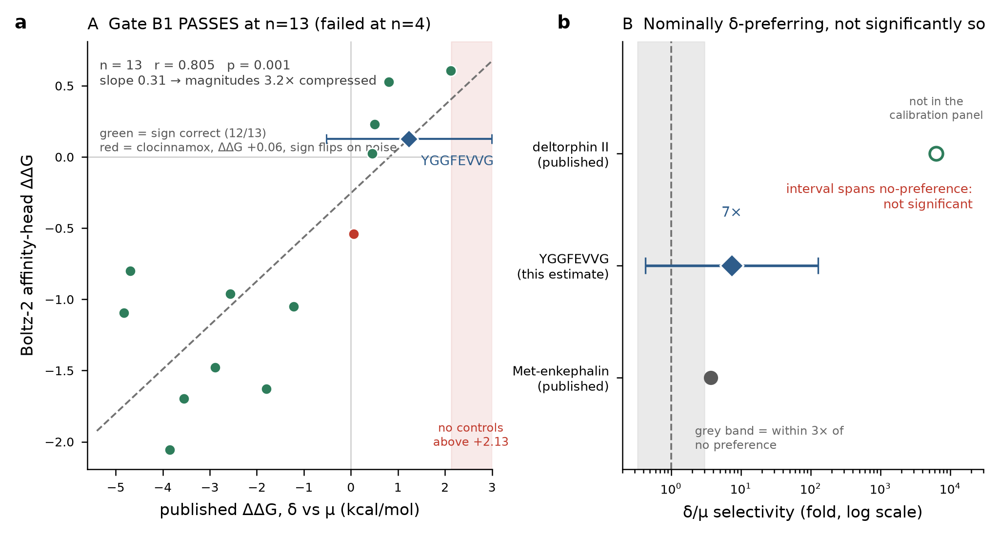
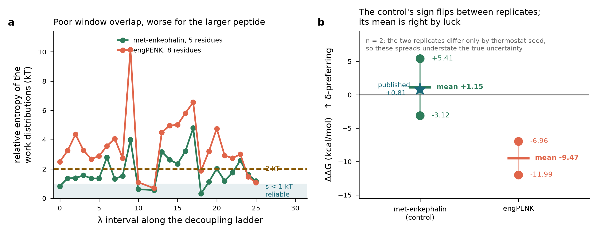

# Engineering Success

*Epione — a DNA-encoded enkephalin factory for chronic cancer pain. iGEM Patras 2026.*

Our project is wet-lab led. The dry lab's job is to decide **what to build** and to
refuse to let an untested assumption reach the bench. This page documents three
Design–Build–Test–Learn cycles on the thing we are actually building, in the order we ran
them. Every prediction below was committed to public version control **before** the test
that judged it, so each claim here is checkable against `git log` rather than taken on
trust.

A fourth cycle follows, on the *method* rather than the product. We separate it deliberately:
it never changed the construct, so it is not an engineering success on the thing we are
building. It is one on the instrument we use to judge it, and it went round the loop twice. The other covers the
delivery vehicle. The full granular record, including every cycle we do not narrate here,
is in [`06_engineering_cycles/`](https://github.com/kei-zan/dry-lab-modelling/tree/main/06_engineering_cycles).

---

## Cycle 1 — Designing a payload that DNA can encode


*The engineered precursor keeps the native architecture — seven cassettes at the native spacing,
flanked by the same dibasic sites the cell's convertases already recognise — and changes only the
message-plus-address sequence inside them. The cassette count is not an optimisation: it is what
human PENK carries, so the spacing is already known to work in secretory granules.*

**The problem.** Enkephalins are the body's own analgesic peptides, but they act at both the
μ- and δ-opioid receptor. μ-receptor activation is what brings the respiratory depression,
constipation and dependence that make opioid therapy self-limiting. A payload biased toward
δ is therefore the design goal.

### Design

The most δ-selective natural opioid peptides are the deltorphins, from *Phyllomedusa*
frogs. Deltorphin II is **Tyr-D-Ala-Phe-Glu-Val-Val-Gly-NH₂**, and opioid peptide
pharmacology splits that into two parts: a **message** (the N-terminal residues that
activate the receptor) and an **address** (the C-terminal residues that select *which*
receptor).

We could not use deltorphin II itself. It contains **D-alanine** and a **C-terminal amide**,
and a gene can encode neither — the ribosome builds L-amino acids and leaves a free acid.

So we built a chimera: deltorphin's δ-**address** on the enkephalin **message**.

```
deltorphin II   Tyr–D-Ala–Phe | Glu-Val-Val-Gly –NH₂     not encodable
Met-enkephalin  Tyr–Gly–Gly–Phe | Met –OH               encodable
our payload     Tyr–Gly–Gly–Phe | Glu-Val-Val-Gly –OH   YGGFEVVG
```

### Build

`YGGFEVVG` as a synthetic cassette, repeated seven times in a proenkephalin-like precursor.
Seven is not an arbitrary choice: the native human precursor (UniProt **P01210**) carries
seven opioid cores, so the spacing between our cassettes is already known to work inside
human secretory granules.

### Test

Co-folding of the peptide into both receptors, then a selectivity estimate from the
predicted complexes.

### Learn

**The direction was right; our first quantitative claim was wrong.** An early version of this
cycle reported the payload as 1.96× more δ-preferring than native enkephalin. **That figure
is withdrawn** — it came from an estimator we had not calibrated against any experimental
value, and when we later calibrated one properly (see *Method validation*), the number did
not survive.

What carried forward was the sequence. `YGGFEVVG` is what every construct in the project now
expresses, and what the wet lab will measure.

**The honest status of δ-preference is a design goal, not a demonstrated result.** We say so
on our poster and we say so here.

---

## Cycle 2 — Can the cassette actually be manufactured?



*Synthesis difficulty is not spread evenly. Locating the specific windows that drive the vendor's
complexity score is what allowed a targeted recoding instead of a blanket redesign.*

This is our strongest cycle, and the only one whose Test step is **not** a simulation. The
test was an external commercial DNA synthesis vendor, whose feasibility engine either
accepts a sequence or refuses to make it. We ran three rounds against it.

### Round 1 · Design → Build → Test

Four bicistronic constructs, codon- and GC-optimised, submitted for synthesis.

**Result: denied.** One construct scored **23.8** on the vendor's complexity scale, where
anything at or above 10 is refused.

### Round 1 · Learn — and the finding that justifies the whole cycle

Our assumption had been that if anything was unmanufacturable it would be the engineered
part: seven near-identical repeats of a synthetic cassette is exactly the kind of sequence
a synthesiser struggles with.

**That assumption was wrong.** The itemised rejection report put most of the score on two
*terminal flanking sequences* — not our cassettes at all. Those two flanks are exact reverse
complements of one another, forming a **10 bp terminal inverted repeat**.

Those flanks came from the wet lab's own existing plasmid files. They were inherited, not
designed by us, and they had never been tested as a pair.

The lesson we took, and now apply to every sequence that enters a design:
**inherited sequence is still untested sequence.** A terminal inverted repeat is also a
genuine biological liability beyond synthesis — it can form a hairpin and destabilise the
construct — so this was worth catching before the bench, not after.

### Round 2 · Design → Test

A minimal repair of the flanks rather than a redesign, screened against a restriction-enzyme
panel so the wet lab's existing cloning scheme still worked.

**Result: 3 of 4 accepted.** The fourth still flagged.

### Round 2 · Learn

The vendor's report named **two** scoring rules and we had only modelled one. The residual
flag came from long-range repeats *between* tandem cassettes — a consequence of repeating
one cassette seven times, and invisible to the local scoring window we had been using.

### Round 3 · Design → Test → Learn

We rebuilt the codon optimisation against a **global** repeat objective rather than a local
one, so synonymous codon choices were made to minimise repeats across the whole insert
instead of within a sliding window.

**Result: v6 accepted. All four constructs ordered.**

Before querying the vendor we committed a prediction for each construct's complexity score,
derived from a two-rule model we had reverse-engineered from the earlier reports. Those
predictions are in the repository with timestamps preceding the vendor's reply. Most were
exact; one revealed a third rule we had not encoded, which we recorded as a falsified
prediction rather than quietly updating the model.

**Why this cycle matters for engineering.** A design that cannot be manufactured is not a
design. The loop closed across the dry–wet boundary with a real external oracle, it took
three rounds, and it caught a defect in material the project had been treating as settled.

---

## Cycle 3 — What should the first transfection produce? *(in progress)*


*Every band position here was computed from the construct sequences and committed to version
control before the wet lab ran anything, including one species predicted to be **absent**. A
prediction that only names what should appear cannot be falsified by a blank lane.*

The constructs are ordered. This cycle is **pre-registered and awaiting bench data**, which
is what an open cycle should look like.

### Design

Rather than transfect and then interpret whatever appears, we committed falsifiable
predictions first — band sizes, which species should be present, which should be **absent**,
and target masses for mass spectrometry — so the first experiment can contradict us.

### Build

Four constructs as a two-by-two comparison: two bicistronic strategies against two reporter
orientations, so the comparison is controlled rather than anecdotal.

### Test *(wet lab, pending)*

Transfection, western blot, and a biomimetic *in vitro* digest using the convertase pair
that generates enkephalins natively.

### Learn — already, before the bench

Two findings came out of the prediction work itself:

**An asymmetry between orientations.** In one bicistronic arrangement, an uncleaved
read-through product buries the signal peptide *internally*, where it cannot be cleaved and
the product cannot be secreted. The two orientations are therefore not equivalent, and the
western blot should show it.

**One cassette cannot release free peptide.** Computing the C-terminal context of every
cassette showed that the terminal cassette has no downstream cleavage site, so it releases an
extended species rather than a free octapeptide — in **all four** constructs equally. That
told us the yield is identical across the constructs we had already ordered, so no re-order
was warranted. We added the extended species to the mass-spectrometry target list as a
labelled internal negative control.

This mirrors the native precursor, which also releases extended products from some of its
cores, so it is expected behaviour rather than a defect.

---

## Cycle 4 — Engineering the instrument, not the product

A large part of our computational effort went into one question: **is `YGGFEVVG` really
δ-preferring?** None of it changed the construct. What it did change, twice, was the method
we use to answer the question — and that is a Design–Build–Test–Learn loop in its own right,
with the Learn step of each round visibly driving the Design of the next.

### Round 1 · a method that failed its own control

**Design.** Rank candidate peptides by δ/μ selectivity using a co-folding confidence score.
**Test.** Score published reference opioids whose selectivity is already measured, and
require the predictions to correlate with them before any number for our own peptide is
quoted. **Result at n = 4: every gate failed**, including a wrong sign on the most strongly
selective reference in the set.

**Learn.** The failure was *statistical power*, not the method. We computed the correlation
threshold that n = 4 can clear and found the test could not have passed even had the method
been perfect. The honest consequence was to withhold the target number entirely — and it is
worth saying what that cost: had we skipped the controls, the withheld value would have
agreed with our own earlier null and been mistaken for confirmation.

### Round 2 · the same test, properly powered

**Design.** Expand the reference panel rather than accept the negative. **Build.** Thirteen
published opioids, all affinities taken from a single source so that between-study scatter
could not enter the calibration axis.



**Test.** `r = 0.805`, `p = 0.001`, signs correct on **12 of 13**. The gate passed, and the
project got its first calibrated selectivity estimate.

**Learn.** Three limits came with it, all reported: the regression slope compresses
magnitudes, so direction and ranking are calibrated while absolute values are not; the panel
contains no control in the strongly δ-selective regime, because the two most selective
peptides failed the inclusion criterion — and those are exactly the two the method had called
with the wrong sign at n = 4; and binding is not efficacy.

### Round 3 · a harder method, and what its control did to it

**Design.** Replace the ranking score with alchemical free energy, which does not interpolate
from published values at all. **Test.** Run native Met-enkephalin — whose selectivity is
published — through the identical protocol as a control.



**Result.** The control's two replicates came back at **−3.12 and +5.41 kcal/mol** — opposite
signs, from nothing but a different random seed.

**Learn.** Rather than stop at "the method is noisy", we measured why. Along the
thermodynamic path, **20–21 of 25 intervals** had poorly overlapping work distributions for
our payload against 9–15 of 25 for the control. The cause is not sampling time but spacing:
at fixed spacing the perturbation per step grows with the size of the molecule being
decoupled, so a ladder validated on a 5-residue peptide is too coarse for an 8-residue one.
More computer time would have tightened the error bar around a biased number, which is worse
than a visibly noisy one.

**Design, again.** A 57-window ladder spaced for uniform overlap, with replicates generated
from independent equilibrations rather than a shared one. That campaign is running now, and
its gates were committed before it started.

### Where that leaves the question

**We assessed five independent computational approaches. Each one failed, for a specific and
documented reason.**

| approach | why it cannot answer the question |
|---|---|
| Co-folding confidence difference | failed its correlation gate against published reference compounds |
| MM-GBSA rescoring | failed its own pre-registered gate |
| Fingerprint QSAR (ours) | aggregate correlation looks good, but the prediction is a nearest-neighbour lookup and flips sign when neighbours are removed |
| Published sequence- and transfer-learning predictors | their reported error, converted to a selectivity difference, is several times larger than the effect we need to resolve |
| Alchemical free energy | its own control's **sign flips between replicates** |

That last one is the most informative. We ran native Met-enkephalin — whose selectivity is
published — through the identical protocol as a control. Its two replicates came back at
**−3.12 and +5.41 kcal/mol**: opposite signs, from nothing but a different random seed. We
then measured *why*: along the thermodynamic path, **20–21 of 25 intervals** had poorly
overlapping work distributions for our payload (9–15 of 25 for the control), which makes the
estimator noisy rather than wrong-headed. More computer time cannot fix that; only a finer
path can, which is what we are now running.

**The common cause is the reference data, not any single method.** Four of the five calibrate
against published binding affinities — and our own records disagree by **1.83 kcal/mol** on a
single compound measured in two different studies, which is *larger than the effect we are
trying to measure*.

So the honest position, and the one on our poster: **δ-preference is a design goal, and the
cAMP assay is the experiment that decides it** — not a confirmation of a computational
result, but the only measurement that can settle it.

**Four of the five approaches in that table are our own, and we report all four as failed.**
At the level of individual predictions the repository's ledger stands at **20 scored, 10
confirmed, 10 falsified**, each with the commit that registered it before its test.

We think that is a stronger position than one unchallenged number, and it is the reason we
trust the three cycles above.

---

## Delivery vehicle

The construct has to reach nasal epithelium. We modelled a non-viral lipoplex — coarse-grained
molecular dynamics of a lipid formulation with the DNA cargo — and produced a formulation
specification for the wet lab.

Non-viral delivery is a deliberate choice rather than a fallback: no genomic integration, no
anti-vector immunity, re-administrable, and a better-established regulatory route than viral
vectors. It is also why a nasal spray is plausible at all, where the gene-therapy
alternatives for chronic pain require intrathecal delivery or hospitalisation.

---

## What we would tell another team

**Test the assumption you did not make.** Our vendor rejection was in inherited sequence, not
in the part we designed. We had tested what we built and trusted what we were given.

**Calibrate a method before you quote it.** Every selectivity number we withdrew came from a
method we had not first checked against a value someone had measured.

**A control that destroys your result is the control working.** Our free-energy control cost
us our only quantitative selectivity claim. Running it was still right, and we would rather
find that here than in front of a reviewer.
