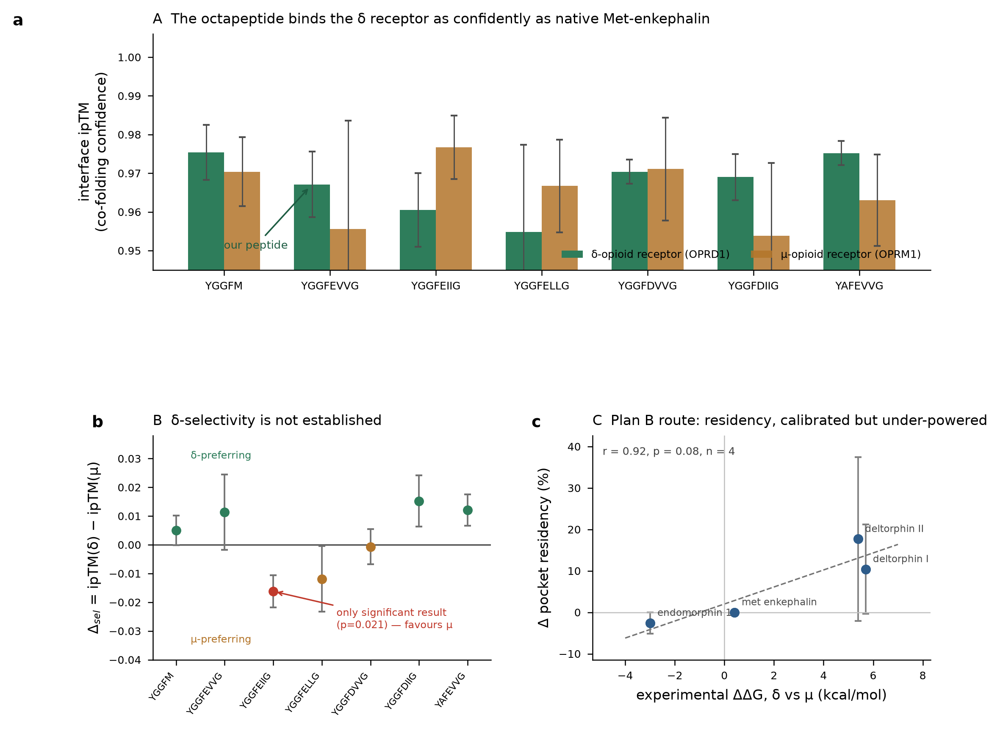

# The δ-opioid receptor connection: what is already shown, and Plan B

**Written 2026-09-17, before the wet lab runs any DOR assay.** Answers two questions from
the wet lab: (1) can the DOR interaction be shown *in silico*, and has it been done;
(2) what is the fallback if the wet-lab demonstration fails.

---

## 0. One terminology correction first

The request said "DOR **inhibitor**". DOR (δ-opioid receptor, gene `OPRD1`) is a
**Gi/o-coupled** GPCR, and enkephalins (native and engineered) are **agonists** at it.
The *inhibition* is downstream: agonist occupancy inhibits adenylyl cyclase and lowers
cAMP. So the peptide is an agonist whose cellular consequence is inhibitory; it is not a
receptor inhibitor (that would be an antagonist, e.g. naltrindole).

This is not pedantry: **it determines the assay.** An agonist is measured by the response
it *produces*; an antagonist by the response it *blocks*. Everything below assumes agonist.
If the wet lab has been planning an antagonist-style assay, that is worth catching now.

---

## 1. Yes, it is already done. Two independent lines.

### 1.1 Co-folded structure (Boltz-2)

| Complex | interface ipTM | complex ipTM | peptide pLDDT | file |
|---|---|---|---|---|
| **`YGGFEVVG`** + human OPRD1 | **0.809** | 0.972 | 81.3 | `04_structures/engPENK_octapeptide_YGGFEVVG_DORbound.pdb` |
| native `YGGFM` + human OPRD1 | 0.757 | 0.979 | 87.2 | `04_structures/native_MetEnkephalin_YGGFM_DORbound.pdb` |

Repeated across 5 diffusion samples per complex (Cycle 2, MSA = 1024):

| Peptide | ipTM at δ | ipTM at μ | δ-pose convergence |
|---|---|---|---|
| native `YGGFM` | 0.9754 ± 0.0071 | 0.9704 ± 0.0089 | 1.42 Å |
| **engineered `YGGFEVVG`** | **0.9671 ± 0.0085** | 0.9556 ± 0.0280 | **1.14 Å** |

**What this supports:** the engineered octapeptide is predicted to occupy the δ orthosteric
pocket with confidence statistically indistinguishable from native Met-enkephalin, and with
a *more* converged pose at δ than native. On interface ipTM in the single-complex run it
scores slightly *above* native (0.809 vs 0.757). This is a legitimate, showable in-silico
result and it is already in the repository.

**What it does not support: affinity.** ipTM is a structural-confidence metric, not a
binding energy. High ipTM at both receptors means "a plausible complex was built", not
"it binds tightly". Do not present ipTM as a surrogate for potency.

### 1.2 δ-selectivity, falsified, by our own dry lab

| Peptide | Δ_sel = ipTM(δ) − ipTM(μ) | p |
|---|---|---|
| native `YGGFM` | +0.0050 ± 0.0051 | 0.36 |
| engineered `YGGFEVVG` | +0.0114 ± 0.0131 | **0.43** |

`YGGFEVVG`'s δ-preference is **smaller than its own uncertainty** and indistinguishable
from zero, and from native (p = 0.60). Cycle 1's headline "**1.96× native selectivity**"
was **retracted**, it came from `model_0` alone and did not survive 5-sample statistics.
4 of 5 Cycle 2 pre-registered predictions were falsified, and the *only* statistically
significant selectivity in the whole panel (V1 `YGGFEIIG`, p = 0.021) points toward **μ**.

> **Tell the wet lab to expect DOR *activity*, not δ-*selectivity*.** If the planned
> experiment is designed to demonstrate selectivity, our own dry lab predicts it will not
> show one, and that prediction is already on record, pre-registered, in `CYCLE2_RESULTS.md`.
> A null selectivity result would *confirm* our model, not refute the project.

---

## 2. The real gap, and it needs no wet lab

The MM-GBSA physics-rescoring pipeline (Cycle 3b) is **validated end-to-end**, four
defects found and fixed, including one silently emitting the ligand's absolute energy
instead of the binding delta. But its 8 systems are Met-enkephalin, endomorphin-1,
deltorphin I and deltorphin II. **It was never run on `YGGFEVVG`.**

So our own peptide has co-folding confidence only, while four benchmark peptides have
physics-based ΔΔG. Closing that is the single highest-value dry-lab action available, and
it does not depend on the transfection.

---

## 3. Wet-lab Plan B

### 3.1 A negative result is ambiguous, design to disambiguate it

"No DOR connection" has four causes, and the DOR assay alone cannot separate them:

1. No peptide was produced (digest failed)
2. Peptide produced but lost in handling: aggregation near its pI (`SUBSTRATE_PREP_BRIDGE.md` §3)
3. Assay not functioning
4. Peptide genuinely inactive at DOR

### 3.2 The one control that splits them: synthetic peptide, run in parallel

**`STD-ENGC` (`YGGFEVVG`) is already on the control-peptide order sheet**
(`07_invitro_penk/tables/control_peptides_order.csv`). Run the DOR assay on synthetic
`YGGFEVVG` alongside the digest-derived material, every time.

| Synthetic | Digest-derived | Native `YGGFM` | Conclusion |
|---|---|---|---|
| active | inactive | (none) | production/recovery problem (causes 1–2). **Pharmacology is fine.** |
| inactive | inactive | active | the peptide design is the problem (cause 4) |
| inactive | inactive | inactive | assay problem (cause 3): nothing learned about the peptide |

Without the synthetic arm, a negative result is uninterpretable and the time is wasted.
`STD-MENK` (`YGGFM`) is also already on the sheet and is the assay's positive control.
**Both are commercial peptides, order them now, not after a failure.** Given the tight
timeline this is the highest-leverage thing the wet lab can do today.

### 3.3 Assay formats compatible with the no-animal / no-antibody constraint

DOR is Gi-coupled, so agonist → ↓cAMP. Ranked by fit to the standing constraints:

| Format | Readout | Fits? | Note |
|---|---|---|---|
| **cAMP reporter** (GloSensor or CRE-luciferase) | luminescence | **yes**: plasmid + plate reader | forskolin-stimulated; agonist *lowers* signal |
| **β-arrestin recruitment** (split-luciferase / NanoBiT) | luminescence | **yes**: plasmid only | orthogonal to G protein; catches biased agonism |
| **Gi BRET** (TRUPATH-style biosensor) | BRET ratio | **yes**: plasmid only | most direct G-protein readout |
| `[35S]`GTPγS binding | radioactivity | only if licensed | membrane prep, no live cells |
| Radioligand competition | radioactivity | only if licensed | gives K_i directly |

No antibodies and no animals in the top three. HEK293T is already the host, so DOR +
reporter co-transfection is the same workflow they just performed.

### 3.4 Controls that make a positive result defensible

- **SNC80** or **DPDPE** (δ-selective agonist): positive control and potency benchmark
- **naltrindole**: δ-selective antagonist. Must abolish the response. **Without this, a
  cAMP drop is not attributable to DOR.**
- **untransfected HEK293T**: receptor dependence (endogenous opioid receptor levels are negligible)
- **pertussis toxin**: abolishes Gi coupling; confirms mechanism
- **test MOR in parallel**: our prediction is activity at *both*. Assaying δ alone cannot falsify it.

### 3.5 If the peptide is active but weak

This is the likely partial-failure mode: `EVVG` replaces `M` as a DNA-encodability
compromise. Options, cheapest first:

1. **Raise concentration / extend incubation**: a weak agonist is not an inactive one
2. **Test the amidated form `STD-ENGA` (`YGGFEVV`-NH₂)**: already on the order sheet;
   C-terminal amidation frequently raises opioid potency
3. **Test the extended digest species** `YGGFEVVGRGL` (cassette 4) and `YGGFEVVGRF`
   (cassette 7): these are real products, not artefacts, and may differ pharmacologically
4. **Switch peptide to V4 (`YGGFDIIG`)**: Cycle 2's top-ranked variant, best δ-pose
   convergence in the panel (0.81 Å). A single-cassette DNA change, fully encodable.
   Note its Δ_sel is also not significant (p = 0.15); it is a *potency* candidate, not a
   selectivity fix.

---

## 4. Dry-lab Plan B: available now, no waiting

Ordered by value:

1. ~~**Run MM-GBSA on `YGGFEVVG` at δ and μ.**~~ **RETRACTED 2026-09-17: see §6.**
   This item contained two errors. `gate.py` **does exist**
   (`cycle3b_physics_rescoring/scripts/gate.py`); the "does not exist" line in
   `MMGBSA_STATUS.md` "Next actions" was superseded by `RESUME_2.md` (2026-08-12), which
   records it as already written and dry-run on synthetic data. More importantly, the
   MM-GBSA route **has already been run to completion and failed its own pre-registered
   gate** on 2026-08-31 (`docs/GATE_VERDICT_BOUND.md`, `results/verdict_bound.json`).
   Proposing it as the path forward was wrong.
2. **Pocket-residency time for `YGGFEVVG`.** Δ residency tracks experimental ΔΔG across the
   four calibration peptides at **r = 0.915 (p = 0.085, n = 4)**, suggestive but
   under-powered. It is the metric least sensitive to MM-GBSA's known weaknesses, and it
   uses the replicates the energy pipeline has to discard. Free once step 1's trajectories exist.
3. **Expand the calibration set.** n = 4 is *why* step 2 is not significant. Adding DPDPE,
   SNC80, DAMGO and β-endorphin (all with published δ/μ K_i) would establish whether
   residency is a usable predictor at all. This is the difference between a correlation and
   a calibrated instrument, and it is the honest prerequisite to quoting step 2.
4. **Pre-register the DOR predictions before the assay runs**, per project convention:
   `YGGFEVVG` is active at DOR; potency within ~10× of Met-enkephalin; **no** significant
   δ-over-μ selectivity; naltrindole abolishes the response.

---

## 4b. Both computational routes are now closed: tested, not assumed

Added 2026-09-17, after testing one route and discovering the other had already been tested.

### Route 1 (Boltz-2 affinity head): FAILED calibration (2026-09-17, Cycle 6)

The peptides are 40–82 heavy atoms, under the head's 128-atom cap, so they can be submitted
as `ligand` chains. Ten co-folds were run: our octapeptide plus the four literature-calibrated
controls, against OPRD1 and OPRM1. Three gates were pre-registered before the run.

| Gate | Required | Observed | |
|---|---|---|---|
| A1 rank order | ρ = 1.0 | ρ = 0.80 | **FAIL** |
| A2 correlation | \|r\| > 0.95 (p<0.05, n=4) | r = 0.72 (p = 0.28) | **FAIL** |
| A3 sign agreement | 3 of 3 | 2 of 3 | **FAIL** |

Deltorphin II is **8448-fold δ-selective** and the head predicts it **μ-preferring**,
a 6.5 kcal/mol sign error on the most selective peptide in the panel. Met-enkephalin's
sign is also inverted. The head's two internal sub-predictions disagree by 1.19 kcal/mol
on average and, for endomorphin-1 at δ, disagree in sign (+0.35 vs −1.79).

Per the pre-registration, the predicted ΔΔG for `YGGFEVVG` is **not reported**. It is
retained in `cycle6_scored.csv` marked non-reportable. Had the controls been omitted, the
value would have agreed with the Cycle 2 null and been mistaken for confirmation.

### Route 2 (MM-GBSA): FAILED its gate on 2026-08-31, before this was ever proposed

| control | n | computed ΔΔG | SEM | experimental | \|error\| |
|---|---|---|---|---|---|
| met-enkephalin | 5 | +26.38 | **1.46** | 0.00 | **26.4** |
| deltorphin I | 5 | +15.18 | 4.95 | +5.70 | 9.5 |
| deltorphin II | 5 | +7.48 | 3.24 | +5.39 | 2.1 |
| endomorphin-1 | 5 | −0.91 | 3.32 | −2.99 | 2.1 |

**G1 PASS** (signs and ranking correct) · **G2′ FAIL** (3 of 4 SEMs are 3.2–5.0 against a
1.5 threshold) · **G3 FAIL** (slope CI spans zero, r = 0.179 over 20 points).

Met-enkephalin is the diagnostic: the **tightest** replicate agreement and the **largest**
error. A reproducible large error is a systematic one: consistent with these being
enthalpy-dominated energies with no entropy term, which should penalise the smallest and
most flexible peptide hardest, and does.

Cycle 3b terminated on its own pre-registration with the negative methodological result:
**single-trajectory MM-GBSA at n=5 does not resolve δ/μ selectivity for these peptides.**
Running it on `YGGFEVVG` would return a ΔΔG with SEM 3–5 kcal/mol from a method whose
correlation with experiment is indistinguishable from zero. It cannot separate "no
selectivity" (~0, our Cycle 2 prediction) from "moderately δ-selective" (~5).

### What survives: residency, as a direction and not a number

| peptide | δ residency | μ residency | Δ | experimental ΔΔG |
|---|---|---|---|---|
| deltorphin I | 93.0% | 82.6% | +10.4 | +5.70 |
| deltorphin II | 75.7% | 58.0% | +17.7 | +5.39 |
| endomorphin-1 | 97.4% | 100.0% | −2.6 | −2.99 |
| met-enkephalin | 100.0% | 100.0% | 0.0 | +0.41 |

Pocket residency is **measured, not modelled**; it does not depend on the energy model at
all, and it is the part of Cycle 3b least sensitive to MM-GBSA's known weaknesses.
Deltorphin II holds the δ pocket in up to 99% of frames but the μ pocket in as little as
**10.7%**, which is the right direction for a δ-selective peptide.

But it is **r = 0.915, p = 0.085, n = 4**, suggestive and not significant. It supports a
directional statement ("δ-preferring" / "no preference") and not a ΔΔG.

### Consequence for the dry lab

**No computational route in this project resolves δ/μ selectivity to significance.** That
is now a tested conclusion on both routes rather than an untested hope about one. The
project's standing recommendation, already recorded in `GATE_VERDICT_BOUND.md` before
either of these tests, is **radioligand competition binding on `YGGFEVVG`**, i.e. the
wet lab. Cycle 6 does not change that recommendation; it removes the last argument for
postponing it.

What the dry lab can still deliver, honestly labelled:

- **Residency for `YGGFEVVG` at δ and μ**, a directional observable on the same protocol
  as the four calibrated controls. ~200 ns of MD across 2 receptors × 5 replicates,
  ≈3 days on one GPU. Reports "δ-preferring / no preference", never a ΔΔG.
- **MM-GBSA sign only (G1 level)**, falls out of the same trajectories at no extra cost.
  G1 is the one criterion that passed, so the sign is usable where the magnitude is not.

---

## 5. What this plan does not fix

- **No in-silico route here produces an EC50.** ipTM and MM-GBSA both predict *interaction*,
  not potency. If the wet lab needs a potency number, it has to come from the assay.
- MM-GBSA effective energies carry **no entropy term**; absolute values are not affinities
  and only differences within one consistent protocol are interpretable.
- The residency calibration is **n = 4, p = 0.085**. It is not a validated predictor and
  must not be quoted as one until step 4.3 is done.
- Nothing here addresses whether the peptide is **stable in assay medium** over the
  incubation, serum peptidases degrade enkephalins rapidly, and that is untested.

---

## Sources in this repository

| Claim | File |
|---|---|
| Co-folded δ complexes, confidences | `04_structures/*_DORbound_AFformat_confidence.json` |
| 5-sample ipTM, Δ_sel, convergence | `06_engineering_cycles/cycle2_delta_selectivity/data/cycle2_results.csv` |
| Cycle 1 "1.96×" retraction | `cycle2_delta_selectivity/CYCLE2_RESULTS.md` |
| MM-GBSA validation, 4 defects, missing `gate.py` | `cycle3b_physics_rescoring/MMGBSA_STATUS.md` |
| Benchmark ΔΔG and residency | `cycle3b_physics_rescoring/mmgbsa_selectivity.csv`, `08_checkable_audit/tables/residency_vs_selectivity.csv` |
| Synthetic control peptides already specced | `07_invitro_penk/tables/control_peptides_order.csv` |
