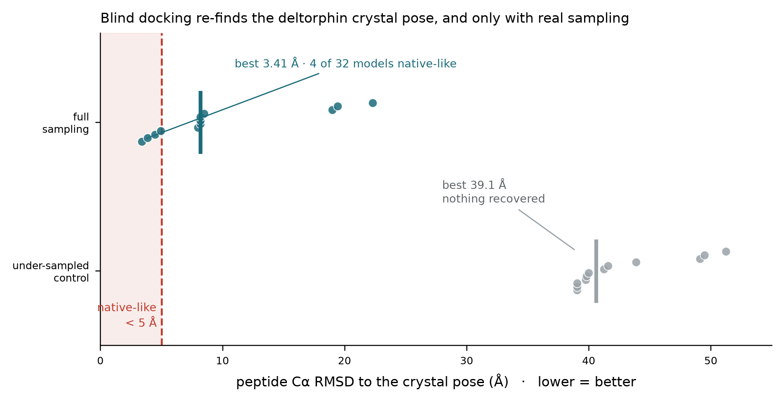

# Cycle 17, gate G1: PASS. Blind docking re-finds the crystal pose.

**11 Oct 2026. Gates were committed in `data/cycle17_prereg.json` before anything ran.**

## The question

Can blind CABS-dock re-find the crystallographic pose of deltorphin in the delta-opioid
receptor it was crystallised in (PDB 8F7S), **without** the membrane extension the 2026
preprint used and which is not in the public release?

If it cannot, the missing membrane term breaks the method in our hands and the cycle stops.

## Result



| run | models | best RMSD | < 5 A | < 8 A |
|---|---|---|---|---|
| **full sampling** (10 replicas, 50x50 MC) | 32 | **3.41 A** | **4** | 5 |
| under-sampled control (4 replicas, 2x2 MC) | 26 | 39.05 A | 0 | 0 |

**G1 PASSES.** Four of 32 models land within 5 A of the crystal pose, from a random starting
conformation at a random location on the receptor.

## Why the control is load-bearing

The under-sampled run was written as a pipeline guard, not as science, and became the right
negative control. It recovers **nothing**: best 39 A, peptide scattered over the surface.

This matters because the RMSD selector takes the last 7 CA atoms of each model, and a
selector bug could in principle manufacture a low number. **A bug would have produced low
RMSDs in BOTH runs.** The signal appears only when sampling is real, which is how a working
protocol behaves and a broken scorer does not.

## Measured cost, replacing an estimate

```
10,328 s per simulation (172 min, 4 cores)
100 simulations  =  286 core-hours per peptide
two peptides     =  572 core-hours   (~18 h wall on 32 concurrent)
```

Earlier figures in this repo of ">25 min" and ">105 min" per simulation were lower bounds
imposed by my own timeouts, not measurements. This is the measurement.

## What G1 does and does not license

**Does:** justify spending the sampling budget on G2 (does deltorphin reproduce the
preprint's address-first asymmetry?) and then G3 (where does our payload fall?).

**Does not:** constitute an engagement-order result. This is ONE simulation, seed 1. It
answers *can it*, not *how often*, and the preprint's statistics need many runs.

## Four declared deviations, all still standing

1. **No membrane term.** Not in the public release. G1 passing shows its absence does not
   break pose recovery; it does not show the absence is harmless for rate statistics.
2. **No DSSP.** Receptor modelled without assigned secondary structure.
3. **No D-amino acid, no C-terminal amide.** CABS is coarse-grained on L-amino-acid
   statistics, so the deltorphin control is L-Ala free-acid: stripped of exactly the two
   features the Cycle 16 literature attributes its rigidity to. **Still the most damaging.**
4. **CA-only models.** `--aa-rebuild` needs MODELLER, which is not installed. Harmless here
   because the metric is CA-RMSD.

**The ceiling has not moved.** This measures which domain engages first. It does not give a
delta/mu selectivity value for YGGFEVVG, and nothing computational available to this project
does. The cAMP assay remains the only instrument for that.
