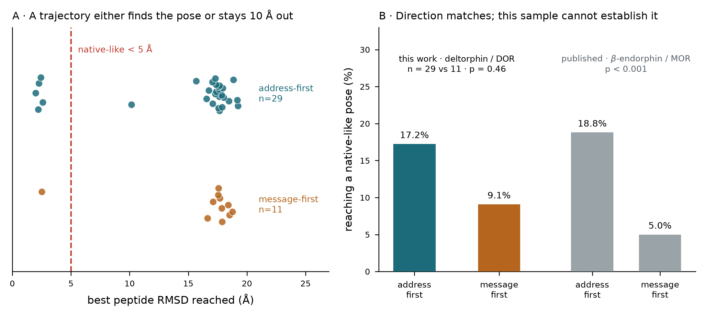

# Cycle 17 G2, interim on 40 of 300 trajectories: direction matches, power does not

**16 Oct 2026. Reported as an interim, NOT as a gate pass. Two bugs in my own analysis were
found and fixed before any number here was produced; both are described below because the
first one would have been invisible.**

## The numbers

| | this work, deltorphin at DOR | published, beta-endorphin at MOR |
|---|---|---|
| address-first productive | **17.2 %** (5 of 29) | 18.8 % |
| message-first productive | **9.1 %** (1 of 11) | 5.0 % |
| significance | **p = 0.46** (Fisher, one-sided) | p < 0.001 |

The address-first rate lands close to the published value on a different peptide and a
different receptor. **The direction reproduces and the magnitude is consistent.**

**And this sample establishes nothing.** Power to detect the published effect at n = 29
versus 11 is **0.35**, so failing to reach significance was the expected outcome rather than
evidence against the hypothesis. G2 is therefore **not scored**, and G3 stays unrun, exactly
as the pre-registration requires. The remaining 26 simulations bring each arm to roughly 150
trajectories, where power exceeds 0.95.

## A structural finding that stands on its own

Best-pose RMSD is **sharply bimodal**: 1.99 to 2.58 A, or 10.2 to 19.2 A, with a single
value between. A trajectory either finds the orthosteric site or never approaches it. This
makes productivity a genuinely binary property rather than an artefact of where the
threshold sits; moving the cutoff anywhere between 3 and 10 A leaves every count unchanged.

The best trajectory reached **1.99 A**, better than G1's 3.41 A from clustered models. That
is expected rather than contradictory, since a cluster medoid is a representative pose and
not the single closest frame.

## Two bugs in my own analysis

**1. The chain split returned the wrong molecule, silently.** The crystal reference models
deltorphin as EIGHT residues, `TYR1 DAL2 PHE3 GLU4 VAL5 VAL6 GLY7 NH2`, the amide cap being
its own residue, while CABS simulates seven. No chain matched seven, so a fallback written
to tolerate CABS rewriting chain IDs instead returned **the last seven receptor residues as
the peptide**. Every RMSD was measured against a piece of the receptor and nothing in the
output looked wrong.

Fixed: the split is strict and raises; the cap is dropped explicitly for a stated reason; and
the criterion now states what the molecules are (peptide at most 25 residues, receptor at
least 40) rather than imposing a size ratio, which had wrongly rejected a legitimate test.

**2. Productivity was read from each replica's final frame.** CABS runs replica-exchange
Monte Carlo and derives poses by CLUSTERING the trajectory, so a replica's last frame is
simply where that replica was when sampling stopped, often a hot replica far from any bound
state. Every one of 40 trajectories scored 28 to 46 A while clustered models from the same
run reached 3.41 A, and that contradiction is what exposed the error.

Fixed: productivity is the MINIMUM RMSD the trajectory reaches at any frame.

**The corrected run executes its own self-checks on the compute node before reading any
trajectory**: reference peptide from chain P, 7 residues after the cap is dropped,
reference-against-itself RMSD 0.0000 A, and the strict split raising on the length mismatch.

## Definitions, stated because they are choices

- **message / address split** at the conserved aromatic ending the message motif, so both
  peptides are divided by the same chemical logic rather than by position index.
  `YAFEVVG` gives message 1-3, address 4-7; `YGGFEVVG` gives 1-4 and 5-8.
- **first contact**: first frame in which any heavy atom of a domain comes within 4.5 A of
  any receptor heavy atom. Ties are reported as `simultaneous` rather than forced into a
  class the frame rate cannot resolve. No trajectory tied here.
- **productive**: minimum peptide CA RMSD below 5.0 A, computed after superposing the
  RECEPTOR, so the measure asks whether the peptide found the right place rather than
  merely the right shape. 5.0 A is the same threshold G1 was scored against.
