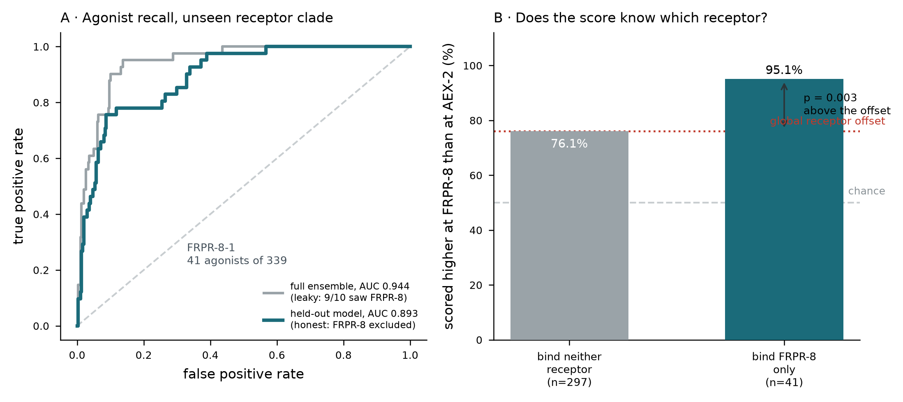

# DeorphaNN runs here, and it does receptor discrimination. First positive from a learned method.

**15 Oct 2026. Run on the authors' own data with their pretrained weights. No GPU, no cluster
time, no AlphaFold. This REPLACES the two earlier assessments in `method_surveys/`.**

---

## What was actually run

339 peptides scored against each of two *C. elegans* receptors, using the authors' shipped
pair representations, their shipped Arpeggio contacts and their 10-model pretrained ensemble.

A detail the README does not mention, read out of the weight files: the ten models are a
**phylogenetic leave-one-out set**, each named for the receptor clade excluded from its
training (`AEX-2`, `DMSR-3`, `FRPR-16`, `FRPR-7`, `FRPR-8`, `NPR-41`, `NPR-42`, `NPR-8`,
`TKR-1`, `TRHR-1`). Scoring a receptor with the full ensemble is therefore **leaky** for any
receptor in that list. Every honest number below uses only the model that held the clade out.

## Result 1: it recalls agonists on a receptor clade it never saw

FRPR-8-1, 41 true agonists among 339 peptides:

| | AUC | p |
|---|---|---|
| full ensemble (9 of 10 trained on FRPR-8) | 0.944 | 2.8e-20 |
| **held-out model (FRPR-8 excluded)** | **0.893** | **3.2e-16** |

The leak costs 0.05 AUC. **0.893 on an unseen clade is real generalisation.**

## Result 2: the score knows WHICH receptor, and it survives the offset control

This is the test that matters for us, because it has the shape of the delta/mu question.
42 peptides bind exactly one of the two receptors. Scored at both, the score favours the
correct receptor in **39 of 42 (92.9 %, p = 5.6e-9)**.

**That number alone is confounded**, and the confound is the Cycle 16 lesson: 41 of the 42
bind FRPR-8, so a constant score offset between the two receptors would reproduce it with no
discrimination at all. Checking the null:

| | scored higher at FRPR-8 |
|---|---|
| peptides binding **neither** receptor (n=297) | **76.1 %** <- the offset |
| peptides binding **FRPR-8 only** (n=41) | **95.1 %** |

**The offset is real and large.** Against it rather than against 50 %, the binders still come
out higher: **p = 0.003**. The within-peptide score gap confirms it independently: median
0.151 for binders versus 0.037 for non-binders, Mann-Whitney **p = 7e-10**.

**DeorphaNN performs genuine per-peptide receptor discrimination.**

## A correction to my own interim report

I first scored AEX-2-1, which has exactly **one** true binder, got rank 73 of 339 under the
held-out model, and reported that as "not distinguishable from chance" (p = 0.215). That was
correct arithmetic on a single observation and the wrong conclusion to leave standing. With
41 binders the same method gives AUC 0.893. **The first result was noise, as n=1 warranted.**

## What this does and does not license

**Does:** the pipeline is proven end to end on real data, and the capability we need
(receptor discrimination, not just agonist detection) is demonstrated rather than assumed.
The 572 core-hours question does not arise here; this cost one afternoon of downloads.

**Does not:**

1. **AEX-2 and FRPR-8 are different receptor families.** DOR and MOR share **18 of 29**
   orthosteric pocket residues. Discriminating them is a far finer task than the one passed
   here, and nothing in this result says the method resolves it.
2. **Training is entirely C. elegans.** Human opioid receptors are out of distribution. The
   good news is that all ten models are then valid for them, since none was trained on
   either; the bad news is that the generalisation gap is unmeasured.
3. **The output is an agonist score, not kcal/mol.** It cannot produce a selectivity value
   and cannot replace the cAMP assay.

## The remaining engineering, unchanged

To score `YGGFEVVG` we still need AlphaFold-Multimer run with the `(L, L, 128)` pair
representation saved, which ColabFold does not write by default. Everything downstream of
that is now proven to work. Step 1 is already done: the authors ship finished active-state
templates for `OPRD`, `OPRM` and `OPRK`.

**And the control stays mandatory.** Before scoring our payload, run the 13-compound
calibration panel at both receptors. If it cannot rank compounds of known delta/mu
preference, it cannot rank ours, whatever it does on C. elegans peptides.
