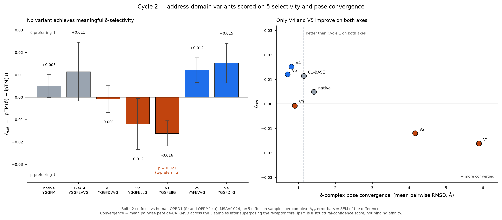

# Cycle 2: Results

**Status:** complete · 10/10 co-folds succeeded · **Primary hypothesis falsified**
**Headline:** no variant achieves meaningful δ-selectivity; the one statistically
significant result points the **wrong way**; and Cycle 1's headline number does not
survive proper statistics.

---

## Results table

n = 5 diffusion samples per complex; MSA = 1024; identical settings to Cycle 1.
Δ_sel = ipTM(δ) − ipTM(μ). Convergence = mean pairwise peptide-CA RMSD across the
5 samples after superposing the receptor core (lower = more converged).

| ID | Sequence | ipTM δ | ipTM μ | **Δ_sel** | SEM | p | conv δ (Å) | conv μ (Å) |
|---|---|---|---|---|---|---|---|---|
| native | `YGGFM` | 0.975 ± 0.007 | 0.970 ± 0.009 | +0.0050 | 0.0051 | 0.36 | 1.42 | 1.86 |
| C1-BASE | `YGGFEVVG` | 0.967 ± 0.009 | 0.956 ± 0.028 | +0.0114 | 0.0131 | 0.43 | 1.14 | 4.16 |
| **V1** | `YGGFEIIG` | 0.961 ± 0.010 | 0.977 ± 0.008 | **−0.0162** | 0.0056 | **0.021** | 5.89 | 2.46 |
| V2 | `YGGFELLG` | 0.955 ± 0.023 | 0.967 ± 0.012 | −0.0119 | 0.0114 | 0.34 | 4.16 | 2.51 |
| V3 | `YGGFDVVG` | 0.970 ± 0.003 | 0.971 ± 0.013 | −0.0007 | 0.0061 | 0.91 | 0.90 | 3.41 |
| **V4** | `YGGFDIIG` | 0.969 ± 0.006 | 0.954 ± 0.019 | **+0.0152** | 0.0089 | 0.15 | **0.81** | 3.60 |
| **V5** | `YAFEVVG` | 0.975 ± 0.003 | 0.963 ± 0.012 | **+0.0121** | 0.0055 | 0.083 | **0.71** | 6.62 |

Observed ranking: `V4 > V5 > C1-BASE > native > V3 > V2 > V1`
Predicted ranking: `V4 ≳ V1 > V2 ≈ V3 > C1-BASE > V5`

---

## Scoring the pre-registered predictions

| # | Prediction | Outcome | Evidence |
|---|---|---|---|
| P1 | V1 > C1-BASE on Δ_sel | ❌ **FALSIFIED** | V1 −0.0162 vs C1 +0.0114, V1 is μ-preferring |
| P2 | V1 > V2 (β-branching helps) | ❌ **FALSIFIED** | V1 −0.0162 *worse* than V2 −0.0119 |
| P3 | V1 converges better than C1-BASE | ❌ **FALSIFIED** | V1 5.89 Å vs C1 1.14 Å, 5× *worse* |
| P4 | V5 loses δ-preference | ❌ **FALSIFIED** | V5 +0.0121 ≈ C1 +0.0114, and far better converged |
| P5 | Effects small (\|Δ_sel\| < 0.05) | ✅ confirmed | max \|Δ_sel\| = 0.0162 |

**4 of 5 falsified.** The pre-registration did its job: had these predictions been
written after seeing the data, this cycle would read as a success story about V4.

---

## ⚠ Correction to the Cycle 1 record

Cycle 1 reported **Δ_sel = +0.0390, "1.96× native"**. That number was computed from
`model_0` only. Recomputed across all 5 diffusion samples:

| Estimator | native | C1 `YGGFEVVG` |
|---|---|---|
| `model_0` only | +0.0199 | +0.0390 |
| **5-sample mean** | **+0.0050 ± 0.0051** | **+0.0114 ± 0.0131** |

C1's Δ_sel is **smaller than its own uncertainty** and statistically indistinguishable
from zero (Welch p = 0.43) or from native (p = 0.60).

**Why `model_0` was misleading:** the `MOR_eng` complex has an ipTM spread of 0.0280
across samples, 3× any other complex, ranging 0.9201–0.9850. `model_0` happened to
land at 0.9328, near the floor of that distribution. The apparent Cycle 1 selectivity
was substantially an artifact of one unlucky μ sample.

`CYCLE1.md` has been annotated accordingly. The qualitative Cycle 1 conclusions
(the address graft works directionally; the engineered pose is less converged than
native at μ) survive; **the "1.96×" figure does not** and should not be quoted.

---

## What was learned

**1. The `[Ile⁵,⁶]` result does not transfer to this scaffold.** V1 is the DNA-encodable
analog of the literature's most δ-selective deltorphin modification, and on this chimera
it produced the *only* statistically significant selectivity in the panel, **toward μ**
(Δ_sel = −0.0162, p = 0.021). Adding β-branched bulk to the address raised μ confidence
(0.956 → 0.977) rather than δ. The published `[Ile⁵,⁶]` gains were measured on a
**D-Ala²** backbone; on our Gly-Gly backbone the same substitution behaves differently.
This is a real interaction between the chirality compromise and the address modification,
not a small quantitative shift.

**2. β-branching is not the mechanism.** V1 (Ile, β-branched) and V2 (Leu, not β-branched)
both went μ-ward, V1 slightly more so. H2 is falsified in the sense that β-branching gives
no δ advantage here; both bulky substitutions hurt.

**3. Asp vs Glu is not equivalent, and Asp is the productive lever.** V3 (`DVVG`, Asp
alone) is flat (−0.0007), but V4 (`DIIG`, Asp + Ile) is the top-ranked variant (+0.0152)
with the best δ-convergence in the panel (0.81 Å). The two substitutions are **not
additive**: Ile alone is strongly μ-ward, Asp alone is neutral, together they are the
most δ-preferring. Non-additivity of this size implies the address residues are
conformationally coupled rather than acting as independent contacts.

**4. Pose convergence and selectivity are largely decoupled.** V5 has the best δ-convergence
(0.71 Å) and the worst μ-convergence (6.62 Å) in the whole panel: the peptide is
well-determined in the δ pocket and ill-determined in μ. Notably, **every δ-preferring
variant (C1, V4, V5) has δ-convergence ≤ 1.15 Å while both μ-preferring variants (V1, V2)
have δ-convergence ≥ 4.16 Å.** Convergence-in-pocket may be a better selectivity signal
than the ipTM difference itself; the ipTM gaps are all within noise, but the convergence
gaps are 4–8×. **This should be tested directly in Cycle 3.**

**5. V5 is the surprise.** The L-Ala² register variant was predicted to be the *worst*
(it substitutes L-Ala where nature uses D-Ala). Instead it matches C1's Δ_sel with a third
of the uncertainty (SEM 0.0055 vs 0.0131) and the second-best δ-convergence. Shortening
`GG` → `A` evidently rigidifies the message domain enough to help, even with the wrong
chirality. This partially rescues the idea behind Cycle 1's "floppy backbone" reading:
but the fix came from the **message**, not the address.

**6. No variant is meaningfully δ-selective.** All ipTM values sit in 0.95–0.98 at both
receptors. Every peptide in this panel is predicted to be a **dual μ/δ binder**. Δ_sel
magnitudes (≤0.016) are an order of magnitude below what would constitute a selectivity
claim, and only V1's (the wrong-direction one) reaches p < 0.05.

---

## Success criterion

> *"At least one variant with Δ_sel > C1-BASE whose peptide pose is also better converged."*

**Formally met by V4 and V5.** But this must be read against finding #6: both margins are
within noise. The honest statement is that **V4 and V5 are the only variants not excluded**,
not that either is demonstrated to be δ-selective.

---

## Decision → Cycle 3

**Carry forward:** V4 (`YGGFDIIG`) and V5 (`YAFEVVG`).
**Drop:** V1, V2 (μ-preferring), V3 (flat).

**Do not order synthesis on these Δ_sel values.** The defensible use of this cycle is that
it narrowed 5 candidates to 2 and eliminated a literature-motivated hypothesis cheaply.

Cycle 3 should:
1. **Test the convergence hypothesis directly** (finding #4): it is the strongest signal
   in this dataset and was found, not predicted. Pre-register it before testing.
2. **Combine the two independent wins**: V4's address (`DIIG`) with V5's shortened
   message register (`YA F`) → `YAFDIIG`.
3. **Increase n.** With n = 5 the SEMs (0.005–0.013) are the same size as the effects.
   n = 20 would roughly halve them.
4. **Add a physics-based estimate.** ipTM is saturated near 0.97 for every variant and
   cannot resolve these differences. MM-GBSA or FEP on the existing poses would give an
   energy-based ranking that ipTM cannot.

---

## Files

| File | Contents |
|---|---|
| `data/cycle2_results.csv` | full table: per-variant ipTM/pLDDT means ± SD, Δ_sel, SEM, p, convergence |
| `data/variant_panel.csv` | the pre-registered panel with rationale |
| `figures/cycle2_selectivity.png` | two-panel results figure |
| `CYCLE2_DESIGN.md` | pre-registration (committed `f2d6ade`, **before** these runs) |
