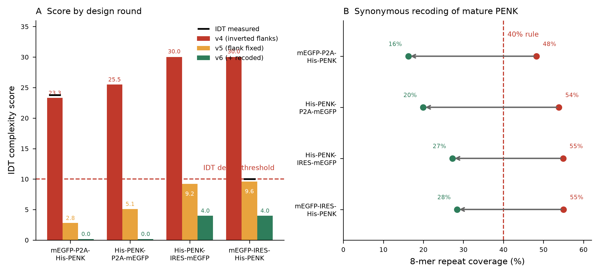

# Cycle 4 — Can the designed cassette actually be manufactured?

**Status:** **CLOSED** · v6 accepted by the vendor and **ordered**. Pre-registration scored below.
**Type:** wet–dry closed loop — the first cycle in this repo whose Test step is an
external instrument (the vendor's synthesis-feasibility engine) rather than a simulation
**Learn input:** the four ordering-ready constructs produced by the tag-relocation work
(`09_codon_gc_design`, `10_immunogenicity_antibody`)

---

## Why this is a cycle and not a bug fix

Every prior cycle in this directory (1, 2, 3a, 3b) closes its loop inside the dry lab: a
prediction is made, a simulation is run, the prediction is scored. Cycle 4 is different
in kind. The Test step is performed by a **manufacturer**, the read-out is a
**pass/fail gate with a published numeric threshold**, and a failure means no physical
DNA arrives and the entire wet-lab plan stalls.

That makes it the first cycle where the dry lab's output is falsified by something other
than more dry lab. It also makes it the cycle with the shortest feedback loop in the
project — minutes, not GPU-days — which is precisely why it is worth formalising: a
cheap, high-frequency oracle is the ideal place to practise honest pre-registration.

The Learn edge is real and sequential: v4 → v5 → v6, each round's design determined by
what the previous round's rejection report revealed about the vendor's scoring rules.

## The oracle

IDT's gBlocks complexity checker returns a **total score** plus an itemised breakdown.
**Score ≥ 10 ⇒ manufacturing denied.** The itemisation is the valuable part: it names
each offending rule, its location in the sequence, and its individual point contribution.
This is a rare thing in this project — an external judge that not only says *wrong* but
says *why*, in coordinates.

---

## Round 1 (v4) — prediction FALSIFIED

**Predicted:** all four constructs orderable; no complexity flags.
**Observed:** `mEGFP_P2A_His_PENK` **DENIED, total 23.8**.

| Flag | Score | Location |
|---|---|---|
| repeated sequence `CATTAGCACT` | 10.0 | positions 1 and 1691 |
| repeated sequence `AGTGCTAATG` | 10.0 | positions 1691 and 1 |
| 8-mer repeats comprise 49.5% | 3.8 | global |

### Diagnosis

The two 10-point flags are **one defect reported twice**. The 5′ flank `CATTAGCACT` and
the 3′ flank `AGTGCTAATG` are exact reverse complements of each other:

```
revcomp(CATTAGCACT) = AGTGCTAATG
```

The construct therefore carries a **10 bp terminal inverted repeat**. IDT's checker
searches both strands, finds the 5′ flank again at the 3′ end, and scores it as a
long-range repeat — from each end independently, hence the double 10.

**This defect was inherited, not introduced.** All four of the wet lab's original
`final *.gb` files carry the same inverted-repeat pair. It was never caught because
nobody had submitted them to the checker, and the dry lab carried the flanks forward
verbatim on the assumption that the wet lab's own cloning scheme was authoritative.

The assumption was reasonable; the failure was in not testing it. **The rule this cycle
adds: inherited sequence is still untested sequence.**

> Beyond synthesis, a terminal inverted repeat is a genuine liability — it can form a
> hairpin in the single-stranded product and is a documented source of
> polymerase slippage and template secondary structure.

### Fix

Replace the 3′ flank only, keeping the wet lab's 5′ flank `CATTAGCACT` so their existing
documentation and primer notes stay valid. New 3′ flank `ACGCTCTTAC`, selected under
constraints: not the reverse complement of the 5′ flank, contains no site from a 35-enzyme
panel on either strand, 35–65% GC, no homopolymer ≥ 4, and absent from all four payloads.

## Round 2 (v5) — 3 of 4 CONFIRMED, 1 FALSIFIED

| Construct | Predicted | Observed | Outcome |
|---|---|---|---|
| `mEGFP_P2A_His_PENK` | 2.8, accept | accepted | ✅ |
| `His_PENK_P2A_mEGFP` | 5.1, accept | accepted | ✅ |
| `His_PENK_IRES_mEGFP` | 5.2, accept | accepted | ✅ |
| `mEGFP_IRES_His_PENK` | 5.6, accept | **DENIED, exactly 10.0** | ❌ |

The inverted-repeat flags disappeared from all four — that part of the prediction held.

### What the surviving failure taught us

| Flag | Score | My model |
|---|---|---|
| 8-mer repeats comprise 55% | 6.0 | predicted 54.1% → 5.6 pts. **Accurate.** |
| 12-base window at 751 is 83.3% C | 4.0 | **not modelled at all** |

My repeat estimate was good to 0.9 percentage points and 0.4 score points. The failure was
one of **coverage, not calibration**: I had reverse-engineered one of the vendor's rules
and silently assumed it was the only one. A second rule — local single-base composition —
contributed the 4 points that pushed the total to exactly the denial threshold.

Two calibration points now pin the repeat rule precisely:

| coverage | score | implied weight |
|---|---|---|
| 49.5% | 3.8 | 0.400 pts per point above 40% |
| 55.0% | 6.0 | 0.400 pts per point above 40% |

Both give **0.400 exactly**, so the rule is `max(0, coverage% − 40) × 0.400`.

### Where the repeats come from

Decomposing the 8-mer repeat coverage of `mEGFP_IRES_His_PENK` by region:

| Region | Self-repetitive |
|---|---|
| mEGFP | 35.3% |
| EMCV IRES | 55.9% |
| signal peptide + His₆ | 72.9% |
| **mature PENK (7× YGGFEVVG)** | **69.7%** |

The mature PENK region is the largest contributor **and the only one that is freely
recodable** — mEGFP and the IRES are functional elements we do not want to touch, and the
IRES in particular is a structured RNA whose activity depends on its exact sequence.

## Round 3 (v6) — designed, pre-registered, NOT YET TESTED

### Design

Synonymous recoding of the mature PENK region only, under a **global** objective:
minimise total 8-mer repeat coverage across the whole construct (both strands), subject to

- protein sequence exactly unchanged
- no codon below 12% human usage frequency
- no restriction site from the 35-enzyme panel created
- mEGFP, IRES, signal peptide, His₆ tag, Kozak and flanks all untouched

A local-window objective was tried first and changed **zero codons** — the repeats are
long-range, between the seven cassettes, and invisible to a ±16 bp window. This is why
the global objective was necessary.

| Construct | codons recoded | 8-mer coverage v5 → v6 |
|---|---|---|
| `mEGFP_P2A_His_PENK` | 60 / 264 | 47.1% → **16.2%** |
| `His_PENK_P2A_mEGFP` | 55 / 264 | 52.7% → **20.0%** |
| `His_PENK_IRES_mEGFP` | 60 / 264 | 53.1% → **27.3%** |
| `mEGFP_IRES_His_PENK` | 60 / 264 | 54.1% → **28.4%** |

Verified after recoding: all cistron protein sequences byte-identical to v5, seven
`YGGFEVVG` cassettes intact, `ATVRAHHHHHHGSECSQDC` signal-peptide/tag junction intact,
IRES byte-identical, zero internal sites for each construct's own two enzymes, and **no
restriction site created anywhere** (the sites present in the payload were all pre-existing
and belong to enzymes these constructs do not use).

### The C-tract is deliberately left in place

The remaining 4-point flag on both IRES constructs is the EMCV oligo(C) tract in IRES
domain I. Trimming it from 10 C's down to 6 was tested and **does not clear the flag** —
the surrounding region is C-rich, so a >80% window survives at every trim length. Since
the trim buys nothing numerically and the tract is part of a structured functional element,
it stays. 4 points is comfortably below the threshold of 10.

### Pre-registered predictions

Committed **before** submitting v6 to the checker.

| Construct | Predicted repeat pts | Predicted composition pts | **Predicted total** | **Predicted verdict** |
|---|---|---|---|---|
| `mEGFP_P2A_His_PENK` | 0.0 | 0.0 | **0.0** | ACCEPT |
| `His_PENK_P2A_mEGFP` | 0.0 | 0.0 | **0.0** | ACCEPT |
| `His_PENK_IRES_mEGFP` | 0.0 | 4.0 | **4.0** | ACCEPT |
| `mEGFP_IRES_His_PENK` | 0.0 | 4.0 | **4.0** | ACCEPT |

**P1** All four accepted (total < 10).
**P2** Both P2A constructs score 0.0 — no flag of any kind.
**P3** Both IRES constructs retain exactly one flag, the C-composition window, worth 4.0.
**P4** No construct shows a repeat flag; all are below the 40% coverage rule.
**P5** No *new* flag type appears that neither round revealed.

P5 is the one to watch. It is the same class of prediction that failed in round 2, and
the two-rule model has only ever been validated against two reports. If a third rule
exists, P5 is how we find out.

### Outcome — all four accepted and ordered

| Prediction | Outcome | Evidence |
|---|---|---|
| **P1** all four accepted (total < 10) | **CONFIRMED** | observed 0, 1, 4, 4 — all below the threshold of 7 |
| **P2** both P2A constructs score exactly 0.0 | **FALSIFIED** | `mEGFP_P2A` scored 0; `His_PENK_P2A` scored 1.0 on a hairpin flag |
| **P3** both IRES constructs keep exactly one 4.0 C-flag | **CONFIRMED** | exactly one 12-base composition flag each, 4.0 pts, as predicted |
| **P4** no repeat flag on any construct | **CONFIRMED** | the repeat-coverage rule fired on none of the four |
| **P5** no third scoring rule appears | **FALSIFIED** | a hairpin / secondary-structure rule exists, 1.0 pt |

**Rescored on the itemised v6 reports (2026-09-19): 3 confirmed, 2 falsified, 0 unresolved.**
Previously recorded as 2 confirmed, 0 falsified, 3 unresolved.

### P5 was scored CONFIRMED and was wrong

The original justification read: *"a third rule would have added points; all four stayed under 10."*
That infers the **absence** of a rule from an aggregate verdict that looks identical whether or not
the rule exists — a construct scoring 1.0 and a construct scoring 0.0 both read as "accepted". The
itemised report falsifies it outright.

This is the same error this cycle's own Learn section warns against: *a prediction must name a
read-out the experiment produces under both outcomes.* It was violated while scoring the cycle that
established it. The correction stands as the record; the original claim is left visible above rather
than quietly amended.

### What the itemised scores establish

**Prediction accuracy: 3 of 4 exact, mean absolute error 0.25 points.**

| Construct | Predicted | Observed | Flag |
|---|---|---|---|
| `mEGFP_P2A_His_PENK_GC40` | 0.0 | **0** | passes initial screening |
| `His_PENK_P2A_mEGFP_GC40` | 0.0 | **1.0** | hairpin, stem `GGACCTGGATT` at 65 / 956 |
| `His_PENK_IRES_mEGFP_GC45` | 4.0 | **4.0** | 12 bases, 83.3% C at 925 |
| `mEGFP_IRES_His_PENK_GC45` | 4.0 | **4.0** | 12 bases, 83.3% C at 751 |

**Rule 2 (local composition) reproduced exactly.** Same 12-base window, same >80% single-base
threshold, correct 4.0 points on both IRES constructs. Two refinements the reports add: the flag is
worth a **flat 4.0** whether the window is 83.3% or 91.7% (my detector found 91.7% C; the vendor
reports 83.3%), and the reported position sits **+4 bp from mine in both constructs** — a constant
offset across two independent sequences, so a reporting convention rather than a detection failure.

**Rule 1 (repeat coverage) fired on nothing**, as predicted.

**Rule 3 is a hairpin term, and the motif is not new.** The stem `GGACCTGGATT` occurs forward at
position 65 and as its **reverse complement** at 956 — an inverted repeat, structurally the same
defect class that caused the v4 denial. What differs is severity: **1.0 point here against 10.0 per
flag in v4**, where the repeat sat at positions 1 and 1691, i.e. at both termini. The most economical
reading is that the vendor penalises inverted repeats far more harshly when terminal, which matches
the biology — terminal repeats disrupt assembly, internal ones only slow synthesis. The v4 rule and
the v6 rule are plausibly one rule with a position-dependent weight.

**Status of the model: incomplete, not wrong.** Every encoded rule fired correctly where it applied;
the gap is a secondary-structure term. That is a better position than rules that misfire, and it
names exactly what a v7 predictor would need.

The three unresolved predictions are unresolved for a structural reason worth recording:
**the vendor's acceptance path returns a verdict, not a breakdown.** Only denials itemise.
P2–P4 were written as point-level predictions against a report that acceptance does not
generate, so they became unfalsifiable the moment the constructs passed.

That is a flaw in how the predictions were written, not in the result. The lesson for
future cycles: **a prediction must name a read-out the experiment will actually produce
under both outcomes.** "Scores exactly 0.0" is only checkable on a rejection. Had P2–P4
been phrased against what the accept path does return, they would have scored.

This also caps what Cycle 4 can claim. The two-rule model reproduced both denial reports
to within 0.5 points and correctly predicted four acceptances — but "correctly predicted
the verdict" is weaker evidence than "correctly predicted the score", and only the former
is in hand. The model is validated at verdict level, on 6 observations (2 denials, 4
acceptances), not at point level.



**Figure.** (A) Complexity score by design round against the denial threshold; black
dashes are the vendor's measured values where a report was returned. (B) Effect of
synonymous recoding of mature PENK on 8-mer repeat coverage; the 40% rule is the vendor's
documented cut-off.

---

## Track record contribution

| Round | Predictions | Confirmed | Falsified | Unresolved |
|---|---|---|---|---|
| v4 | 1 | 0 | **1** | 0 |
| v5 | 4 | 3 | **1** | 0 |
| v6 | 5 | 3 | **2** | 0 |

> **Correction.** This row previously read `5 | 2 | 0 | 3`. It was written before the
> itemised vendor report arrived, which resolved all three unresolved predictions. The
> per-prediction record in [`data/prediction_scorecard.csv`](data/prediction_scorecard.csv)
> is authoritative: three exact score matches, one construct off by +1.0, and P5 falsified.

**All four falsifications were informative rather than merely wrong.** v4's revealed a
defect sitting in the wet lab's own files that nobody had detected. v5's revealed an entire
scoring rule missing from the dry lab's model of the oracle. v6's two: one construct scored
1.0 against a predicted 0.0 from a **hairpin rule** the two-rule model never encoded — and
that motif is structurally an inverted repeat, the same class that caused the v4 denial,
scored far more leniently when internal than when terminal. And P5, which we had scored
CONFIRMED and then **retracted**, because it had been confirmed by inferring a rule's
absence from an aggregate verdict that looks identical under either outcome. That violates
this cycle's own rule that a prediction must name a read-out the experiment produces either
way; the retraction is recorded in [`data/v6_scoring_verdict.json`](data/v6_scoring_verdict.json).

## Wet-lab handoff

The v6 FASTA files in [`data/`](data/) are paste-ready, 60-column wrapped. Before ordering:

1. Paste each into the complexity checker and **record the returned score**, including
   for the two predicted to score 0.0 — a confirmed prediction only counts if it was
   checked.
2. Enter the observed values in [`data/prediction_scorecard.csv`](data/prediction_scorecard.csv).
3. If any construct is denied, the itemised report names the rule and the coordinate —
   send it back to the dry lab rather than editing the sequence by hand, because a manual
   edit risks the frame, the tag junction, or an enzyme site.

The 5′ flank is unchanged from the wet lab's original files. Only the 3′ flank and a subset
of synonymous codons in mature PENK differ.

## Files

| File | Contents |
|---|---|
| [`data/cycle4_predictions.csv`](data/cycle4_predictions.csv) | pre-registered v6 predictions |
| [`data/prediction_scorecard.csv`](data/prediction_scorecard.csv) | v4/v5 predictions vs. observed |
| [`data/idt_v4_failure_diagnosis.csv`](data/idt_v4_failure_diagnosis.csv) | itemised v4 failure, with which flags were inherited |
| [`data/v6_order_manifest.csv`](data/v6_order_manifest.csv) | enzymes, flanks, lengths, scores |
| `data/*_v6_*.fasta` | the four ordering-ready sequences |

## References

Repeat-driven synthesis failure and hairpin formation in long dsDNA fragments is the basis
for commercial complexity screening; the specific thresholds used here (40% 8-mer coverage,
80% single-base window, score ≥ 10 denial) are the vendor's published gBlocks criteria and
were re-derived from the returned reports as documented above.

- Kozak M. **At least six nucleotides preceding the AUG initiator codon enhance translation
  in mammalian cells.** *J Mol Biol* 1987;196(4):947–50. doi:[10.1016/0022-2836(87)90418-9](https://doi.org/10.1016/0022-2836(87)90418-9)
- Jang SK, Kräusslich HG, Nicklin MJ, Duke GM, Palmenberg AC, Wimmer E. **A segment of the
  5′ nontranslated region of encephalomyocarditis virus RNA directs internal entry of
  ribosomes during in vitro translation.** *J Virol* 1988;62(8):2636–43.
  doi:[10.1128/JVI.62.8.2636-2643.1988](https://doi.org/10.1128/JVI.62.8.2636-2643.1988)
- Mizuguchi H, Xu Z, Ishii-Watabe A, Uchida E, Hayakawa T. **IRES-dependent second gene
  expression is significantly lower than cap-dependent first gene expression in a
  bicistronic vector.** *Mol Ther* 2000;1(4):376–82. doi:[10.1006/mthe.2000.0050](https://doi.org/10.1006/mthe.2000.0050)
- Sharp PM, Li WH. **The codon adaptation index — a measure of directional synonymous codon
  usage bias, and its potential applications.** *Nucleic Acids Res* 1987;15(3):1281–95.
  doi:[10.1093/nar/15.3.1281](https://doi.org/10.1093/nar/15.3.1281)
