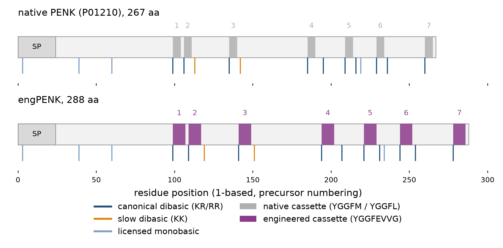
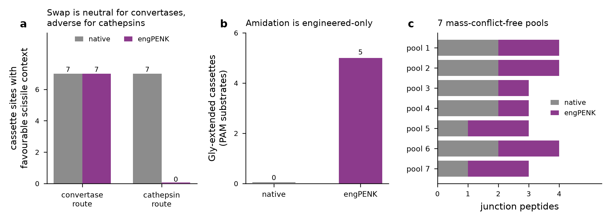
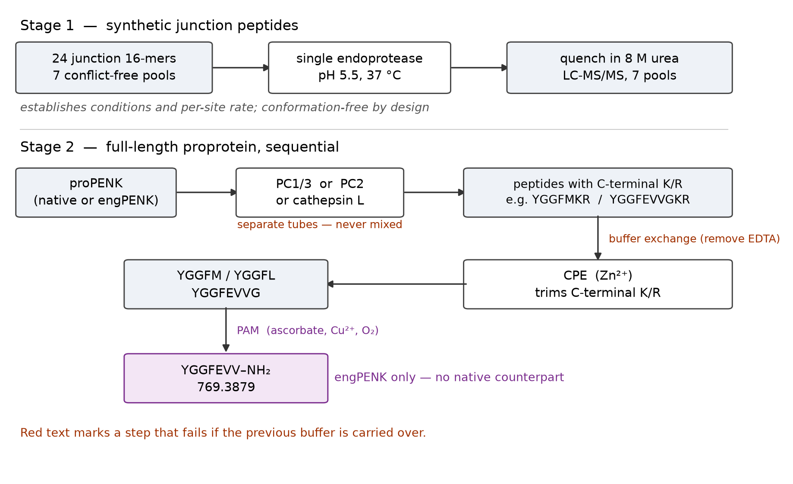
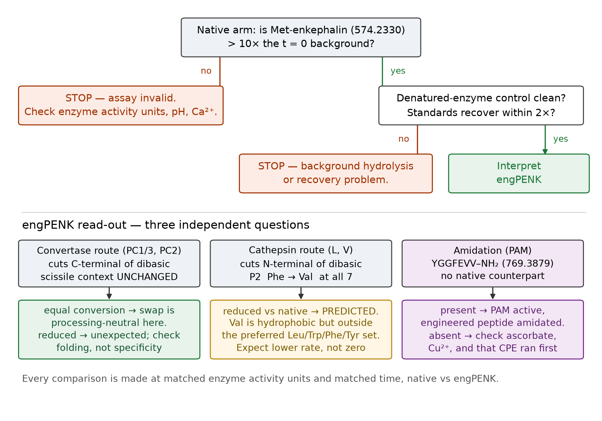

# Cell-free reconstitution of PENK proteolytic processing

**Purpose.** Reproduce, in a tube, the proteolytic cascade that converts proenkephalin
into its opioid peptide products — and determine whether the engineered construct
(engPENK) is processed equivalently to the native precursor (P01210).

**Design.** Two stages, two constructs, run as paired arms:

| | Stage 1 | Stage 2 |
|---|---|---|
| Substrate | 24 synthetic junction peptides (16-mer) | full-length recombinant proprotein |
| Purpose | establish enzyme conditions; measure per-site cleavage | confirm in conformational context |
| Readout | LC-MS/MS, 7 multiplexed pools | LC-MS/MS, intact + peptide-level |

The **native arm is the built-in positive control**: every native product is documented
in the literature, so a native reaction that fails to produce Met-enkephalin invalidates
the run before any engPENK result is interpreted.

---

## 1. Site architecture (computed from the sequences)

Both constructs carry **7 enkephalin cassettes** and an identical
junction-tier architecture — 10 canonical dibasic (KR/RR),
2 slow dibasic (KK), 4 licensed monobasic — offset only by
the cassette-length difference (native 267 aa, engPENK 288 aa).

Two engineered cassettes will **not** give a clean uniform product:

- **Cassette 4** runs into `RGLKRSPQ` — the native Met-enk-Arg-Gly-Leu extension is retained.
- **Cassette 7** ends in `RF` at the C-terminus — no downstream dibasic exists.

### Two divergences that this experiment is designed to detect

**(a) Amidation.** 5 of 7 engineered cassettes terminate in Gly
(`YGGFEVVG`) and are therefore **PAM substrates**. **No native cassette is**
(0 of 7). If PAM is active, engPENK yields `YGGFEVV-NH₂`
(769.3879, [M+H]⁺) — a species with no native counterpart.

**(b) Cathepsin L accessibility.** The two routes cut in *different places*, which is why
the cassette swap affects them unequally [Yoon2022]:

- **PC1/3 and PC2** cleave on the **C-terminal side** of the dibasic.
- **Cathepsin L and V** cleave on the **N-terminal side of, and between**, the dibasic,
  with a preference for hydrophobic residues at P2 — specifically **Leu, Trp, Phe, Tyr**.

For the **convertase route the scissile context is unchanged** by the swap: P1 and P1′ are
identical between constructs at all seven cassettes (the dibasic itself was not altered).

For the **cathepsin route the P2 residue changes at all seven sites**:

| | native | engPENK |
|---|---|---|
| cassettes 1-5, 7 | `YGGF·M↓KR/KK/RR` — P2 = **Phe**, P1 = Met | `YGGFEVV·G↓KR/KK/RR` — P2 = **Val**, P1 = Gly |
| cassette 6 | `YGGF·L↓KR` — P2 = **Phe**, P1 = Leu | `YGGFEVV·G↓KR` — P2 = **Val**, P1 = Gly |
| sites with P2 in the preferred set (Leu/Trp/Phe/Tyr) | **7 of 7** | **0 of 7** |

Native P2 is Phe at every cassette — one of the four residues the source names explicitly.
engPENK P2 is Val at every cassette: still hydrophobic, but **not** among the four
preferred residues. P1 additionally changes from Met/Leu to Gly.

**Prediction: engPENK is a poorer cathepsin L substrate than native PENK, while remaining
an equivalent convertase substrate.** This is a direct, falsifiable consequence of the
cassette design and is the single most informative thing Stage 1 can tell you. It is *not*
a defect of the construct if the convertase route dominates in the target cell — but it
must be measured, not assumed. Note the prediction is directional, not quantitative: Val
at P2 is a demotion from the preferred set, not an abolition, so expect reduced rate rather
than no cleavage.

---

**Figure 1 — Junction map.** Every predicted endoproteolytic site in both constructs,
coloured by tier. Cassette positions are shaded; numbers above the bar index the seven
enkephalin cassettes.

**Figure 2 — Design summary.** (a) The cassette swap leaves the convertase scissile
context unchanged at all seven sites but removes the preferred cathepsin L P2 residue at
all seven. (b) Gly-extended, PAM-competent cassettes exist only in engPENK. (c) The 24
junction peptides split into 7 mass-conflict-free pools.

## 2. Enzymes, buffers, and cofactors

All buffer compositions below marked **[verbatim]** are quoted from the cited primary
source. Values from database annotation are marked **[UniProt]**.

### 2.1 PC1/3 (PCSK1) — [verbatim Yoon2022]
- 50 mM Na-acetate, **pH 5.5**
- 5 mM CaCl₂
- 0.1% octyl-β-glucopyranoside (bOG)
- 37 °C
- Published working concentration: **3.6 ng/µL**
- Cofactor: Ca²⁺ [UniProt P29120]

### 2.2 PC2 (PCSK2) — [verbatim Yoon2022]
- 50 mM Na-acetate, **pH 5.5**
- 5 mM CaCl₂
- 0.1% bOG
- **plus 100 mM NaCl** (PC2 only)
- 37 °C
- Published working concentration: **5.4 ng/µL**
- **Requires the 7B2 chaperone (SCG5)** for maturation and activity [UniProt P05408].
  Source PC2 as the 7B2-co-expressed, pre-activated enzyme; do not assume recombinant
  PC2 alone is active.

### 2.3 Cathepsin L (CTSL) — [verbatim Yoon2022]
- 50 mM citrate phosphate, **pH 5.5**
- 1 mM EDTA
- 100 mM NaCl
- 5 mM DTT
- 37 °C
- Published working concentration: **0.04 ng/µL**
- **No preactivation required** (cathepsin V does require it: 5 mM DTT, 20 mM Na-acetate
  pH 5.5, 1 mM EDTA, 100 mM NaCl, 37 °C, 30 min)

### 2.4 CPE (carboxypeptidase E)
- Acidic, granule-matched (pH ≈ 5.5)
- **Zn²⁺ metalloenzyme** [UniProt P16870] — **do not add EDTA to a CPE reaction**
- Removes C-terminal K/R exposed by endoproteolysis

### 2.5 PAM (PHM → PAL)
- Requires **ascorbate + Cu²⁺ + O₂**; include catalase to suppress peroxide
- Bifunctional: PHM hydroxylates, PAL cleaves — two sequential domains [UniProt P19021]
- Inhibited by **EDTA, phenylglyoxal, diethyl pyrocarbonate** [UniProt P19021]
- Net mass change: **−58.00548 Da** (loss of Gly 57.02146 + 0.98402 amidation)

### 2.6 Furin — comparison arm
- pH optimum **6.0** [UniProt P09958], Ca²⁺-dependent
- Tests whether cassette junctions are furin-accessible *before* the granule

### CRITICAL — enzyme loading is not equal-mass

Relative specific activities on standard substrates [Yoon2022]:

| enzyme | specific activity | substrate used |
|---|---|---|
| cathepsin L | **100%** (reference) | Z-Phe-Arg-AMC |
| cathepsin V | 10% | Z-Phe-Arg-AMC |
| PC1/3 | **1.5%** | pGlu-Arg-Thr-Lys-Arg-AMC |
| PC2 | **0.07%** | pGlu-Arg-Thr-Lys-Arg-AMC |

PC2 is roughly **1,400× less active than cathepsin L**. Loading equal enzyme mass across
arms would under-sample the PC2 arm to the point of a false negative. **Normalise by
activity units against the reference fluorogenic substrate, not by protein mass**, and
report the units used.

---

---

## 2A. Materials — what to order

Enzymes, in the exact form the source used [Yoon2022]. Catalogue numbers are the ones
cited in the paper; verify availability before ordering.

| item | source in [Yoon2022] | cat. no. | notes |
|---|---|---|---|
| Human recombinant cathepsin L | R&D Systems | #952-CY-010 | no preactivation needed |
| Human recombinant cathepsin V | R&D Systems | #1080-CY-010 | **requires preactivation** (§2.3) |
| Human recombinant PC1/3 | R&D Systems | #2810-SE-010 | |
| Human recombinant PC2 | R&D Systems | #6018-SE-010 | must be 7B2-matured — confirm with vendor |
| Cathepsin H | R&D Systems | — | only for the coupled AMC assay (§2B) |
| CPE, PAM, furin | not used in [Yoon2022] | — | source separately; conditions in §2.4-2.6 are [UniProt]-derived |

Fluorogenic substrates for activity normalisation:

| substrate | supplier in [Yoon2022] | used for |
|---|---|---|
| Z-Phe-Arg-AMC | Bachem | cathepsin L and V titration |
| pERTKR-AMC (pGlu-Arg-Thr-Lys-Arg-AMC) | R&D Systems | PC1/3 and PC2 titration |
| Z-Tyr-Lys-Arg-AMC | GenScript | cross-enzyme specific-activity comparison |
| Z-Leu/Trp/Phe/Tyr/Val/Gly/Ala-Lys-Arg-AMC | GenScript | **P2 preference series — see §2B** |

Reagents: octyl-β-glucopyranoside (Sigma-Aldrich), DTT (Promega), urea (Teknova),
acetonitrile and TFA (Fisher Chemical), C18 SPE stage-tips (3M), BEH C18 packing
(Waters), DMSO, BSA, MES, GEMSA (CPE inhibitor), ascorbate, CuSO₄, catalase.

Instrumentation used in the source: **Dionex UltiMate 3000 nano LC + Orbitrap Q-Exactive**
(Thermo Fisher); 75 µm ID × 25 cm BEH C18 (1.7 µm) at 65 °C, 0.3 µL/min, 60 min 5-30% B
then 15 min 30-85% B (B = 100% ACN in 0.1% TFA; A = 0.1% TFA in water). MS1 at 70,000
resolution over m/z 250-1500; MS2 at 17,500, HCD NCE 30 [verbatim Yoon2022]. Any
comparable nano-LC-Orbitrap will do; these are the settings the reference conditions were
established on.

---

## 2B. Activity normalisation — do this before the real experiment

Section 2's "CRITICAL" note says to normalise by activity, not mass. This is how.

1. **Titrate each enzyme against its fluorogenic substrate** — Z-Phe-Arg-AMC for the
   cathepsins, pERTKR-AMC for PC1/3 and PC2 — in that enzyme's own buffer (§2.1-2.3),
   37 °C, monitoring AMC at **ex 360 / em 460 nm**.
2. Take the initial linear rate. Define **1 unit = 1 pmol AMC released per minute** at
   37 °C under those conditions, and record it; the absolute definition matters less than
   using the same one for every arm.
3. **Load equal units, not equal ng**, into the PENK reactions. As a sanity anchor, the
   source's own MSP-MS loadings were cathepsin L 0.04, cathepsin V 0.16, PC1/3 3.6, and
   PC2 5.4 ng/µL — a ~135-fold mass spread that reflects exactly this normalisation.
4. **Optional but recommended — run the P2 series directly.** The central prediction of
   this study is a P2 effect, and it can be tested on pure chemistry before any PENK
   substrate is consumed: assay cathepsin L against Z-**F**-KR-AMC (the native P2) versus
   Z-**V**-KR-AMC (the engineered P2), with Z-**L**-KR-AMC and Z-**Y**-KR-AMC as
   preferred-set positives and Z-**G**-KR-AMC / Z-**A**-KR-AMC as poor-P2 negatives.
   In [Yoon2022] cathepsin L was most active on Z-L-KR-AMC, Z-F-KR-AMC, and Z-Y-KR-AMC.
   The Phe-vs-Val rate ratio measured here is the cleanest possible statement of the
   predicted defect, uncontaminated by folding or accessibility.
   Note the cathepsins need a **coupled assay with cathepsin H** to liberate AMC from
   Z-Xaa-Lys-Arg-AMC (add cathepsin H at 0.5 ng/µL in 50 mM MES to bring pH to 6.5, then
   30 min at 37 °C); PC1/3 and PC2 give the same result with or without it [Yoon2022].
   Fluorogenic assay buffer for the cathepsins: 5 mM citrate-phosphate pH 5.5, 4 mM DTT,
   1 mM EDTA, 50 mM NaCl, 1% DMSO, 60 µM substrate, plus 0.001% BSA for cathepsin L;
   for PC1/3 and PC2: 5 mM Na-acetate pH 5.5, 5 mM CaCl₂, 50 mM NaCl [verbatim Yoon2022].

---

## 3. Buffer incompatibilities — read before combining enzymes

These cannot all go in one tube:

1. **Cathepsin L buffer contains 1 mM EDTA. CPE and PAM are metalloenzymes.**
   EDTA will inhibit both. Cathepsin L and CPE/PAM **must be staged sequentially with a
   buffer exchange**, never co-incubated.
2. **DTT (5 mM, cathepsin L) will reduce disulfides.** Native PENK has cysteines in the
   N-terminal domain; in Stage 2 this will unfold the proprotein and destroy the
   conformational context the stage exists to test. Run the Stage-2 cathepsin arm as a
   deliberate *denatured-accessibility* comparison, not as the physiological arm.
3. **PC buffers use Na-acetate; cathepsin uses citrate phosphate.** Citrate chelates
   Ca²⁺. Do not substitute one for the other.

---

## 4. Order of addition

### Stage 1 — junction peptides (establish conditions)

1. Reconstitute each peptide pool to 0.5 µM per peptide final (matching the library
   concentration in [Yoon2022]).
2. Pre-warm substrate + buffer to 37 °C.
3. Remove the **t = 0 aliquot before adding enzyme.**
4. Add enzyme; start timer.
5. Sample at **0, 15, 30, 60, 120 min** (the published assay reads 30 and 60 min).
6. **Quench: transfer a 10 µL aliquot into 60 µL of 8 M urea, vortex, store at −70 °C**
   [verbatim Yoon2022]. This gives **6.86 M urea final** in 70 µL.
7. Acidify with 40 µL 1% TFA; desalt on C18 SPE stage-tips, eluting sequentially with 50%
   then 80% ACN in 0.1% TFA; dry in a SpeedVac; store at −70 °C [verbatim Yoon2022].
8. Resuspend in 40 µL 0.1% TFA for LC-MS/MS.

### Stage 2 — full-length proprotein (confirm in context)

1. Endoprotease first (PC1/3 **or** PC2 **or** cathepsin L — separate tubes, never mixed).
2. Quench / buffer exchange.
3. **Then** CPE (removes exposed C-terminal K/R).
4. Buffer exchange (remove any EDTA).
5. **Then** PAM (+ascorbate, Cu²⁺, catalase) — engPENK arm especially.

Order matters: CPE cannot act until endoproteolysis exposes a C-terminal basic residue,
and PAM cannot act until CPE has exposed the Gly.

---

**Figure 3 — Staged cascade.** Order of addition for both stages. Red annotations mark
steps that fail if the preceding buffer is carried over.

## 5. Controls

| control | purpose | expected result |
|---|---|---|
| **t = 0, no enzyme** | baseline | intact substrate only |
| **Heat/urea-denatured enzyme** | rules out non-enzymatic hydrolysis | no products [Yoon2022 used urea-denatured enzyme as the "0" condition] |
| **Native arm** | assay validation | Met-enkephalin (574.2330) must appear |
| **STD-CPE (`YGGFMKR`)** | CPE activity, independent of endoprotease | trims to `YGGFM` |
| **GEMSA** | CPE-specific inhibitor | blocks the trim step only |
| **EDTA add-back** | confirms metal dependence | abolishes CPE and PAM, not cathepsin L |
| **No-ascorbate PAM** | confirms PAM cofactor dependence | Gly-extended peptide persists |
| **Furin arm** | pre-granule accessibility | reveals whether junctions are cut early |

---

## 6. Peptide pooling — why 7 pools and not 1

All seven engPENK cassettes release the **identical** C-terminal product `YGGFEVVG`
(827.3934). Pooling peptides whose products are isobaric makes the MS assignment
ambiguous. A mass-conflict graph was built over every species each peptide can generate
(intact, both products, CPE-trimmed N-product, and +1/+2 Met oxidation) at **20 ppm**,
then coloured into the minimum number of conflict-free pools.

- **7 pools, 3-4 peptides each, zero intra-pool conflicts.**
- Splitting simply by construct **fails** — 31 conflicting pairs in the engPENK arm alone.
- **Pool 6 caveat:** N099 (1956.0272) and N106 (1956.9757) are baseline-resolved at MS1,
  but N099's M+1 isotope peak lies 28 ppm from N106's monoisotopic peak and the two have
  identical GRAVY (−0.850), so they may co-elute. **Require isotope-envelope
  deconvolution and confirm both by MS2.**

---

## 7. Readout and acceptance criteria

**Accept the run if:**
- native arm produces Met-enkephalin (574.2330) above 10× the t=0 background, and
- denatured-enzyme control produces no products, and
- the internal standards recover within 2-fold across pools.

**Then, and only then, interpret engPENK.**

**Primary comparison:** fractional conversion at each paired junction, native vs engPENK,
at matched enzyme activity units and matched time.

---

**Figure 4 — Decision tree.** Gate the run on the native arm first; only then interpret
engPENK against the three independent questions.

## 8. Known limitations

1. **Shennan1995 pH/Ca²⁺ values describe zymogen maturation, not mature-enzyme turnover.**
   pro-PC2 matures optimally at pH 5.5-6.0 with Ca²⁺ K₀.₅ = 2-4 mM; pro-PC3 matures at
   pH 7.0-8.0 without added Ca²⁺. These describe *where in the secretory pathway each
   zymogen activates* — they are **not** turnover optima for the mature enzyme and must
   not be used as such. The assay pH above comes from [Yoon2022], which used mature enzyme.
2. **A cell-free reconstitution cannot reproduce granule crowding, the true lumenal
   pH gradient, or the local enzyme concentrations of a secretory granule.** Rate ratios
   between enzymes will differ from the cell.
3. **Stage 1 removes conformational context by design.** A junction that is cleaved as a
   16-mer may be buried in the folded proprotein. This is precisely why Stage 2 exists;
   do not report Stage 1 rates as proprotein rates.
4. **Dupuy2003 is cited from its abstract only** (paywalled). The PC1-vs-PC2 site
   assignments it provides should be confirmed against the full text before publication.

---

## 9. Methods (for the manuscript)

**Sequence analysis.** Human proenkephalin (UniProt P01210, 267 aa) and the engineered
construct engPENK (288 aa) were analysed in Biopython. Signal-peptide boundaries were
taken from the UniProt P01210 SIGNAL annotation (residues 1-24). Candidate endoproteolytic
sites were enumerated as all dibasic (KR, KK, RR, RK) and licensed monobasic (R/K with a
basic residue at P4 or P6) positions and assigned to three tiers: T1 canonical dibasic
(KR/RR), T2 slow dibasic (KK), T3 licensed monobasic. Scissile-bond contexts were computed
separately for the two mechanistic routes, since they cut on opposite sides of the dibasic
[Yoon2022].

**Mass calculation.** Monoisotopic and average masses were computed with Pyteomics
(`pyteomics.mass`). C-terminal amidation was modelled as -0.98402 Da; the PAM reaction as a
net -58.00548 Da from the Gly-extended precursor (loss of the Gly residue, 57.02146 Da,
plus the amidation offset). Methionine oxidation was modelled as +15.99491 Da per
oxidation, enumerated at one and two oxidations. The mass engine was validated against ten
independently stored reference species and agreed to better than 0.05 ppm.

**Peptide pooling.** Junction peptides were pooled for multiplexed LC-MS/MS by graph
colouring. An undirected conflict graph was constructed over the 24 peptides in which an
edge joins any pair that could generate an indistinguishable species; the species set per
peptide comprised the intact peptide, both endoproteolytic products, the
carboxypeptidase-trimmed N-product, and the +1/+2 methionine-oxidation variants of each.
Two species conflict if they are sequence-identical or if their neutral monoisotopic masses
fall within 20 ppm. The graph (50 edges) was coloured by randomised-restart greedy
colouring under a pool-count cap, minimising the maximum pool size; the accepted solution
uses 7 pools of 3-4 peptides with zero intra-pool conflicts.

**Reference retrieval.** Primary literature was retrieved through NCBI E-utilities and the
PubMed Central open-access corpus. Enzyme cofactor requirements, pH optima, and
activity-regulation annotations were taken from UniProt (release retrieved during this
analysis). Buffer compositions reproduced verbatim from a primary source are marked as such
in the protocol; values from database annotation are marked separately.

**Software.** Python 3, Biopython, Pyteomics, pandas, NumPy, Matplotlib.

---

## 10. References

1. **Yoon MC, Ames J, Mosier C, Jiang Z, Podvin S, O'Donoghue AJ, Hook V** (2022).
   Distinct dibasic cleavage specificities of neuropeptide-producing cathepsin L and
   cathepsin V cysteine proteases compared to PC1/3 and PC2 serine proteases.
   *ACS Chem Neurosci*. doi:[10.1021/acschemneuro.1c00653](https://doi.org/10.1021/acschemneuro.1c00653)
   · PMID 34986304 · PMC9070308 · **full text**
   Source of: PC1/3, PC2 and cathepsin L/V assay buffers (verbatim); the Leu/Trp/Phe/Tyr
   P2 preference of cathepsin L; relative specific activities; the finding that cathepsins
   cut N-terminal to the dibasic while PC1/3 and PC2 cut C-terminal.

2. **Dupuy A, Lindberg I, Zhou Y, Akil H, Lazure C, Chretien M, Seidah NG, Day R** (2003).
   Cleavage of recombinant proenkephalin and blockade mutants by prohormone convertases 1
   and 2: an in vitro specificity study. *J Neurochem* 87:868-878.
   doi:[10.1046/j.1471-4159.2003.02043.x](https://doi.org/10.1046/j.1471-4159.2003.02043.x)
   · PMID 12716426 · **abstract only (paywalled)**
   Source of: PC1-vs-PC2 site assignment on proenkephalin itself; PC2 uniquely cleaves the
   RR-V and KK-M sites; PC1 excludes large aliphatic residues at P1'; processing order is
   non-obligatory. *Confirm against full text before publication.*

3. **Shennan KIJ, Taylor NA, Jermany JL, Matthews G, Docherty K** (1995).
   Differences in pH optima and calcium requirements for maturation of the prohormone
   convertases PC2 and PC3. *J Biol Chem* 270:1402-1407.
   doi:[10.1074/jbc.270.3.1402](https://doi.org/10.1074/jbc.270.3.1402)
   · PMID 7836406 · **abstract only (paywalled)**
   Source of: pro-PC2 maturation optimum pH 5.5-6.0, Ca2+ K0.5 = 2-4 mM; pro-PC3 maturation
   optimum pH 7.0-8.0, Ca2+-independent. **These are zymogen-maturation parameters, not
   mature-enzyme turnover optima — see Limitations 8.1.**

4. **Blanco EH, Peinado JR, Martin MG, Lindberg I** (2014).
   Biochemical and cell biological properties of the human prohormone convertase 1/3
   Ser357Gly mutation: a PC1/3 hypermorph. *Endocrinology* 155:3434-3447.
   doi:[10.1210/en.2013-2151](https://doi.org/10.1210/en.2013-2151)
   · PMID 24932808 · PMC4138575
   Source of: wild-type human PC1/3 is Ca2+-dependent with an acidic pH optimum; the S357G
   hypermorph shifts toward neutral pH and reduced Ca2+ dependence. Relevant only if a
   variant enzyme is sourced.

5. **UniProt Consortium** (2026). UniProt: the universal protein knowledgebase.
   *Nucleic Acids Res* (database issue).
   doi:[10.1093/nar/gkae1010](https://doi.org/10.1093/nar/gkae1010)
   Entries used: P01210 (PENK), P29120 (PCSK1/PC1/3), P16519 (PCSK2/PC2), P05408 (SCG5/7B2),
   P16870 (CPE), P19021 (PAM), P09958 (FURIN), P07711 (CTSL), P08473 (MME/neprilysin),
   P12821 (ACE), P15144 (ANPEP).
   Source of: cofactor requirements, annotated pH optima, activity-regulation notes
   (PAM inhibited by EDTA / phenylglyoxal / diethyl pyrocarbonate; PC2's obligate 7B2
   chaperone), and the P01210 signal-peptide boundary.
