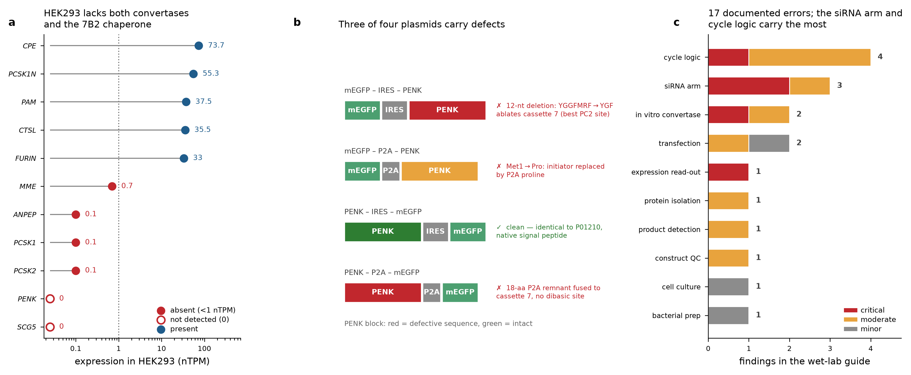
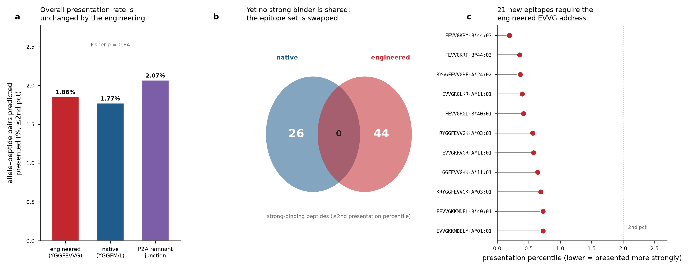

# Έλεγχος υπολογιστικής ανάλυσης και παράδοση στο εργαστήριο, έργο τροποποιημένης προενκεφαλίνης

**Αντικείμενο.** Η παρούσα αναφορά επαναλαμβάνει τον υπολογιστικό έλεγχο του έργου με βάση την **HEK293T**, την κυτταρική σειρά που ορίζεται στον οδηγό του εργαστηρίου (*ΑΝΑΛΥΣΗ ΘΕΜΑΤΟΣ*), αντικαθιστώντας προγενέστερη ανάλυση η οποία είχε στηριχθεί σε καλλιεργημένους ινοβλάστες. Προσθέτει επίσης εκτίμηση της ανοσογονικότητας ως προς το MHC κλάσης I για την τροποποιημένη κασέτα `YGGFEVVG`, έλεγχο σε επίπεδο κατασκευάσματος για τα τέσσερα πλασμίδια, καθώς και κατάλογο σφαλμάτων σε αντιπαραβολή με τον οδηγό. Κάθε ποσοτικός ισχυρισμός είναι ιχνηλάσιμος σε κατονομαζόμενη πηγή· οι DOI παρατίθενται στην §7.

---

## 1. Η κυτταρική σειρά δεν μπορεί να επεξεργαστεί το πρόδρομο μόριο, και αυτό ακριβώς είναι το πείραμα

Ο οδηγός προϋποθέτει ότι τα διαμολυσμένα HEK293T θα εκκρίνουν επεξεργασμένα πεπτίδια εγκεφαλίνης. Αυτό δεν θα συμβεί.

| Γονίδιο | Ρόλος | HEK293 (nTPM) | Κατάσταση |
|---|---|---|---|
| *PCSK1* | PC1/3, ενδοπρωτεόλυση σε διβασικές θέσεις | 0,1 | **απουσιάζει** |
| *PCSK2* | PC2, κύριος παραγωγός μικρών οπιοειδών πεπτιδίων | 0,1 | **απουσιάζει** |
| *SCG5* | 7B2, υποχρεωτική μοριακή συνοδός της PC2 | 0 | **απουσιάζει** |
| *PCSK1N* | proSAAS (ενδογενής αναστολέας της PC1/3) | 55,3 | παρόν |
| *CPE* | καρβοξυπεπτιδάση E (αποκόπτει C-τελικά K/R) | 73,7 | παρόν |
| *PAM* | μονοοξυγενάση α-αμιδίωσης της πεπτιδυλογλυκίνης | 37,5 | παρόν |
| *FURIN* | κονβερτάση της συστατικής οδού (R-X-K/R-R) | 33 | παρόν |
| *MME* | νεπριλυσίνη (τέμνει στο Gly3-Phe4) | 0,7 | **απουσιάζει** |
| *ANPEP* | αμινοπεπτιδάση N (αφαιρεί το Tyr1) | 0,1 | **απουσιάζει** |
| *PENK* | προεγκεφαλίνη (ενδογενές υπόβαθρο) | 0 | **απουσιάζει** |
| *CTSL* | καθεψίνη L (εναλλακτική οδός επεξεργασίας) | 35,5 | παρόν |

Στα HEK293 απουσιάζουν **και οι δύο** προορμονικές κονβερτάσες, καθώς και η υποχρεωτική συνοδός της PC2, η 7B2. Το εύρημα αυτό είναι ισχυρότερο από εκείνο της προγενέστερης ανάλυσης σε ινοβλάστες, όπου είχε διαπιστωθεί απουσία μόνο της PC2.

Απορρέουν τρεις συνέπειες, δύο από τις οποίες λειτουργούν υπέρ σας:

- **Το Στάδιο 1 αποδίδει ανεπεξέργαστη προεγκεφαλίνη.** Η απουσία PC1/3, PC2 και 7B2 σημαίνει ότι δεν υφίσταται ενδοπρωτεόλυση στις διβασικές θέσεις. Αναμένεται, επομένως, το ακέραιο πρόδρομο μόριο στο υπερκείμενο.
- **Κατά συνέπεια, το Στάδιο 2 δεν αποτελεί επιβεβαίωση αλλά το πείραμα καθαυτό.** Το σχέδιο του οδηγού: απομόνωση του πρόδρομου μορίου και εξωγενής προσθήκη κονβερτάσης, είναι το μόνο βήμα που μπορεί να παραγάγει πεπτίδια. Αντιμετωπίστε το ως το κύριο καταληκτικό σημείο και διαθέστε ανάλογους πόρους.
- **Δύο παράγοντες λειτουργούν υπέρ σας.** Το *PAM* εκφράζεται σε αφθονία (37,5 nTPM), άρα η C-τελική αμιδίωση είναι διαθέσιμη. Το ενδογενές *PENK* βρίσκεται στα 0,0 nTPM, οπότε **δεν υπάρχει υπόβαθρο**: ό,τι ανιχνεύεται προέρχεται από το κατασκεύασμα. Πρόκειται για ουσιαστικό πλεονέκτημα των HEK293T έναντι μιας νευροενδοκρινικής σειράς.

Ένας πειραματικός βραχίονας ακυρώνεται: τόσο το *MME* (0,7 nTPM) όσο και το *ANPEP* (0,1 nTPM) απουσιάζουν, οπότε η αποσιώπηση του Κύκλου 5 δεν έχει εδώ ενδογενή στόχο (§4, εύρημα ¶49).

**Εικόνα 1.** (α) Ο μηχανισμός επεξεργασίας στα HEK293· RNA κυτταρικής σειράς σε nTPM· οι ανοικτοί κύκλοι αντιστοιχούν σε γονίδια χωρίς ανιχνεύσιμο μετάγραφο. Οι τιμές των ινοβλαστών παρατίθενται στον συνοδευτικό πίνακα, αλλά δεν απεικονίζονται παράλληλα, καθώς τα TPM ιστού του GTEx και τα nTPM κυτταρικής σειράς δεν αποτελούν άμεσα συγκρίσιμες μονάδες. (β) Αρχιτεκτονική και σφάλματα των τεσσάρων πλασμιδίων. (γ) Τα 17 ευρήματα του οδηγού ανά στάδιο πρωτοκόλλου και σοβαρότητα.

---

## 2. Τρία από τα τέσσερα πλασμίδια είναι μη αξιοποιήσιμα

Τα στοιχεία εξήχθησαν απευθείας από τα αρχεία SnapGene που παρείχατε· το *PENK* δεν έφερε επισημείωση σε κανένα από τα τέσσερα, οπότε τα ανοιχτά αναγνωστικά πλαίσια μεταφράστηκαν και συγκρίθηκαν με το UniProt P01210.

| Πλασμίδιο | ORF (aa) | Κασέτες YGGF | Ταυτίζεται με P01210 | Πεπτίδιο-σήμα | Κίνδυνος επεξεργασίας | Αξιοποιήσιμο |
|---|---|---|---|---|---|---|
| `1_mEGFP_IRES_PENK` | 263 | 6/7 | **όχι** | N-τελικό, φυσικό (Met1 ακέραιο) | ΣΟΒΑΡΟΣ: κατάργηση της κασέτας 7: έλλειψη 12 nt εντός πλαισίου, YGGFMRF -> YGF | **ΟΧΙ** |
| `2_mEGFP_P2A_PENK` | 523 | 7/7 | **όχι** | Met1 -> Pro (προερχόμενη από P2A)· h-περιοχή ακέραιη | κανένας ανιχνεύσιμος | **ΟΧΙ** |
| `3_PENK_IRES_mEGFP` | 267 | 7/7 | ναι | N-τελικό, φυσικό (Met1 ακέραιο) | κανένας ανιχνεύσιμος | **ΝΑΙ: το μόνο καθαρό κατασκεύασμα** |
| `4_PENK_P2A_mEGFP` | 523 | 7/7 | ναι | N-τελικό, φυσικό (Met1 ακέραιο) | ΣΟΒΑΡΟΣ: υπόλειμμα P2A 18 aa συντηγμένο με την κασέτα 7· το MERF γίνεται YGGFMRF+ATNFSLLKQAGDVEENPG ΧΩΡΙΣ διβασική θέση για την απομάκρυνσή του | **ΟΧΙ** |

Αναλυτικά για κάθε ελάττωμα:

- Το **`1_mEGFP_IRES_PENK`** φέρει **έλλειψη 12 nt εντός πλαισίου**, η οποία μετατρέπει την C-τελική κασέτα `YGGFMRF` σε `YGF`. Έτσι καταργείται η κασέτα 7 και, το κρισιμότερο, καταστρέφεται το πλαίσιο `VPRMEKRYGGFMQ`: η **θέση PC2 με το υψηλότερο kcat/Km σε ολόκληρο το πρόδρομο μόριο** (9,4×10⁴ M⁻¹ s⁻¹, 39 φορές υψηλότερη από την ασθενέστερη θέση της ίδιας σειράς υποστρωμάτων) [1].
- Το **`2_mEGFP_P2A_PENK`** τοποθετεί το *PENK* καθοδικά του P2A, με αποτέλεσμα το εναρκτήριο Met1 να αντικαθίσταται από την προλίνη που τερματίζει το γεγονός παράκαμψης του ριβοσώματος στο P2A. Η h-περιοχή του πεπτιδίου-σήματος παραμένει ακέραιη, όμως η καθοδική θέση δεν αποκαθιστά τη λειτουργία του πεπτιδίου-σήματος: αλληλουχία-σήμα εξακολουθεί να απαιτείται, και η τοποθέτηση καθοδικά ενός πεπτιδίου 2A δεν την παρέχει [3].
- Το **`4_PENK_P2A_mEGFP`** αφήνει **υπόλειμμα P2A 18 aa** (`ATNFSLLKQAGDVEENPG`) συντηγμένο με την κασέτα 7, δίνοντας `YGGFMRF`+υπόλειμμα **χωρίς καμία διβασική θέση** για την αποκοπή του. Το υπόλειμμα δεν είναι δυνατόν να αφαιρεθεί από οποιαδήποτε κονβερτάση της οδού. Σημειώνεται ότι το P2A, όπως έχει επισημειωθεί στα αρχεία σας, στερείται του κανονικού διαχωριστή GSG, γεγονός που μειώνει την αποδοτικότητα της παράκαμψης [4].
- Το **`3_PENK_IRES_mEGFP`** είναι το **μόνο καθαρό κατασκεύασμα**, απολύτως ταυτόσημο με το P01210, με φυσικό N-τελικό πεπτίδιο-σήμα και χωρίς υπόλειμμα. Ο μόνος περιορισμός του αφορά τον αναφορητή: η έκφραση του δεύτερου γονιδίου υπό IRES κινείται στο 6–100% των επιπέδων της cap-εξαρτώμενης μετάφρασης, τυπικά στο 20–50% [2], οπότε το mEGFP **υποεκτιμά** το *PENK*.

**Δράση: επιβεβαιώστε με αλληλούχηση και τα τέσσερα πλασμίδια πριν από τη χρήση τους και θεμελιώστε τα κύρια πειράματά σας στο πλασμίδιο 3.**

---

## 3. Το τεχνητά σχεδιασμένο επίτοπο αντικαθιστά το ανοσοπεπτιδίωμα αντί να το διευρύνει

Το MHCflurry 2.1 [5] εφαρμόστηκε σε 612 πεπτίδια, 8–11-mers που καλύπτουν τις τεχνητά σχεδιασμένες κασέτες `YGGFEVVG`, τις φυσικές κασέτες `YGGFM`/`YGGFL` ως αντιστοιχισμένο συγκριτικό δείγμα, καθώς και τη συναρμογή του υπολείμματος P2A, έναντι 10 αντιπροσωπευτικών υπερτύπων HLA (6,120 ζεύγη αλληλόμορφου–πεπτιδίου).

**Εικόνα 2.** (α) Ποσοστό ζευγών αλληλόμορφου–πεπτιδίου στο ή κάτω από το 2ο εκατοστημόριο παρουσίασης, κατά ομάδα. (β) Επικάλυψη των πεπτιδίων-ισχυρών προσδετών μεταξύ του φυσικού και του τεχνητά σχεδιασμένου πρόδρομου μορίου. (γ) Τα ισχυρότερα νεοεπίτοπα που απαιτούν την τεχνητά σχεδιασμένη διεύθυνση EVVG, με σήμανση πεπτίδιο·αλληλόμορφο.

- **Ο συνολικός ρυθμός παραμένει αμετάβλητος.** Προβλέπεται παρουσίαση για το 1,86% των τεχνητά σχεδιασμένων ζευγών έναντι 1,77% των φυσικών (ακριβής δοκιμασία Fisher, p = 0,84). Με βάση αυτό το μέτρο, η γενετική τροποποίηση είναι ουδέτερη.
- **Η ταυτότητα των επιτόπων, όμως, είναι εντελώς διαφορετική.** 44 τεχνητά σχεδιασμένα και 26 φυσικά πεπτίδια είναι ισχυροί προσδέτες, και **η τομή τους είναι κενή**. Η τροποποίηση δεν προσθέτει επίτοπα σε καθαρούς όρους· αντικαθιστά ένα σύνολο με ένα άλλο, το οποίο το ανοσοποιητικό σύστημα του λήπτη δεν έχει συναντήσει ποτέ σε αυτό το πλαίσιο.
- **21 νεοεπίτοπα απαιτούν την τεχνητά σχεδιασμένη διεύθυνση**, καλύπτοντας 7 από τα 10 αλληλόμορφα. Τα ισχυρότερα είναι τα `FEVVGKRY` (HLA-B\*44:03, 73 nM, 0,19ο εκατοστημόριο), `FEVVGKRF` (B\*44:03) και `RYGGFEVVGRF` (A\*24:02). Υπό ισορροπία Hardy-Weinberg και με συχνότητες αλληλομόρφων πληθυσμού ΗΠΑ-Ευρώπης, περίπου 85% των ατόμων φέρουν τουλάχιστον ένα εμπλεκόμενο αλληλόμορφο, τιμή ενδεικτική μόνο, καθώς οι συχνότητες εξαρτώνται από τον πληθυσμό.
- **Το πλασμίδιο 4 φέρει πρόσθετο κίνδυνο επιτόπων.** Η συναρμογή του υπολείμματος P2A παράγει 9 ισχυρούς προσδέτες, μεταξύ των οποίων το `GFMRFATNF` (A\*24:02, 0,13ο εκατοστημόριο), το οποίο εκτείνεται στην ίδια τη συναρμογή και επομένως υπάρχει μόνο σε εκείνο το κατασκεύασμα.

Πρόκειται για προβλέψεις πρόσδεσης και παρουσίασης από υπολογιστική ανάλυση (*in silico*) και όχι για μετρημένη ανοσογονικότητα: η παρουσίαση από MHC είναι αναγκαία αλλά όχι ικανή συνθήκη για απόκριση Τ-κυττάρων. Το εύρημα αποτελεί προειδοποιητική επισήμανση για μια θεραπευτική πορεία και όχι αποτέλεσμα που αφορά τα τρέχοντα πειράματα.

---

## 4. Σφάλματα στον οδηγό εργαστηρίου

17 ευρήματα: **5 κρίσιμα**, 9 μέτρια, 3 ήσσονα. Οι αριθμοί των παραγράφων αντιστοιχούν στη σειρά των παραγράφων του οδηγού.

### Τα πέντε κρίσιμα

1. **Ο αριθμός των κυττάρων δεν ταυτίζεται με την απόδοση προενκεφαλίνης** (¶31). Ο οδηγός επιλέγει τη χρονική στιγμή συλλογής με βάση την καταμέτρηση των κυττάρων. Ο αριθμός των κυττάρων και η έκκριση ανά κύτταρο είναι διακριτά μεγέθη, ενώ η Lipofectamine είναι κυτταροτοξική· κατά συνέπεια, η στιγμή του μέγιστου αριθμού κυττάρων μπορεί να είναι εκείνη της *χαμηλότερης* έκφρασης. Μετρήστε απευθείας το υπερκείμενο (φθορισμός mEGFP κανονικοποιημένος ως προς τα βιώσιμα κύτταρα, ή ανοσοπροσδιορισμός) και όχι τον αριθμό των κυττάρων.
2. **Η PC1/3 προτάσσεται έναντι της PC2** (¶33). Ο οδηγός εκτελεί πρώτα την αντίδραση με PC1/3 και αντιμετωπίζει τις PC2, 7B2 και CPE ως προαιρετικές προσθήκες. Η PC2 ευθύνεται πρακτικά για το σύνολο της παραγωγής μικρών οπιοειδών πεπτιδίων από την προενκεφαλίνη, ενώ η ισχυρότερη θέση PC2 σε ολόκληρο το πρόδρομο μόριο (`VPRMEKRYGGFMQ`, kcat/Km 9,4×10⁴ M⁻¹ s⁻¹) είναι 39 φορές αποτελεσματικότερη από την ασθενέστερη. Εκτελέστε την αντίδραση PC2 + 7B2 ως κύρια.
3. **Το συμπέρασμα του Κύκλου 1 διατυπώνεται ανεξάρτητα από τα δεδομένα** (¶37). Το κείμενο αναφέρει ότι, ανεξαρτήτως αποτελέσματος, η βιβλιογραφία τεκμηριώνει ήδη ότι η IRES μεταβάλλει την έκφραση. Εάν το συμπέρασμα δεν εξαρτάται από τη μέτρηση, τότε η μέτρηση δεν συνιστά πείραμα. Διατυπώστε εκ των προτέρων μια διαψεύσιμη πρόβλεψη με συγκεκριμένο κατώφλι.
4. **Η αποσιώπηση της νεπριλυσίνης δεν έχει στόχο σε αυτή την κυτταρική σειρά** (¶49). Τα HEK293 εκφράζουν το MME σε 0,7 nTPM και το ANPEP σε 0,1 nTPM, αμφότερα πρακτικά απόντα. Δεν υπάρχει, επομένως, τι να αποσιωπηθεί, και το σκέλος του siRNA δεν μπορεί να δώσει σήμα. Είτε προσθέστε την πεπτιδάση εξωγενώς σε μια in vitro αντίδραση, είτε μεταφέρετε το σκέλος αυτό σε κυτταρική σειρά που την εκφράζει.
5. **Οι χρονικές στιγμές μέτρησης για το siRNA είναι υπερβολικά πρώιμες** (¶53). Οι αναγνώσεις αποτελέσματος στη 1 h και στις 2 h προηγούνται οποιασδήποτε εξάντλησης της πρωτεΐνης· η RNAi προϋποθέτει πέψη του μεταγράφου και, εν συνεχεία, ανακύκλωση της προϋπάρχουσας πρωτεΐνης. Χρησιμοποιήστε 24, 48 και 72 h.

### Πλήρης κατάλογος

| ¶ | Βαρύτητα | Ζήτημα | Γιατί είναι εσφαλμένο | Διόρθωση | Παραπομπή |
|---|---|---|---|---|---|
| `[6]` | Μέτριο | Αναμένει «δύο κλίμακες DNA» ως αποτέλεσμα της διαγνωστικής πέψης | Η κλίμακα είναι το πρότυπο μοριακού βάρους και όχι αποτέλεσμα. Το αναμενόμενο αποτέλεσμα είναι δύο ζώνες προερχόμενες από το ένθεμα, με τα προβλεπόμενα μεγέθη, για κάθε κατασκεύασμα, σε σύγκριση με μία διαδρομή κλίμακας. | Να επαναδιατυπωθεί ως: δύο ζώνες στα προβλεπόμενα μεγέθη, με προσδιορισμό μεγέθους έναντι μίας μόνο διαδρομής κλίμακας. Τα προβλεπόμενα μεγέθη παρατίθενται στην παρούσα αναφορά. | Καθιερωμένη πρακτική· τα μεγέθη των ζωνών υπολογίζονται από τους χάρτες των πλασμιδίων (παρούσα αναφορά, Table 2) |
| `[7]` | Ήσσον | Το στέλεχος αναγράφεται ως «NHB10 E. coli» | Το χημικά δεκτικό στέλεχος της NEB που χρησιμοποιείται με το 10-beta/Stable Outgrowth Medium είναι το NEB 10-beta· η ονομασία «NHB10» δεν αντιστοιχεί σε κανένα στέλεχος καταλόγου. Το πρωτόκολλο που παρατίθεται στα [9]-[24] είναι το πρωτόκολλο 10-beta της NEB. | Να διορθωθεί σε «NEB 10-beta». Επισημαίνεται ότι το παρατιθέμενο πρωτόκολλο είναι της ίδιας της NEB, οπότε η ονομασία του στελέχους οφείλει να συμφωνεί με αυτό. | Δεκτικά κύτταρα E. coli NEB 10-beta (C3019)· στο κείμενο του πρωτοκόλλου στα [14],[17] αναφέρεται το «10-beta/Stable Outgrowth Medium» |
| `[25]` | Ήσσον | «heat-activated FBS» (δηλ. «θερμικά ενεργοποιημένος» FBS) | Η καθιερωμένη επεξεργασία είναι η θερμική ΑΔΡΑΝΟΠΟΙΗΣΗ (56 C, 30 min), ώστε να καταστραφεί το συμπλήρωμα. Ο όρος «heat-activated» αντιστρέφει το νόημα. | Να αλλάξει σε «heat-inactivated FBS (56 C, 30 min)», δηλαδή θερμικά αδρανοποιημένος FBS. | Καθιερωμένη πρακτική κυτταροκαλλιέργειας |
| `[26]` | Ήσσον | Το Opti-MEM χρησιμοποιείται μόνο για τα σύμπλοκα DNA+λιπιδίων | Αυτό είναι σωστό για τον σχηματισμό των συμπλόκων, όμως στη συνέχεια η [27] αλλάζει το ΘΡΕΠΤΙΚΟ ΜΕΣΟ ΚΑΛΛΙΕΡΓΕΙΑΣ σε Opti-MEM, το οποίο είναι μέσο μειωμένου ορού. Η παρατεταμένη καλλιέργεια σε Opti-MEM χωρίς ορό επιβραδύνει την ανάπτυξη των κυττάρων και νοθεύει τη χρονοσειρά καταμέτρησης κυττάρων στην οποία στηρίζεται η [31]. | Κρατήστε το Opti-MEM για τα σύμπλοκα. Για τη συλλογή στις 24-72 h, είτε παραμείνετε σκόπιμα σε συνθήκες χωρίς ορό (και αναφέρετέ το ρητά, καθώς διευκολύνει την ανάλυση του υπερκειμένου) είτε διατηρήστε DMEM+FBS. Σε καμία περίπτωση όμως μην αλλάζετε μέσο στο μέσο της σειράς. | Πρωτόκολλο Thermo Fisher Lipofectamine 3000 (σύμπλοκα σε Opti-MEM)· τεχνική τεκμηρίωση προϊόντος Opti-MEM |
| `[27]` | Μέτριο | Πρώτη ανάγνωση φθορισμού στις 24 h για την επιλογή του πλασμιδίου | Τα συγκριτικά δεδομένα της ίδιας της Thermo για το Lipofectamine 3000 αναλύουν την GFP στις 48 h μετά τη διαμόλυνση. Μια μέτρηση στις 24 h γίνεται ενώ το σήμα βρίσκεται ακόμη στην ανοδική φάση, και επιπλέον τα κατασκευάσματα με IRES διαφέρουν κινητικά από εκείνα με P2A· έτσι, η κατάταξή τους στις 24 h μπορεί να αντιστρέψει τη σειρά που προκύπτει στις 48 h. | Ανάγνωση στις 24, 48 και 72 h (δείγματα συλλέγονται ήδη σε αυτά τα χρονικά σημεία) και κατάταξη με βάση την τιμή των 48 h. | Δεδομένα προϊόντος Thermo Fisher Lipofectamine 3000 (η GFP αναλύεται 48 h μετά τη διαμόλυνση) |
| `[31]` | Κρίσιμο | «η καταμέτρηση των κυττάρων προσδιορίζει τη χρονική στιγμή με τη μεγαλύτερη ποσότητα προενκεφαλίνης» | Ο αριθμός των κυττάρων και η απόδοση σε προενκεφαλίνη είναι δύο διαφορετικά μεγέθη. Η καταμέτρηση των κυττάρων αποτυπώνει τον πολλαπλασιασμό και την τοξικότητα των λιποπλεγμάτων· δεν λέει απολύτως τίποτα για την παραγωγή PENK ανά κύτταρο. Τα δύο μεγέθη μπορούν μάλιστα να μεταβάλλονται προς αντίθετες κατευθύνσεις, καθώς η διαμόλυνση μειώνει τη βιωσιμότητα ενώ ταυτόχρονα η έκφραση αυξάνεται. | Απαιτείται κανονικοποίηση: η PENK να αναφέρεται ανά βιώσιμο κύτταρο (ή ανά mg ολικής πρωτεΐνης). Η καταμέτρηση των κυττάρων πρέπει να χρησιμοποιείται ως παρονομαστής και ως μάρτυρας τοξικότητας, όχι ως ανάγνωση αποτελέσματος για την απόδοση. | Εσωτερική λογική· η κυτταροτοξικότητα του Lipofectamine τεκμηριώνεται στις συχνές ερωτήσεις (FAQ) του προϊόντος της Thermo |
| `[32]` | Μέτριο | Απομόνωση της PENK αποκλειστικά με χρωματογραφία μοριακής διήθησης (SEC) | Η προενκεφαλίνη έχει μοριακή μάζα ~31 kDa και συνεκλούεται με άφθονες πρωτεΐνες του ορού και του θρεπτικού μέσου παρόμοιου μεγέθους. Η SEC από μόνη της συνιστά βήμα κλασμάτωσης και όχι καθαρισμού, ενώ τα εν λόγω κατασκευάσματα δεν φέρουν καμία λαβή συγγένειας. | Είτε να προστεθεί μια C-τελική ετικέτα στο κατασκεύασμα επόμενης γενιάς, είτε να ακολουθήσει μετά τη SEC ένα βήμα ανοσοκαθήλωσης έναντι της PENK / Western. Σημειώνεται ότι η ετικέτα ΔΕΝ πρέπει να τοποθετηθεί στο C-τελικό άκρο της κασέτας 7. | Γενικές αρχές χρωματογραφίας· οι χάρτες των κατασκευασμάτων δεν εμφανίζουν ετικέτα επιτόπου (παρούσα αναφορά, Πίνακας 2) |
| `[33]` | Κρίσιμο | Η PC1/3 ορίζεται ως η κύρια κονβερτάση in vitro, ενώ οι PC2/7B2/CPE εξετάζονται μόνο «εφόσον υπάρχει χρόνος» | Η PC2 (και όχι η PC1/3) ευθύνεται για ουσιαστικά όλη την παραγωγή μικρών οπιοειδών πεπτιδίων από την προενκεφαλίνη. Οι Johanning et al. αναφέρουν ότι η παραγωγή μικρών οπιοειδών πεπτιδίων από τα ενδιάμεσα προϊόντα διαμεσολαβείται σχεδόν εξ ολοκλήρου από την PC2 και όχι από την PC1, καθώς και ότι στους εγκεφάλους με απαλοιφή της PC2 οι ώριμες εγκεφαλίνες είναι μειωμένες κατά περισσότερο από τα τρία τέταρτα. Με την PC1/3 μόνη, το αναμενόμενο προϊόν είναι ενδιάμεσα μόρια και όχι εγκεφαλίνες. | Αντιστρέψτε την ιεράρχηση: το σκέλος PC2 + 7B2 είναι το απαραίτητο, ενώ η PC1/3 το δευτερεύον. Η 7B2 δεν είναι προαιρετική: αποτελεί υποχρεωτική συνοδό πρωτεΐνη (chaperone) για τη δραστικότητα της PC2 (UniProt P16519/P05408). | Johanning et al. 1998, J Biol Chem 273:22672-80, doi:10.1074/jbc.273.35.22672 |
| `[33]` | Μέτριο | Απουσία CPE στην κύρια αντίδραση | Η διάσπαση από την κονβερτάση αφήνει βασικά αμινοξέα (K/R) στο καρβοξυτελικό άκρο. Χωρίς καρβοξυπεπτιδάση Ε τα προϊόντα είναι οι εκτεταμένες μορφές Met-enk-Arg / Met-enk-Lys και όχι η Met-enkephalin καθαυτή, επομένως μια ανάλυση MS ή μια ανοσοδοκιμασία που στοχεύει τη Met-enkephalin μπορεί να δώσει αρνητική ανάγνωση αποτελέσματος, ακόμη και όταν η διάσπαση έχει όντως επιτευχθεί. | Συμπεριλάβετε CPE στην κύρια αντίδραση ή στοχεύστε ρητά τις εκτεταμένες μάζες +K/+R κατά την ανάγνωση του αποτελέσματος. | UniProt P16870 (CPE), λειτουργία· καθιερωμένη οδός επεξεργασίας της προεγκεφαλίνης |
| `[35]` | Μέτριο | «Χρωματογραφία για να φανεί ότι προέκυψαν διαφορετικά θραύσματα» | Η χρωματογραφία δίνει χρόνο κατακράτησης, ο οποίος δεν ταυτοποιεί πεπτίδιο. Δύο διαφορετικά προϊόντα μπορούν να συνεκλούονται, ενώ η σύγκριση που έχει αποδεικτική αξία εδώ είναι αυτή μιας συγκεκριμένης μάζας. | Χρησιμοποιήστε LC-MS και στοχεύστε τις υπολογισμένες μάζες: για τη Met-εγκεφαλίνη η τιμή [M+H]+ 574.2330 είναι ήδη καταγεγραμμένη στο invitro_ms_targets.csv από την προηγούμενη εργασία. | Το πρωτόκολλο in vitro του ίδιου του έργου υπολογίζει ήδη τις ακριβείς μάζες-στόχους (07_invitro_penk) |
| `[37]` | Κρίσιμο | «ανεξάρτητα από το αποτέλεσμα, μπορούμε να πούμε από τη βιβλιογραφία ότι ο IRES δίνει διαφορετικά επίπεδα έκφρασης» | Η διατύπωση αυτή δηλώνει το συμπέρασμα ανεξάρτητα από τα δεδομένα, κάτι που αντιστρέφει τον κύκλο σχεδίασης-κατασκευής-μέτρησης. Η πρόβλεψη που προκύπτει από τη βιβλιογραφία είναι η υπόθεση που πρέπει να ελεγχθεί και όχι υποκατάστατο της μέτρησης. | Επαναδιατυπώστε το ως διαψεύσιμη πρόβλεψη με αριθμητική τιμή: αναμένεται η έκφραση του γονιδίου που βρίσκεται κάτω από τον IRES να κινείται περίπου στο 20-50% της έκφρασης του cap-εξαρτώμενου γονιδίου, και αναφέρετε τη μετρούμενη αναλογία, όποια και αν αποδειχθεί αυτή. | Mizuguchi et al. 2000, Mol Ther 1:376-82, doi:10.1006/mthe.2000.0050 (η έκφραση του δεύτερου γονιδίου μέσω IRES ανέρχεται στο 6-100%, κυρίως στο 20-50%, της έκφρασης του πρώτου, cap-εξαρτώμενου γονιδίου) |
| `[38]` | Μέτριο | Θεωρεί δεδομένο ότι τα κατασκευάσματα με P2A θα δώσουν «μεγαλύτερη ποσότητα PENK» | Η υπόθεση είναι εύλογη ως προς την έκφραση, αλλά και τα δύο κατασκευάσματα με P2A της σειράς αυτής φέρουν ατέλειες που καθιστούν τη σύγκριση μη ισοδύναμη: στο mEGFP-P2A-PENK η εναρκτήρια Met της PENK αντικαθίσταται από την προλίνη του P2A, ενώ στο PENK-P2A-mEGFP ένα υπόλειμμα P2A 18 αμινοξέων παραμένει συντηγμένο με την κασέτα 7. | Συγκρίνετε τη συνολική PENK με Western, αλλά μην εκλαμβάνετε την υψηλότερη PENK ως καλύτερο αποτέλεσμα, εκτός αν το προϊόν υφίσταται και ορθή επεξεργασία: μετρήστε την παραγωγή πεπτιδίου και όχι την αφθονία του πρόδρομου μορίου. | Yan et al. 2010, Anal Biochem 399:144-6, doi:10.1016/j.ab.2009.11.032· Liu et al. 2017, Sci Rep 7:2193, doi:10.1038/s41598-017-02460-2· ανάλυση κατασκευασμάτων στην παρούσα έκθεση |
| `[40]` | Μέτριο | Ο Κύκλος 2 επαναλαμβάνει τη μέτρηση του Κύκλου 1 | Ο Κύκλος 1 ([37]-[38]) συγκρίνει ήδη την έκφραση των κατασκευασμάτων· ο Κύκλος 2 συγκρίνει «ποιο από τα 2 κατασκευάσματα εκφράζεται περισσότερο» με μικροσκοπία φθορισμού. Το ίδιο ερώτημα, με άλλο όργανο. | Συγχωνεύστε τους δύο κύκλους, ή διαμορφώστε τον Κύκλο 2 ώστε να απαντά σε διαφορετικό ερώτημα, π.χ. στον υποκυτταρικό εντοπισμό, τον οποίο η μικροσκοπία μπορεί να αναδείξει, σε αντίθεση με τον αναγνώστη μικροπλακών, και ο οποίος συνιστά τη πραγματική δοκιμή της έκκρισης. | Εσωτερική επανάληψη |
| `[49]` | Κρίσιμο | siRNA έναντι της νεπριλυσίνης σε HEK293T, με πλασμίδιο που φέρει το cDNA της νεπριλυσίνης ως το αντίστοιχο σκέλος του πειράματος | Τα HEK293 δεν εκφράζουν νεπριλυσίνη (MME 0,7 nTPM) ούτε αμινοπεπτιδάση N (ANPEP 0,1 nTPM). Δεν υπάρχει ενδογενής στόχος προς αποσιώπηση, οπότε ένα πείραμα αποσιώπησης σε αυτή την κυτταρική σειρά δεν έχει μετρήσιμη βασική τιμή. Η λύση που επινοούν οι ίδιοι, η συν-διαμόλυνση με cDNA του MME, κινείται προς τη σωστή κατεύθυνση, αλλά πρέπει τότε να δηλωθεί ως τεχνητή ανασύσταση και όχι ως αποσιώπηση ενδογενούς ενζύμου. | Παρουσιάστε το ρητά ως ανασύσταση: συν-διαμολύνετε cDNA του MME ώστε να ΔΗΜΙΟΥΡΓΗΘΕΙ η αποικοδομητική δραστικότητα και στη συνέχεια δείξτε ότι το siRNA την εξαλείφει. Σημειώστε επίσης ότι η εγκεφαλίνη αποικοδομείται και από την ANPEP, όχι μόνο από την MME· επομένως η αποσιώπηση μόνο του MME δεν επαρκεί σε ιστό που διαθέτει και τα δύο ένζυμα. | Human Protein Atlas cell-line RNA (HEK293): MME 0.7, ANPEP 0.1 nTPM |
| `[53]` | Κρίσιμο | Χρονικά σημεία siRNA στα «1 h, 2 h, αργότερα» | Η RNAi δρα αποδομώντας το mRNA· η πρωτεΐνη πρέπει στη συνέχεια να ανακυκλωθεί για να εμφανιστεί οποιαδήποτε επίδραση. Στη 1-2 h μετά τη διαμόλυνση δεν είναι δυνατή καμία αποσιώπηση σε επίπεδο πρωτεΐνης, οπότε τα χρονικά αυτά σημεία είναι εξ ορισμού αρνητικά, για λόγους που δεν έχουν σχέση με το αν λειτουργεί το siRNA. | Μεταφέρετε τη δειγματοληψία στις 24, 48 και 72 h μετά τη διαμόλυνση και επιβεβαιώστε την αποσιώπηση και σε επίπεδο mRNA (RT-qPCR), πέραν της λειτουργικής μέτρησης. | Μηχανισμός της RNAi (η αποκοπή του mRNA προηγείται της εξάντλησης της πρωτεΐνης)· η καθιερωμένη πρακτική για siRNA είναι 24-72 h |
| `[51]-[54]` | Μέτριο | Η μέτρηση στον κύκλο 5 είναι «φθορισμός/έκφραση» για τον έλεγχο της παραμονής της εγκεφαλίνης | Το mEGFP αποτυπώνει τη διαμόλυνση και τη μετάφραση του γονιδίου-αναφοράς· δεν αποτυπώνει τη συγκέντρωση της εγκεφαλίνης ούτε τον χρόνο ημιζωής της. Η αποσιώπηση της νεπριλυσίνης δεν μπορεί να μεταβάλει τον φθορισμό του mEGFP. | Η ανάγνωση αποτελέσματος πρέπει να αφορά το πεπτίδιο: LC-MS ή ELISA στο υπερκείμενο σε κάθε χρονικό σημείο. Ο φθορισμός να χρησιμοποιείται αποκλειστικά για κανονικοποίηση ως προς την αποδοτικότητα διαμόλυνσης μεταξύ των φρεατίων. | Αρχιτεκτονική του κατασκευάσματος, το mEGFP αποτελεί ξεχωριστό προϊόν μετάφρασης από το PENK και στα τέσσερα πλασμίδια (παρούσα αναφορά, Table 2) |
| `[36]-[56]` | Μέτριο | Έξι κύκλοι εδώ, έναντι τριών στο αρχείο της υπολογιστικής ανάλυσης | Οι Κύκλοι 1-6 του οδηγού δεν αντιστοιχούν στους κύκλους 1-3b του αποθετηρίου, οι οποίοι πραγματεύονται εντελώς διαφορετικό ερώτημα (βαθμολόγηση του τρόπου πρόσδεσης). Δύο ανεξάρτητα συστήματα αρίθμησης χρησιμοποιούνται για «τους κύκλους μηχανικής» του ίδιου έργου. | Υιοθετήστε ένα σύστημα. Πρόταση: κρατήστε την αρίθμηση της πειραματικής εργασίας ως επίσημο αρχείο του έργου και επισημάνετε την υπολογιστική εργασία ως υπολογιστικούς υπο-κύκλους, ώστε ο «Κύκλος 3» να είναι μονοσήμαντος. | Αποθετήριο 06_engineering_cycles (κύκλοι 1, 2, 3, 3b) έναντι παραγράφων [36]-[56] του οδηγού (κύκλοι 1-6) |

Δύο σημεία του οδηγού που είναι **σωστά** και δεν πρέπει να τροποποιηθούν: το Lipofectamine 3000 είναι υπαρκτό προϊόν (cat. L3000001) και αποτελεί ένα από τα αντιδραστήρια που είναι κατάλληλα για ταυτόχρονη επιμόλυνση (co-transfection) siRNA μαζί με πλασμιδιακό DNA, όπως ακριβώς απαιτεί ο Κύκλος 5.

---

## 5. Τα δύο συστήματα αρίθμησης των κύκλων είναι ασύνδετα μεταξύ τους

Οι Κύκλοι 1–6 του οδηγού και οι Κύκλοι 1–3b του αποθετηρίου **δεν μοιράζονται καμία ερώτηση**. Εκείνοι του οδηγού καλύπτουν την εργαστηριακή εργασία για το κατασκεύασμα και την έκφραση (1, 2), το όχημα μεταφοράς (3, 4), τον βραχίονα της αποδόμησης (5) και την ασφάλεια (6). Εκείνοι του αποθετηρίου καλύπτουν τη χίμαιρα της δελτορφίνης, τη δέλτα-εκλεκτικότητα και την επικύρωση της μετρικής εκλεκτικότητας. Μηδενική επικάλυψη.

Ο πρακτικός κίνδυνος: **ο «Κύκλος 3» είναι αμφίσημος**, μοντελοποίηση λιποπλεγμάτων στο ένα σύστημα, επικύρωση της μετρικής εκλεκτικότητας στο άλλο. Χρειάζεται να τους δοθούν προθέματα (`W1`–`W6` για το εργαστήριο, `D1`–`D3b` για την υπολογιστική ανάλυση) προτού τα δύο αρχεία διαβαστούν το ένα δίπλα στο άλλο.

---

## 6. Τι πρέπει να κάνω εγώ για να στηρίξω το εργαστήριο

Κατά σειρά του πόσο γρήγορα αποδεσμεύουν την πειραματική εργασία.

1. **Παράδοση των αναμενόμενων μεγεθών ζωνών πέψης για τα τέσσερα πλασμίδια**, υπολογίζονται άμεσα από τους χάρτες και μετατρέπουν τους «δύο δείκτες μοριακού βάρους» της ¶6 σε συγκεκριμένο κριτήριο επιτυχίας/αποτυχίας. *(Δεν προϋποθέτει τίποτε άλλο· πρώτο στη σειρά.)*
2. **Παράδοση των ακριβών στοχευόμενων μαζών και των αναμενόμενων συνόλων θραυσμάτων** για την αντίδραση PC2 + 7B2 + CPE, ανά πλασμίδιο, ώστε η χρωματογραφία της ¶35 να γίνει ταυτοποίηση και όχι απλή παρατήρηση χρόνου κατακράτησης. Το in vitro πρωτόκολλο στο `07_invitro_penk` τα υπολογίζει ήδη· απομένει να δοθούν ως φύλλο πάγκου.
3. **Καθορισμός των συνθηκών της αντίδρασης του Σταδίου 2**, αναλογία ενζύμου προς υπόστρωμα, ρυθμιστικό διάλυμα, pH, Ca²⁺, χρονική σειρά, καθώς και οι αντιστοιχισμένοι μάρτυρες (χωρίς ένζυμο, χωρίς υπόστρωμα, θετικός μάρτυρας με φυσική *PENK*). Τα στοιχεία βρίσκονται στο `enzyme_conditions.csv`.
4. **Επανασχεδιασμός του Κύκλου 5.** Ελλείψει *MME* ή *ANPEP* στα HEK293T, προτείνεται η in vitro εναλλακτική: καθαρισμένη πεπτιδάση προστίθεται σε συνθετικό πεπτίδιο, ± αναστολέας, με χρόνο ημιζωής αποδόμησης ως μετρούμενο μέγεθος.
5. **Παροχή ποσοτικού σχεδίου μέτρησης για τους Κύκλους 1 και 2**, με προδηλωμένο κατώφλι, ώστε να αντικατασταθεί το συμπέρασμα της ¶37 που δεν εξαρτάται από τα δεδομένα.
6. **Καταχώριση του ευρήματος ανοσογονικότητας στο αρχείο ασφάλειας του έργου** για τον Κύκλο 6, με συνημμένο τον κατάλογο των νεοεπιτόπων.

Δύο πράγματα που **δεν** πρέπει να κάνω: να ισχυριστώ ότι τα κατασκευάσματα με P2A θα δώσουν περισσότερη *PENK* (η ανάλυση δείχνει το αντίθετο για τα πλασμίδια 2 και 4), και να επιτρέψω να εκληφθεί ο δείκτης ως υποκατάστατο της απόδοσης σε πεπτίδιο: το mEGFP είναι ξεχωριστό προϊόν μετάφρασης από την *PENK* σε όλα τα πλασμίδια.

---

## 7. Βιβλιογραφία

1. Johanning K, Juliano MA, Juliano L, Lazure C, Lamango NS, Steiner DF, Lindberg I. *Specificity of prohormone convertase 2 on proenkephalin and proenkephalin-related substrates.* J Biol Chem 1998;273(35):22672–22680. doi:[10.1074/jbc.273.35.22672](https://doi.org/10.1074/jbc.273.35.22672)
2. Mizuguchi H, Xu Z, Ishii-Watabe A, Uchida E, Hayakawa T. *IRES-dependent second gene expression is significantly lower than cap-dependent first gene expression in a bicistronic vector.* Mol Ther 2000;1(4):376–382. doi:[10.1006/mthe.2000.0050](https://doi.org/10.1006/mthe.2000.0050)
3. Yan L, Kaplan FS, Shore EM, Xu M. *Signal sequence is still required in genes downstream of “autocleaving” 2A peptide for secretary or membrane-anchored expression.* Anal Biochem 2010;399(1):144–146. doi:[10.1016/j.ab.2009.11.032](https://doi.org/10.1016/j.ab.2009.11.032)
4. Liu Z, Chen O, Wall JBJ, Zheng M, Zhou Y, Wang L, Ruth Vaseghi H, Qian L, Liu J. *Systematic comparison of 2A peptides for cloning multi-genes in a polycistronic vector.* Sci Rep 2017;7:2193. doi:[10.1038/s41598-017-02460-2](https://doi.org/10.1038/s41598-017-02460-2)
5. O'Donnell TJ, Rubinsteyn A, Laserson U. *MHCflurry 2.0: improved pan-allele prediction of MHC class I-presented peptides by incorporating antigen processing.* Cell Syst 2020;11(1):42–48.e7. doi:[10.1016/j.cels.2020.06.010](https://doi.org/10.1016/j.cels.2020.06.010)
6. Uhlén M, Fagerberg L, Hallström BM, et al. *Tissue-based map of the human proteome.* Science 2015;347(6220):1260419. doi:[10.1126/science.1260419](https://doi.org/10.1126/science.1260419), Human Protein Atlas cell-line RNA data (HEK293), [proteinatlas.org](https://www.proteinatlas.org)
7. UniProt Consortium. *UniProt: the Universal Protein Knowledgebase in 2025.* Nucleic Acids Res 2025;53(D1):D609–D617. doi:[10.1093/nar/gkae1010](https://doi.org/10.1093/nar/gkae1010), accessions P01210 (PENK), P29120 (PCSK1), P16519 (PCSK2), P05408 (SCG5/7B2), P16870 (CPE)
8. GTEx Consortium. *The GTEx Consortium atlas of genetic regulatory effects across human tissues.* Science 2020;369(6509):1318–1330. doi:[10.1126/science.aaz1776](https://doi.org/10.1126/science.aaz1776)

---

## 8. Αρχεία δεδομένων

Όλες οι τιμές που παρατίθενται στην παρούσα αναφορά είναι αναπαραγώγιμες από τους πίνακες που ακολουθούν.

| Αρχείο | Περιεχόμενα |
|---|---|
| `hek293t_processing_competence.csv` | nTPM HEK293, TPM ινοβλαστών, ρόλος και πηγή, ανά γονίδιο |
| `construct_risk_table.csv` | ORF, αριθμός κασετών, πεπτίδιο-σήμα, υπόλειμμα P2A και κίνδυνος, ανά πλασμίδιο |
| `guide_error_audit.csv` | Και τα 17 ευρήματα, με σοβαρότητα, αιτιολογία, διόρθωση και βιβλιογραφική αναφορά |
| `mhc_predictions_full.csv` | Όλες οι 6.120 προβλέψεις αλληλομόρφου–πεπτιδίου |
| `mhc_engineered_neoepitopes.csv` | Τα 21 νεοεπίτοπα που εξαρτώνται από το EVVG |
| `mhc_group_summary.csv` | Σύνοψη πρόσδεσης ανά ομάδα |
| `cycle_reconciliation.csv` | Αντιστοίχιση κύκλων μεταξύ οδηγού και αποθετηρίου |
| `hek293t_design_paradox.csv` | Παραδοχή έναντι υπολογιστικά τεκμηριωμένης πραγματικότητας, ανά στάδιο |

*Οι προβλέψεις είναι υπολογιστικές. Οι προβλέψεις πρόσδεσης σε MHC υποδεικνύουν την πιθανότητα παρουσίασης και όχι πειραματικά μετρημένη ανοσογονικότητα. Οι τιμές έκφρασης αφορούν το επίπεδο του μεταγράφου και δεν εξασφαλίζουν αντίστοιχη αφθονία ή δραστικότητα της πρωτεΐνης.*