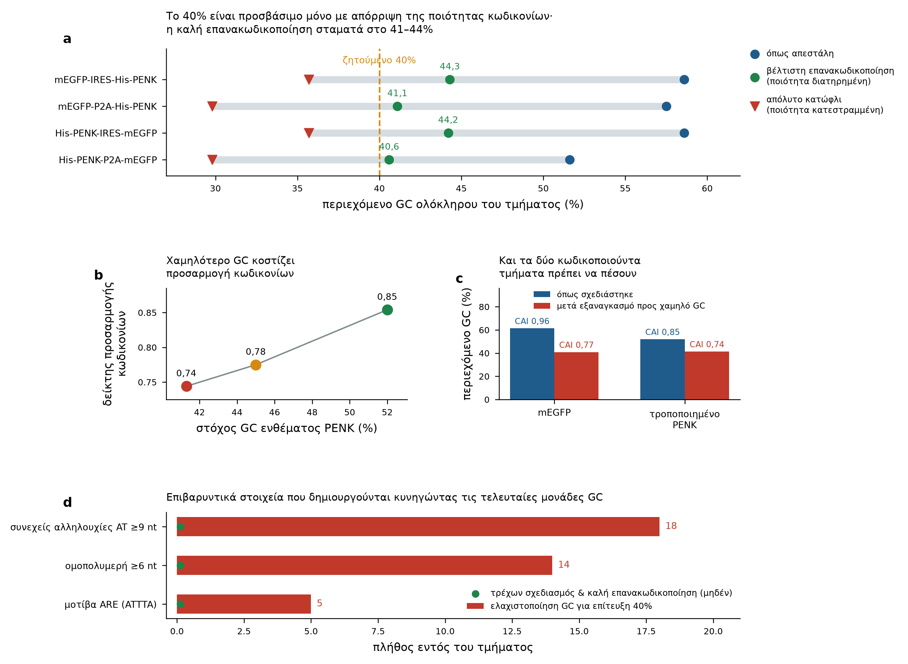
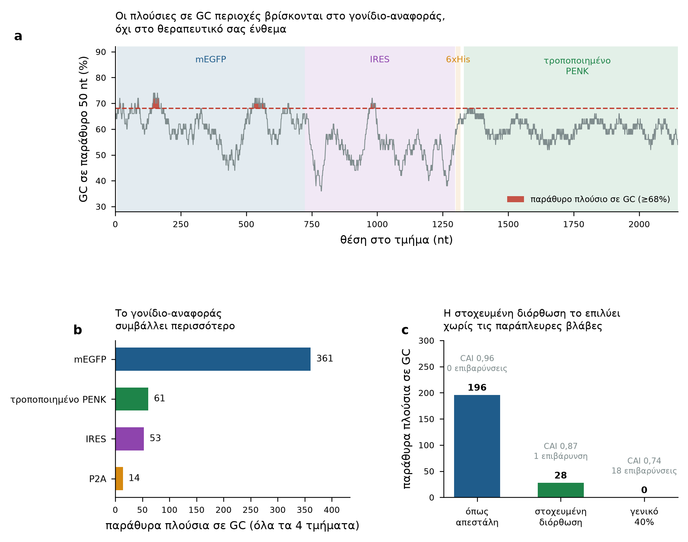

# Το αίτημα για 40% GC — τεκμηρίωση και προτεινόμενη αντιμετώπιση

**Συμπέρασμα.** Το 40% συνολικό περιεχόμενο GC είναι αριθμητικά εφικτό αλλά δεν συνιστάται, και δεν
επιλύει το πρόβλημα που πιθανότατα προορίζεται να επιλύσει. Οι περιοχές πλούσιες σε GC σε αυτά τα
κατασκευάσματα συγκεντρώνονται στο **γονίδιο-αναφοράς mEGFP**, όχι στο θεραπευτικό ένθεμα. Μια στοχευμένη
επανακωδικοποίηση του γονιδίου-αναφοράς απομακρύνει το 86% αυτών διατηρώντας την ποιότητα των κωδικονίων·
μια καθολική επιβολή 40% τις απομακρύνει επίσης, αλλά υποβαθμίζει την προσαρμογή κωδικονίων σε κάθε
στοιχείο και εισάγει επιβαρυντικά στοιχεία αλληλουχίας που δεν υπήρχαν προηγουμένως.

---

## 1. Είναι εφικτό το 40%;

Ναι, αριθμητικά. Το απόλυτο συνώνυμο κατώφλι για την τροποποιημένη προπρωτεΐνη είναι **30,9% GC** — η
τιμή που προκύπτει επιλέγοντας το πλουσιότερο σε AT κωδικόνιο σε κάθε θέση. Το 40% βρίσκεται πάνω από
αυτό το κατώφλι, άρα κανένας κανόνας του γενετικού κώδικα δεν το απαγορεύει.

Τα τμήματα όμως περιέχουν ένα σταθερό στοιχείο. Το **IRES δεν είναι επανακωδικοποιήσιμο** — είναι ένα
δομημένο στοιχείο RNA του οποίου η λειτουργία εξαρτάται από την πραγματική του αλληλουχία και όχι από
την πρωτεΐνη που κωδικοποιεί (δεν κωδικοποιεί καμία). Με 53% GC σε 574–584 nt, πιέζει προς τα κάτω το
απαιτούμενο GC όλων των υπολοίπων:

| τμήμα | συνολικά nt | σταθερά (IRES) nt | επανακωδικοποιήσιμα nt | GC που πρέπει να φτάσει το επανακωδικοποιήσιμο μέρος για 40% συνολικά |
|---|---|---|---|---|
| mEGFP-IRES-His-PENK | 2197 | 584 | 1613 | 35,2% |
| mEGFP-P2A-His-PENK | 1674 | 10 | 1664 | 39,8% |
| His-PENK-IRES-mEGFP | 2194 | 583 | 1611 | 35,2% |
| His-PENK-P2A-mEGFP | 1671 | 9 | 1662 | 39,9% |

Και όταν η επανακωδικοποίηση γίνεται **διατηρώντας την ποιότητα των κωδικονίων**, τα τμήματα σταματούν
πάνω από το 40%:

| τμήμα | GC ως απεστάλη | βέλτιστη επανακωδικοποίηση με διατήρηση ποιότητας | κατώφλι ελαχιστοποίησης GC (απώλεια ποιότητας) |
|---|---|---|---|
| mEGFP-IRES-His-PENK | 58,6% | **44,3%** | 35,7% |
| mEGFP-P2A-His-PENK | 57,5% | **41,1%** | 29,8% |
| His-PENK-IRES-mEGFP | 58,6% | **44,2%** | 35,7% |
| His-PENK-P2A-mEGFP | 51,6% | **40,6%** | 29,8% |

Επομένως: τα δύο κατασκευάσματα με IRES **δεν μπορούν** να φτάσουν το 40% χωρίς εγκατάλειψη της
ποιότητας των κωδικονίων. Τα δύο κατασκευάσματα με P2A μόλις και μετά βίας το προσεγγίζουν.

---

## 2. Τι κοστίζει το 40%

**Προσαρμογή κωδικονίων.** Ο δείκτης προσαρμογής κωδικονίων (CAI) μετρά πόσο στενά μια κωδικοποιούσα
αλληλουχία ταιριάζει με τις προτιμήσεις συνώνυμων κωδικονίων του ξενιστή [R3]. Η μείωση του GC στο
ένθεμα PENK ρίχνει τον CAI από **0,854 → 0,775 → 0,744** στο 52%, 45% και 41% αντίστοιχα. Το mEGFP
πλήττεται εντονότερα: **0,959 → 0,769**. Η χρήση κωδικονίων είναι τεκμηριωμένος καθοριστικός παράγοντας
του επιπέδου έκφρασης σε κύτταρα θηλαστικών, δρώντας ουσιαστικά μέσω επιδράσεων στα επίπεδα mRNA και
όχι μόνο στον ρυθμό μετάφρασης [R5, R6], και η βελτιστότητα κωδικονίων αποτελεί κύριο καθοριστικό
παράγοντα της σταθερότητας του mRNA [R4].

**Το ίδιο το περιεχόμενο GC.** Αυτή είναι η αναφορά που αντιτίθεται πιο άμεσα στο αίτημα: σε κύτταρα
θηλαστικών, η συνώνυμη επανακωδικοποίηση προς **υψηλότερο** περιεχόμενο GC αύξησε τα επίπεδα mRNA και
την έκφραση πρωτεΐνης, με τις πλούσιες σε GC εκδοχές της ίδιας πρωτεΐνης να εκφράζονται πολλαπλάσια
καλύτερα από τις φτωχές σε GC [R1]. Μια σκόπιμη μετάβαση από ~58% σε 40% αντιβαίνει σε αυτό το
αποτέλεσμα.

**Επιβαρυντικά στοιχεία αλληλουχίας.** Η προσέγγιση του κατωφλίου GC με ωμή βία εισάγει, ανά τμήμα:

| επιβαρυντικό στοιχείο | τρέχων σχεδιασμός & καλή επανακωδικοποίηση | ελαχιστοποίηση GC για επίτευξη 40% |
|---|---|---|
| συνεχείς αλληλουχίες AT ≥9 nt | 0 | 18 |
| ομοπολυμερή ≥6 nt | 0 | 14 |
| μοτίβα ARE (ATTTA) | 0 | 5 |

Τα πενταμερή ATTTA σε πλαίσιο πλούσιο σε AU αποτελούν τον πυρήνα αναγνώρισης της οδού αποικοδόμησης
μέσω στοιχείων πλούσιων σε AU, η οποία στοχεύει μετάγραφα για ταχεία απο-αδενυλίωση και αποικοδόμηση
[R8, R9]. Η δημιουργία πέντε τέτοιων σε ένα θεραπευτικό μετάγραφο για την ικανοποίηση ενός αριθμού GC
είναι κακή συναλλαγή. Τα μακρά ομοπολυμερή και οι συνεχείς αλληλουχίες AT ανήκουν επίσης στα
χαρακτηριστικά αλληλουχίας που αυξάνουν τη δυσκολία σύνθεσης και τα ποσοστά λάθους [R11].

**Η γενική επιφύλαξη.** Η βελτιστοποίηση κωδικονίων σε ανθρώπινα θεραπευτικά έχει τεκμηριωμένο ιστορικό
ανεπιθύμητων συνεπειών — μεταβολή αναδίπλωσης, αλλαγή δομής mRNA, απώλεια ρυθμιστικών στοιχείων — και
δεν είναι ακίνδυνη επέμβαση [R2]. Η δομή του mRNA ρυθμίζει ανεξάρτητα την παραγωγή πρωτεΐνης μέσω του
λειτουργικού χρόνου ημιζωής [R10].

---

## 3. Το πρόβλημα που πιθανότατα στοχεύει το 40%

Μια επισήμανση από προμηθευτή ή από τη σύνθεση σε αυτά τα τμήματα θα είχε προκληθεί κατά πάσα
πιθανότητα από **τοπικά παράθυρα πλούσια σε GC**, όχι από το συνολικό GC. Μετρώντας παράθυρα 50 nt με
≥68% GC σε όλα τα τέσσερα τμήματα και αποδίδοντας κάθε ένα στο στοιχείο στο οποίο εμπίπτει:

| στοιχείο | παράθυρα πλούσια σε GC (όλα τα 4 τμήματα) | επανακωδικοποιήσιμο; |
|---|---|---|
| mEGFP | **361** | ναι |
| τροποποιημένο PENK | 61 | ναι |
| IRES | 53 | **όχι — σταθερή αλληλουχία** |
| P2A | 14 | ναι |

**Το γονίδιο-αναφοράς ευθύνεται για το 80% του προβλήματος.** Το δικό σας σύνολο κατασκευασμάτων
περιέχει ήδη το φυσικό πείραμα: το `His-PENK-P2A-mEGFP` φέρει μια παραλλαγή EGFP χαμηλότερου GC (41,0%
GC) και έχει **μηδέν** παράθυρα πλούσια σε GC στο γονίδιο-αναφοράς, έναντι 47 για το mEGFP με 53,5%
στο `mEGFP-P2A-His-PENK`.

---

## 4. Προτεινόμενη εναλλακτική — στοχευμένη επανακωδικοποίηση

Επανακωδικοποιήστε το **γονίδιο-αναφοράς στο 50% GC** και το **ένθεμα PENK στο 52% GC**, αφήνοντας το
IRES ανέπαφο:

| τμήμα | GC ως απεστάλη | μετά τη στοχευμένη διόρθωση | παράθυρα πλούσια σε GC πριν → μετά |
|---|---|---|---|
| mEGFP-IRES-His-PENK | 58,6% | 51,8% | 196 → 28 |
| mEGFP-P2A-His-PENK | 57,5% | 51,9% | 75 → 14 |
| His-PENK-IRES-mEGFP | 58,6% | 51,8% | 203 → 25 |
| His-PENK-P2A-mEGFP | 51,6% | 51,3% | 15 → 0 |

Τα υπολειπόμενα παράθυρα στα κατασκευάσματα με IRES βρίσκονται **εντός του ίδιου του IRES** και δεν
μπορούν να αφαιρεθούν χωρίς καταστροφή του στοιχείου. Η προσαρμογή κωδικονίων του επανακωδικοποιημένου
mEGFP παραμένει στο 0,869 (από 0,959), έναντι 0,769 εάν εξαναγκαστεί προς το 35%. Η ποικιλομορφία
κωδικονίων των κασετών διατηρείται στο 7/7 εντός του ενθέματος PENK.

---

## 5. Εάν το εργαστήριο επιμένει παρ' όλα αυτά στο 40%

Πρόκειται για απόφαση κρίσης που ανήκει σε όποιον έχει την ευθύνη του πειράματος, και υπάρχουν
υπερασπίσιμοι λόγοι συμμόρφωσης — μια προσφορά προμηθευτή υπό αυτόν τον όρο, μια πλατφόρμα σύνθεσης με
αυστηρή προδιαγραφή, ή απλώς η μη επιθυμία επαναδιαπραγμάτευσης. Εάν η απόφαση είναι η συμμόρφωση:

1. **Ρωτήστε μία φορά σε τι χρησιμεύει το 40%.** Εάν προέκυψε από απόρριψη προμηθευτή, ζητήστε την
   πραγματική επισημασμένη περιοχή. Εάν η επισήμανση αφορά τοπικό παράθυρο πλούσιο σε GC, η στοχευμένη
   διόρθωση της §4 την αντιμετωπίζει και ο συνολικός αριθμός είναι άνευ σημασίας. Οι περισσότεροι
   προμηθευτές αποδέχονται 40–60% GC κατά πάγια πρακτική, και αυτά τα τμήματα στο 51,6–58,6%
   βρίσκονται ήδη εντός αυτού του εύρους.
2. **Εφαρμόστε το μόνο όπου δεν κοστίζει.** Τα δύο κατασκευάσματα με P2A φτάνουν το 40,6–41,1% με την
   ποιότητα κωδικονίων σε μεγάλο βαθμό ανέπαφη. Κάντε αυτά και εξαιρέστε τα κατασκευάσματα με IRES,
   που δεν μπορούν.
3. **Χρησιμοποιήστε τις υπό περιορισμούς κατασκευές, όχι έναν αφελή βελτιστοποιητή.** Το
   `engPENK_CDS_GC41_absolute_best_at_40pct` φτάνει το 41,3% με CAI 0,744, μηδέν ομοπολυμερή, μηδέν
   συνεχείς αλληλουχίες AT ≥9 nt και μηδέν μοτίβα ARE. Μια διαδικασία επιλογής του πλουσιότερου σε AT
   κωδικονίου που φτάνει το 29,8% παράγει 18 συνεχείς αλληλουχίες AT, 14 ομοπολυμερή και 5 ARE. Η
   διαφορά μεταξύ των δύο έγκειται εξ ολοκλήρου στον τρόπο περιορισμού του βελτιστοποιητή.
4. **Μην αγγίξετε την περιοχή του σηματοδοτικού πεπτιδίου ή τις κασέτες.** Επαληθεύτηκε: και οι
   τέσσερις υποψήφιες αλληλουχίες μεταφράζονται κατάλοιπο προς κατάλοιπο στην προβλεπόμενη προπρωτεΐνη,
   και οι 7 κασέτες YGGFEVVG διατηρούν διακριτή χρήση κωδικονίων, και το σηματοδοτικό πεπτίδιο παραμένει
   αμετάβλητο.
5. **Αντιμετωπίστε την έκφραση ως εμπειρικό ερώτημα.** Κανένα από αυτά δεν προβλέπει την απόδοση
   πρωτεΐνης. Εάν η ομάδα θέλει να μάθει εάν μια εκδοχή 40% εκφράζεται εξίσου καλά με μια εκδοχή 52%,
   αυτό είναι διαμόλυνση και western blot, όχι υπολογισμός — και δεδομένου του [R1], είναι αποτέλεσμα
   που αξίζει να αποκτηθεί πριν δεσμευτεί ολόκληρο το σύνολο των κατασκευασμάτων.

---

## 6. Ξεχωριστό και πιο επείγον — η θέση της His-επισήμανσης

Ανεξάρτητα από το GC, ο έλεγχος εντόπισε ένα σχεδιαστικό ζήτημα σε όλα τα τέσσερα τμήματα που
υπερτερεί σε σημασία του ερωτήματος περί GC: **η επισήμανση 6×His βρίσκεται αμινοτελικά του
σηματοδοτικού πεπτιδίου.** Κατάλοιπα πριν από την αρχή του σηματοδοτικού πεπτιδίου:

| τμήμα | κατάλοιπα πριν από το σηματοδοτικό πεπτίδιο |
|---|---|
| mEGFP-IRES-His-PENK | 12 |
| mEGFP-P2A-His-PENK | **268** |
| His-PENK-IRES-mEGFP | 11 |
| His-PENK-P2A-mEGFP | 11 |

Ένα σηματοδοτικό πεπτίδιο αναγνωρίζεται συν-μεταφραστικά στο ακραίο αμινοτελικό άκρο της
νεοσυντιθέμενης αλυσίδας· η τοποθέτηση καταλοίπων πριν από αυτό παρεμποδίζει την αναγνώριση και την
αποκοπή [R13]. Στο κατασκεύασμα με P2A η μετατόπιση αντιστοιχεί σε όλο το ανοδικό γονίδιο-αναφοράς συν
το πεπτίδιο 2A — και ένα γονίδιο καθοδικά ενός στοιχείου 2A απαιτεί το δικό του σηματοδοτικό πεπτίδιο
για να εκκριθεί, διότι η «αυτο-αποκοπή» του 2A αφήνει το καθοδικό προϊόν με αμινοτελική προλίνη και όχι
με ελεύθερο σηματοδοτικό πεπτίδιο [R12]. Η μετακίνηση της επισήμανσης στο καρβοξυτελικό άκρο, ή η
τοποθέτησή της αμέσως μετά τη θέση αποκοπής του σηματοδοτικού πεπτιδίου, επιλύει το ζήτημα. Θα πρέπει
να διευθετηθεί πριν από οποιαδήποτε επανασύνθεση, καθώς μια επανασύνθεση στο 40% GC θα παγίωνε το
σφάλμα της επισήμανσης.

---

## Βιβλιογραφία

**[R1]** Kudla G, Lipinski L, Caffin F et al. *High Guanine and Cytosine Content Increases mRNA Levels in Mammalian Cells* PLoS Biology 2006;4:e180. doi:[10.1371/journal.pbio.0040180](https://doi.org/10.1371/journal.pbio.0040180)

**[R2]** Mauro V, Chappell S *A critical analysis of codon optimization in human therapeutics* Trends in Molecular Medicine 2014;20:604-613. doi:[10.1016/j.molmed.2014.09.003](https://doi.org/10.1016/j.molmed.2014.09.003)

**[R3]** Sharp P, Li W *The codon adaptation index-a measure of directional synonymous codon usage bias, and its potential applications* Nucleic Acids Research 1987;15:1281-1295. doi:[10.1093/nar/15.3.1281](https://doi.org/10.1093/nar/15.3.1281)

**[R4]** Presnyak V, Alhusaini N, Chen Y et al. *Codon Optimality Is a Major Determinant of mRNA Stability* Cell 2015;160:1111-1124. doi:[10.1016/j.cell.2015.02.029](https://doi.org/10.1016/j.cell.2015.02.029)

**[R5]** Zhou Z, Dang Y, Zhou M et al. *Codon usage is an important determinant of gene expression levels largely through its effects on transcription* Proceedings of the National Academy of Sciences 2016;113. doi:[10.1073/pnas.1606724113](https://doi.org/10.1073/pnas.1606724113)

**[R6]** Hia F, Takeuchi O *The effects of codon bias and optimality on mRNA and protein regulation* Cellular and Molecular Life Sciences 2020;78:1909-1928. doi:[10.1007/s00018-020-03685-7](https://doi.org/10.1007/s00018-020-03685-7)

**[R7]** Gustafsson C, Govindarajan S, Minshull J et al. *Codon bias and heterologous protein expression* Trends in Biotechnology 2004;22:346-353. doi:[10.1016/j.tibtech.2004.04.006](https://doi.org/10.1016/j.tibtech.2004.04.006)

**[R8]** Barreau C *AU-rich elements and associated factors: are there unifying principles?* Nucleic Acids Research 2005;33:7138-7150. doi:[10.1093/nar/gki1012](https://doi.org/10.1093/nar/gki1012)

**[R9]** Chen C, Shyu A *AU-rich elements: characterization and importance in mRNA degradation* Trends in Biochemical Sciences 1995;20:465-470. doi:[10.1016/s0968-0004(00)89102-1](https://doi.org/10.1016/s0968-0004(00)89102-1)

**[R10]** Mauger D, Cabral B, Presnyak V et al. *mRNA structure regulates protein expression through changes in functional half-life* Proceedings of the National Academy of Sciences 2019;116:24075-24083. doi:[10.1073/pnas.1908052116](https://doi.org/10.1073/pnas.1908052116)

**[R11]** Kosuri S, Church G *Large-scale de novo DNA synthesis: technologies and applications* Nature Methods 2014;11:499-507. doi:[10.1038/nmeth.2918](https://doi.org/10.1038/nmeth.2918)

**[R12]** Yan J, Wang H, Xu Q et al. *Signal sequence is still required in genes downstream of “autocleaving” 2A peptide for secretary or membrane-anchored expression* Analytical Biochemistry 2010;399:144-146. doi:[10.1016/j.ab.2009.11.032](https://doi.org/10.1016/j.ab.2009.11.032)

**[R13]** Teufel F, Almagro Armenteros J, Johansen A et al. *SignalP 6.0 predicts all five types of signal peptides using protein language models* Nature Biotechnology 2022;40:1023-1025. doi:[10.1038/s41587-021-01156-3](https://doi.org/10.1038/s41587-021-01156-3)

---

*Μόνο υπολογιστική ανάλυση. Το περιεχόμενο GC, ο δείκτης προσαρμογής κωδικονίων, οι σαρώσεις τοπικών
παραθύρων και οι μετρήσεις μοτίβων είναι μέτρα που προκύπτουν από την αλληλουχία· δεν προβλέπουν
επίπεδο έκφρασης, αποδοτικότητα έκκρισης ή απόδοση πρωτεΐνης, τα οποία απαιτούν όλα μέτρηση.*
