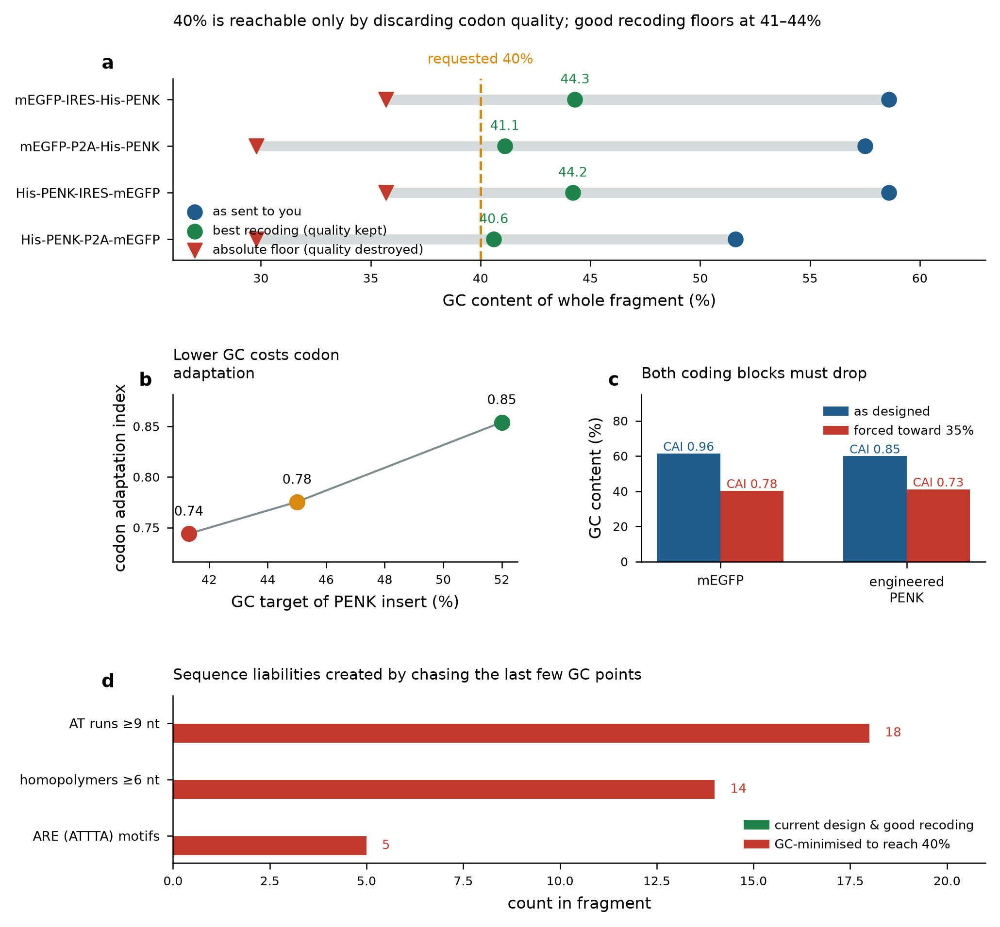

# The 40% GC request, evidence, and what to do about it

**Bottom line.** 40% whole-fragment GC is arithmetically reachable but not advisable, and it does not
solve the problem it is probably meant to solve. The GC-rich stretches in these constructs are
concentrated in the **mEGFP reporter**, not in the therapeutic insert. A targeted recoding of the
reporter removes 86% of them while keeping codon quality; a blanket 40% mandate removes them too, but
degrades codon adaptation across every element and introduces sequence liabilities that were not
there before.

---

## 1. Is 40% achievable?

Yes, arithmetically. The absolute synonymous floor for the engineered proprotein is **30.9% GC**, the
value obtained by choosing the most AT-rich codon at every position. 40% sits above that floor, so no
law of the genetic code forbids it.

But the fragments contain a fixed element. The **IRES is not recodable**, it is a structured RNA
element whose function depends on its actual sequence, not on the protein it encodes (it encodes
nothing). At 53% GC across 574–584 nt, it drags the required GC of everything else downward:

| fragment | total nt | fixed (IRES) nt | recodable nt | GC the recodable part must reach for 40% overall |
|---|---|---|---|---|
| mEGFP-IRES-His-PENK | 2197 | 584 | 1613 | 35.2% |
| mEGFP-P2A-His-PENK | 1674 | 10 | 1664 | 39.8% |
| His-PENK-IRES-mEGFP | 2194 | 583 | 1611 | 35.2% |
| His-PENK-P2A-mEGFP | 1671 | 9 | 1662 | 39.9% |

And when the recoding is done **while preserving codon quality**, the fragments floor out above 40%:

| fragment | GC as sent | best recoding with quality kept | GC-minimised floor (quality discarded) |
|---|---|---|---|
| mEGFP-IRES-His-PENK | 58.6% | **44.3%** | 35.7% |
| mEGFP-P2A-His-PENK | 57.5% | **41.1%** | 29.8% |
| His-PENK-IRES-mEGFP | 58.6% | **44.2%** | 35.7% |
| His-PENK-P2A-mEGFP | 51.6% | **40.6%** | 29.8% |

So: the two IRES constructs **cannot** reach 40% without abandoning codon quality. The two P2A
constructs can just about touch it.

---

## 2. What 40% costs

**Codon adaptation.** Codon adaptation index (CAI) measures how closely a coding sequence matches the
synonymous codon preferences of the host [R3]. Driving the PENK insert down in GC drops CAI from
**0.854 → 0.775 → 0.744** at 52%, 45% and 41% respectively. mEGFP is hit harder: **0.959 → 0.769**.
Codon usage is an established determinant of expression level in mammalian cells, acting substantially
through effects on mRNA levels rather than translation rate alone [R5, R6], and codon optimality is a
major determinant of mRNA stability [R4].

**GC content itself.** This is the reference that argues most directly against the request: in
mammalian cells, synonymous recoding to **higher** GC content increased mRNA levels and protein
expression, with GC-rich versions of the same protein expressing severalfold better than GC-poor ones
[R1]. A deliberate move from ~58% to 40% runs against that result.

**Sequence liabilities.** Reaching the GC floor by brute force introduces, per fragment:

| liability | current design & good recoding | GC-minimised to reach 40% |
|---|---|---|
| AT runs ≥9 nt | 0 | 18 |
| homopolymers ≥6 nt | 0 | 14 |
| ARE (ATTTA) motifs | 0 | 5 |

ATTTA pentamers in AU-rich context are the recognition core of the AU-rich element decay pathway,
which targets transcripts for rapid deadenylation and degradation [R8, R9]. Creating five of them in a
therapeutic transcript to satisfy a GC number is a poor trade. Long homopolymers and AT runs are also
among the sequence features that raise synthesis difficulty and error rates [R11].

**The general caution.** Codon optimization in human therapeutics has a documented history of
unintended consequences (altered folding, changed mRNA structure, loss of regulatory elements) and
is not a free operation [R2]. mRNA structure independently regulates protein output through functional
half-life [R10].

---

## 3. The problem 40% is probably meant to solve

A vendor or synthesis flag on these fragments would most likely have been raised by **local GC-rich
windows**, not by global GC. Counting 50-nt windows at ≥68% GC across all four fragments and
attributing each to the element it falls in:

| element | GC-rich windows (all 4 fragments) | recodable? |
|---|---|---|
| mEGFP | **361** | yes |
| engineered PENK | 61 | yes |
| IRES | 53 | **no: fixed sequence** |
| P2A | 14 | yes |

**The reporter accounts for 80% of the problem.** Your own construct set already contains the natural
experiment: `His-PENK-P2A-mEGFP` carries a lower-GC EGFP variant (41.0% GC) and has **zero** GC-rich
windows in the reporter, versus 47 for the 53.5% mEGFP in `mEGFP-P2A-His-PENK`.

---

## 4. Recommended alternative: targeted recoding

Recode the **reporter to 50% GC** and the **PENK insert to 52% GC**, leaving the IRES untouched:

| fragment | GC as sent | after targeted fix | GC-rich windows before → after |
|---|---|---|---|
| mEGFP-IRES-His-PENK | 58.6% | 51.8% | 196 → 28 |
| mEGFP-P2A-His-PENK | 57.5% | 51.9% | 75 → 14 |
| His-PENK-IRES-mEGFP | 58.6% | 51.8% | 203 → 25 |
| His-PENK-P2A-mEGFP | 51.6% | 51.3% | 15 → 0 |

The residual windows in the IRES constructs are **inside the IRES itself** and cannot be removed
without destroying the element. Codon adaptation of the recoded mEGFP stays at 0.869 (from 0.959),
against 0.769 if forced toward 35%. Cassette codon diversity is retained at 7/7 in the PENK insert.

---

## 5. If the wet lab insists on 40% anyway

This is a judgement call that belongs to whoever owns the experiment, and there are defensible reasons
to comply: a vendor quote conditioned on it, a synthesis platform with a hard specification, or simply
not wanting to renegotiate. If the decision is to comply:

1. **Ask what the 40% is for, once.** If it came from a vendor rejection, ask for the actual flagged
   region. If the flag is a local GC-rich window, the targeted fix in §4 addresses it and the global
   number is beside the point. Most vendors accept 40–60% GC routinely, and these fragments at
   51.6–58.6% are already inside that window.
2. **Apply it only where it is free.** The two P2A constructs reach 40.6–41.1% with codon quality
   largely intact. Do those, and exempt the IRES constructs, which cannot.
3. **Use the constrained builds, not a naive optimizer.** `engPENK_CDS_GC41_absolute_best_at_40pct`
   reaches 41.3% with CAI 0.744, zero homopolymers, zero AT runs ≥9 nt and zero ARE motifs. A
   most-AT-codon pass reaching 29.8% produces 18 AT runs, 14 homopolymers and 5 AREs. The difference
   between these two is entirely in how the optimizer is constrained.
4. **Do not touch the signal peptide region or the cassettes.** Verified: all four candidate sequences
   translate residue-for-residue to the intended proprotein, all 7 YGGFEVVG cassettes retain distinct
   codon usage, and the signal peptide is unaltered.
5. **Treat expression as an empirical question.** None of this predicts protein yield. If the group
   wants to know whether a 40% version expresses as well as a 52% version, that is a transfection and a
   western blot, not a calculation; and given [R1], it is a result worth having before committing the
   whole construct set.

---

## 6. Separate and more urgent: the His tag placement

Independent of GC, the audit found a design issue in all four fragments that outranks the GC question:
**the 6×His tag sits N-terminal to the signal peptide.** Residues upstream of the signal peptide start:

| fragment | residues before signal peptide |
|---|---|
| mEGFP-IRES-His-PENK | 12 |
| mEGFP-P2A-His-PENK | **268** |
| His-PENK-IRES-mEGFP | 11 |
| His-PENK-P2A-mEGFP | 11 |

A signal peptide is recognised co-translationally at the extreme N-terminus of the nascent chain;
placing residues in front of it interferes with recognition and cleavage [R13]. For the P2A construct
the displacement is the entire upstream reporter plus the 2A peptide, and a gene downstream of a 2A
element requires its own signal sequence to be secreted, because 2A "self-cleavage" leaves the
downstream product with an N-terminal proline rather than a free signal peptide [R12]. Moving the tag
to the C-terminus, or placing it immediately after the signal peptide cleavage site, resolves this. It
should be settled before any resynthesis, since resynthesising at 40% GC would lock in the tag error.

---

## Bibliography

**[R1]** Kudla G, Lipinski L, Caffin F et al. *High Guanine and Cytosine Content Increases mRNA Levels in Mammalian Cells* PLoS Biology 2006;4:e180. doi:[10.1371/journal.pbio.0040180](https://doi.org/10.1371/journal.pbio.0040180)

**[R2]** Mauro V, Chappell S *A critical analysis of codon optimization in human therapeutics* Trends in Molecular Medicine 2014;20:604-613. doi:[10.1016/j.molmed.2014.09.003](https://doi.org/10.1016/j.molmed.2014.09.003)

**[R3]** Sharp P, Li W *The codon adaptation index-a measure of directional synonymous codon usage bias, and its potential applications* Nucleic Acids Research 1987;15:1281-1295. doi:[10.1093/nar/15.3.1281](https://doi.org/10.1093/nar/15.3.1281)

**[R4]** Presnyak V, Alhusaini N, Chen Y et al. *Codon Optimality Is a Major Determinant of mRNA Stability* Cell 2015;160:1111-1124. doi:[10.1016/j.cell.2015.02.029](https://doi.org/10.1016/j.cell.2015.02.029)

**[R5]** Zhou Z, Dang Y, Zhou M et al. *Codon usage is an important determinant of gene expression levels largely through its effects on transcription* Proceedings of the National Academy of Sciences 2016;113. doi:[10.1073/pnas.1606724113](https://doi.org/10.1073/pnas.1606724113)

**[R6]** Hia F, Takeuchi O *The effects of codon bias and optimality on mRNA and protein regulation* Cellular and Molecular Life Sciences 2020;78:1909-1928. doi:[10.1007/s00018-020-03685-7](https://doi.org/10.1007/s00018-020-03685-7)

**[R7]** Gustafsson C, Govindarajan S, Minshull J et al. *Codon bias and heterologous protein expression* Trends in Biotechnology 2004;22:346-353. doi:[10.1016/j.tibtech.2004.04.006](https://doi.org/10.1016/j.tibtech.2004.04.006)

**[R8]** Barreau C *AU-rich elements and associated factors: are there unifying principles?* Nucleic Acids Research 2005;33:7138-7150. doi:[10.1093/nar/gki1012](https://doi.org/10.1093/nar/gki1012)

**[R9]** Chen C, Shyu A *AU-rich elements: characterization and importance in mRNA degradation* Trends in Biochemical Sciences 1995;20:465-470. doi:[10.1016/s0968-0004(00)89102-1](https://doi.org/10.1016/s0968-0004(00)89102-1)

**[R10]** Mauger D, Cabral B, Presnyak V et al. *mRNA structure regulates protein expression through changes in functional half-life* Proceedings of the National Academy of Sciences 2019;116:24075-24083. doi:[10.1073/pnas.1908052116](https://doi.org/10.1073/pnas.1908052116)

**[R11]** Kosuri S, Church G *Large-scale de novo DNA synthesis: technologies and applications* Nature Methods 2014;11:499-507. doi:[10.1038/nmeth.2918](https://doi.org/10.1038/nmeth.2918)

**[R12]** Yan J, Wang H, Xu Q et al. *Signal sequence is still required in genes downstream of “autocleaving” 2A peptide for secretary or membrane-anchored expression* Analytical Biochemistry 2010;399:144-146. doi:[10.1016/j.ab.2009.11.032](https://doi.org/10.1016/j.ab.2009.11.032)

**[R13]** Teufel F, Almagro Armenteros J, Johansen A et al. *SignalP 6.0 predicts all five types of signal peptides using protein language models* Nature Biotechnology 2022;40:1023-1025. doi:[10.1038/s41587-021-01156-3](https://doi.org/10.1038/s41587-021-01156-3)

---

*Computational analysis only. GC content, codon adaptation index, local window scans and motif counts
are sequence-derived measures; they do not predict expression level, secretion efficiency or protein
yield, all of which require measurement.*
