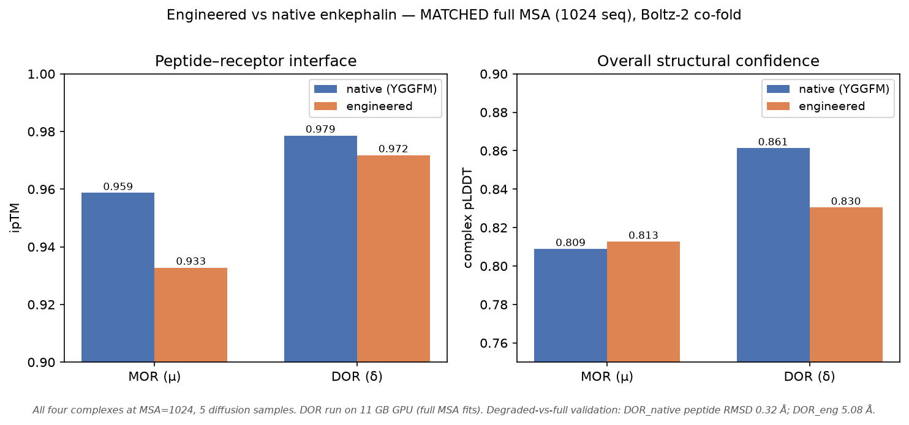

# PENK Dry-Lab Modelling — Consolidated Project Brief

**iGEM Patras · Dry-Lab / Modelling**
Prepared as a consolidated audit and design record across four computational workstreams. All methods, force fields, databases, and design rules are traceable to the accompanying methods & references log.

---

## 0. Executive summary

This project supports an enkephalin-based analgesic strategy built on **proenkephalin (PENK)** expression plus a **neprilysin (NEP/MME) knockdown** arm, delivered by cationic/ionizable **lipoplexes**. The dry-lab work spans four independent but linked deliverables:

1. **Plasmid audit** of four PENK expression cassettes — identity, gene order, linker, and PENK ORF integrity verified against the native reference (UniProt P01210). **One real defect found** (plasmid 1, truncated PENK).
2. **Restriction-digest QC** — a two-tier digest scheme (insert release + identity fingerprint) with a virtual gel, designed to confirm construct identity before transfection.
3. **Human anti-NEP (MME) siRNA design** — four validated-in-silico siRNA duplexes targeting the CDS shared by all MME transcript variants, with off-target and thermodynamic scoring.
4. **Lipoplex CG-MD** — coarse-grained MARTINI simulations comparing three lipid formulations (permanent-cation DOTAP, protonated ionizable MC3-H⁺, neutral MC3⁰) across triplicate replicates, resolving the pH-dependent DNA-binding behaviour that motivates the ionizable-lipid choice.

A fifth workstream was added after the first four: **payload engineering cycles** (§5b) — three pre-registered DBTL iterations attempting to bias the expressed peptide toward the δ opioid receptor. It returned a **negative result**, and is reported here in full because the negative result is load-bearing: it defines where the computational screen stops and the wet-lab assay must begin, and it forced the retraction of an earlier selectivity number.

**Scope note on the payload.** The four cassette plasmids carry the **native** human PENK sequence — they are the expression-system test-bed. The engineered anionic-address PENK (the therapy payload) is a separate construct: it currently exists as a **cloning-ready insert** (`engineered_PENK_GC-optimized.fasta` / `engPENK_insert_annotated.gb`), not yet assembled into an expression plasmid. It is audited here as the payload (§1) and kept out of the four-plasmid restriction QC (§2); §2b then assembles it into a therapy plasmid on the test-bed backbone with its own purpose-built QC.

---

## 1. Plasmid audit — four PENK cassettes

All four plasmids are pcDNA3.1(+)-type backbones carrying native human PENK and mEGFP, differing in **gene order** (which gene is cap-driven / first) and **linker** (EMCV IRES vs self-cleaving P2A).

| # | Plasmid | Size (bp) | Architecture | PENK identity | Cores | Verdict |
|---|---------|-----------|--------------|---------------|-------|---------|
| 1 | mEGFP-IRES-PENK | 7,500 | CMV → mEGFP (cap) → IRES → PENK | **TRUNCATED (263 aa)** | 6 of 7 | **DEFECT** |
| 2 | mEGFP-P2A-PENK | 6,971 | CMV → mEGFP–P2A–PENK (single ORF) | full length (266 aa) | 7 | OK, caveat |
| 3 | PENK-IRES-mEGFP | 7,512 | CMV → PENK (cap) → IRES → mEGFP | full length (267 aa) | 7 | **OK — cleanest** |
| 4 | PENK-P2A-mEGFP | 6,971 | CMV → PENK–P2A–mEGFP (single ORF) | full length (267 aa) | 7 | OK |
| — | **engineered PENK (payload)** | 885 (insert) | NheI–Kozak–ATG–CDS–XhoI (cloning-ready insert) | **engineered** (288 aa) | **7 of 7** | OK — payload |

**Key findings**

- **Plasmid 3 (PENK-IRES-mEGFP) is the cleanest construct**: PENK is cap-dependent with an intact signal peptide (MARFLTLC…), byte-identical to the UniProt P01210 reference.
- **Plasmid 1 has a genuine defect**: a premature stop truncates the C-terminal **YGGFMRF** (the 7th enkephalin core), leaving 6 of 7 cores. This is a point-level lesion — **it will not change any restriction-gel band** and can only be caught by Sanger sequencing of the PENK 3′ end.
- **Plasmid 2 caveat**: PENK is downstream of P2A, so its N-terminus becomes P-ARFLTLC (loses initiator Met, gains a P2A-derived proline) — this may impair signal-peptide function and secretion. For a secreted peptide product, the secreted gene should be placed **first** (as in plasmids 3 and 4).

- **Engineered payload (therapy construct)**: the anionic-address PENK, in which all seven enkephalin cores are recoded YGGF[M/L] → **YGGFEVVG**. Verified from `engineered_PENK_GC-optimized.fasta`: 867 nt CDS → 288 aa, Met start, single clean stop, **7 of 7 engineered cores, 0 native cores**, GC 59.9%, no homopolymers, cores made synonymously distinct, and single flanking NheI/XhoI sites with **no internal cut sites** (cloning-clean for pcDNA3.1(+)). This is the construct that gives the therapy its function; it is **not yet in a backbone**, so it appears in the audit but not in the four-plasmid gel QC.

Full per-feature detail is in `plasmid_feature_audit.csv`.

---

## 2. Restriction-digest QC protocol

A two-tier scheme confirms both **linker type** and **gene order**, and is designed so a single defect (mis-assembly) is caught before transfection.

**Digest A — insert release (AflII + XbaI).** Releases a constant **5,345 bp backbone** band (loading / complete-digestion control) plus one insert band whose size reports the linker: **~2.16 kb = IRES**, **~1.63 kb = P2A**. Limitation: cannot distinguish the two IRES plasmids (12 bp apart) or the two P2A plasmids — gene order requires Digest B.

**Digest B — identity fingerprint (NcoI, 5 cuts).** A unique 5-band pattern per plasmid. Shared 3,342 + 735 bp landmarks; the **second-largest band is diagnostic** for gene order (1,648/1,446 doublet vs 2,416 vs 2,749 vs 2,226 bp).

**Critical limitation flagged in the protocol:** passing the gel QC does **not** clear plasmid 1 — the PENK truncation is invisible on a gel and must be confirmed by **Sanger sequencing**.

The virtual gel (`restriction_qc_gel.png`) shows both digests side-by-side against a 1 kb-plus ladder; the full bench recipe and interpretation logic are in `restriction_qc_protocol.md`.

**Applies to the four native plasmids only.** This scheme is native-PENK-specific: the engineered payload insert has **no AflII and no XbaI site** (it is cloned via NheI/XhoI), so it cannot be screened by Digest A and does not share a lane with the four plasmids. Once the engineered PENK is cloned into an expression backbone, that construct will need its **own restriction map** computed fresh.

---

## 2b. Engineered PENK therapy plasmid — in silico build + QC

The four native plasmids are the **test-bed**; the **engineered PENK is the intended therapeutic construct**. To make it a plasmid rather than a linear fragment, the engineered insert (NheI–Kozak–CDS–XhoI, 885 bp) was cloned in silico into the **pcDNA3.1(+)** backbone shared by the test-bed vectors.

**Assembly.** Backbone donor = plasmid 4 (PENK-P2A-mEGFP), chosen for its **single** NheI and **single** XhoI sites (a clean directional swap). The native P2A–mEGFP cassette (1,639 bp, NheI→XhoI) was excised and replaced by the engineered insert, giving a **6,217 bp circular plasmid**. Verified: single NheI + single XhoI, engineered CDS present exactly once (288 aa, **all 7 YGGFEVVG cores**), native cassette removed. Promoter (CMV), polyA (bGH), and selection (NeoR/AmpR) are held identical to the test-bed, so the therapy construct stays parallel to the validated expression system.

**Purpose-built QC.** The native Digest A/B scheme does not transfer — the engineered plasmid has **no AflII site**, and its only XbaI site is in the backbone. Five diagnostic digests replace it:

| Digest | Enzyme(s) | Expected bands (bp) | Purpose |
|---|---|---|---|
| A — insert release | NheI + XhoI | **5,338 + 879** | insert present & correct size |
| B — linearize | NheI | 6,217 | total size |
| C — identity | BglII | 5,144 + 1,073 | empty vector loses the 1,073 band |
| D — fingerprint | NcoI | 3,342 + 1,845 + 735 + 295 | rearrangement check |
| E — fingerprint | PstI | 4,117 + 1,544 + 447 + 109 | independent fingerprint |

The virtual gel (`engPENK_therapy_qc_gel.png`) shows all five digests vs a 1 kb-plus ladder; the protocol and bench recipe are in `engPENK_therapy_qc_protocol.md`, and the annotated plasmid is `engPENK_therapy_plasmid.gb`.

**Status.** In silico design. After bench cloning, Sanger sequencing across the CDS is mandatory — the seven cores are synonymously distinct by design and a gel cannot verify them (the engineered analogue of the gel-invisible plasmid-1 truncation).

---

## 3. Human anti-NEP (MME) siRNA design

**Rationale.** Neprilysin (NEP / CD10, gene **MME**) is the principal enkephalin-degrading peptidase. Silencing it prolongs the half-life of the enkephalins produced by the PENK construct — the knockdown arm of the therapy.

**Target.** All four human MME transcript variants (NM_000902.5, NM_007287/288/289) share an **identical 2,253 bp CDS**; every design targets that shared CDS, so a single siRNA silences all isoforms.

**Pipeline.** 2,084 candidate 19-mers enumerated across the CDS → **228** pass sequence rules (Reynolds + Ui-Tei: GC 30–52%, positional base preferences, no long homopolymer/GC runs) → ranked by thermodynamic duplex-end asymmetry (favouring guide-strand RISC loading) → off-target screened by NCBI blastn-short against human `refseq_rna`.

**Four recommended duplexes** (all 19/19 on-target, 0 off-targets ≥17/19; standard 3′ dTdT overhangs):

| # | CDS pos | Guide / antisense (5'→3') | GC% | ΔΔG | worst off-target |
|---|---------|---------------------------|-----|-----|------------------|
| si-MME-1 | 759 | UUCCUGACGAAUCAAUCUGdTdT | 42.1 | +1.31 | 16/19 |
| si-MME-2 | 1032 | UUCUGGAGCAUAAACAACCdTdT | 42.1 | +2.33 | 16/19 |
| si-MME-3 | 1224 | AUAGUUUGCACAACGUCUCdTdT | 42.1 | +0.98 | 14/19 |
| si-MME-4 | 1590 | UAUCCACUCAUCUUUGUCCdTdT | 42.1 | +1.93 | 16/19 |

Passenger strands, mRNA positions, and full scoring are in `sirna_design_table.csv`; the design figure is `sirna_design_figure.png`.

**Validation recommended:** qPCR of MME at 48 h (expect ≥70% knockdown for ≥2 duplexes) + NEP activity/CD10 Western; use ≥2 independent effective siRNAs to control for off-target phenotypes. A context-dependence caveat from the project bibliography is recorded — this design provides tool reagents, not a settled biological strategy.

---

## 4. Lipoplex coarse-grained MD

**Question.** Does the ionizable lipid's protonation state control DNA binding as the delivery design assumes — weak binding at physiological pH (neutral, for circulation), strong binding at endosomal pH (protonated, for cargo condensation)?

**Design.** MARTINI 2 CG-MD of a 60-bp CG B-DNA duplex with three lipid formulations, each cationic-lipid 120 : DOPE 80 : cholesterol 40 in ~24k CG waters, 150 mM NaCl:

- **DOTAP** — permanent +1 (control for constitutive binding)
- **MC3-H⁺** — ionizable MC3 surrogate, protonated (endosomal-pH state)
- **MC3⁰** — same lipid, neutral (physiological-pH state)

**3 independent velocity-seed replicates per formulation** (9 runs), analyzed with mean ± SEM.

### Final results (200 ns × 3 seeds)

All 9 replicates were extended from 50 ns to **200 ns** (each continued from its checkpoint); metrics use the equilibrated second half (100–200 ns).

| Formulation | DNA–lipid contacts | Min DNA–lipid dist (nm) | RDF peak g(r) | DNA Rg (nm) |
|-------------|-------------------:|------------------------:|--------------:|------------:|
| DOTAP (permanent +) | 24.7 ± 5.5 | 0.460 ± 0.003 | 1.54 ± 0.12 | 4.10 ± 0.13 |
| MC3-H⁺ (endosomal pH) | 34.4 ± 8.6 | 0.469 ± 0.013 | 1.57 ± 0.31 | 4.24 ± 0.07 |
| MC3⁰ (physiological pH) | 8.1 ± 4.9 | 1.270 ± 0.563 | 1.04 ± 0.09 | 4.18 ± 0.002 |

**The pH switch is reproduced, and the extension confirms it robustly.** At endosomal pH the protonated ionizable lipid (MC3-H⁺) binds DNA as tightly as the permanent-cation control DOTAP — both reach ~0.47 nm closest approach — condensing and protecting the cargo. At physiological pH the neutral form (MC3⁰) holds DNA ~1.3 nm away, with an RDF peak at the bulk value (~1.0) and one seed that never binds (0.08 contacts, 2.36 nm) — the release/circulation state.

### Convergence — the extension did its job

At 50 ns the between-seed spread was large **because binding is a stochastic nucleation event that had not finished** (cumulative-mean contacts still rising, first-half → second-half drift up to +200%, while within-replicate block error stayed small at 0.7–4.2 contacts — i.e. between-seed sampling, not thermal noise). The 200 ns extension resolved this:

- **MC3-H⁺ error bars collapsed** — contacts SEM 15.1 → 8.6, min-distance SEM 0.126 → 0.013 nm (≈10× tighter). The short run had caught nucleation mid-transient; the long run confirms genuine strong binding.
- **DOTAP** stayed strong and tightened further (contacts SEM 6.1 → 5.5) — constitutive binding, as expected for a non-titratable lipid.
- **MC3⁰** stayed weak throughout — the intended physiological-pH control.

Cumulative-mean contacts plateau by ~100 ns for all formulations, so the 100–200 ns analysis window is equilibrated. This was a genuine convergence requirement, not padding.

### Honest limitation (stated by design)

The DOTAP, MC3-H⁺ and MC3⁰ topologies are **MARTINI-2 analogy models** (built from DOPC/DUPC), **not** independently validated published parameters. Consequently all conclusions are **qualitative / comparative** — the relative ranking of DNA-condensing tendency across formulations and protonation states — **not** quantitative binding free energies. More sampling improves convergence but cannot fix a parameter-provenance limitation; this is disclosed rather than hidden.

Figure: `lipoplex_md_200ns.png` (RDF with replicate spread · contacts with individual seeds · closest approach · convergence). Per-replicate and summary metrics in `md_formulation_summary_200ns.json`; full 50→200 ns convergence tables in `04_lipoplex_md/RESULTS_200ns.md`. The Stage-1 50 ns figure/metrics are retained (`lipoplex_md_50ns.png`, `md_formulation_summary.json`) for provenance.

---

## 4b. Therapeutic delivery rationale — putting the two arms together

The four workstreams are not independent analyses; they are components of one system whose therapeutic logic is **endogenous opioid enhancement**: *make more enkephalin, degrade less of it, at the pain relay.*

**Mechanism.** The PENK construct produces proenkephalin, which is processed to enkephalins — endogenous opioid peptides acting on δ- (and μ-) opioid receptors to produce opioid-like analgesia without an exogenous opioid. Neprilysin (NEP / MME / CD10) is the principal enkephalin-degrading ectopeptidase, inactivating enkephalins in the synaptic space within seconds. Silencing NEP prolongs enkephalin action — the knockdown arm. The two arms are synergistic.

**Where the siRNA goes — co-formulation, not just co-expression.** NEP acts as a cell-surface ectoenzyme and enkephalin is degraded *extracellularly*, but siRNA silencing is **cell-autonomous** — it only affects the cells actually transfected. Secreted enkephalin then diffuses past the surfaces of many neighboring cells, and NEP on any of them will degrade it. Silencing NEP only in the enkephalin-producing cell is therefore insufficient. The design consequence: **co-formulate the NEP siRNA and the PENK plasmid in the same lipoplex, delivered to the same locus**, so the population of enkephalin-producing cells overlaps maximally with the population of NEP-silenced cells. This is precisely why the lipoplex CG-MD (§4) is load-bearing — the lipoplex is the vehicle that carries both nucleic acids into the same region, and the siRNA off-target screen (§3) is part of that same package.

**Where in the CNS.** Lipoplexes do not cross the blood–brain barrier, so delivery is local/regional to the analgesic circuit — principally the **spinal dorsal horn (intrathecal)**, the first nociceptive synapse and rich in δ/μ opioid receptors; supraspinal targets (PAG, RVM) are alternatives. There is clinical precedent for the enkephalin-gene-therapy-for-pain concept (an HSV proenkephalin vector reached trials for cancer pain); the additions here are the NEP-knockdown arm and a non-viral lipoplex vehicle.

The two-arm concept and its dorsal-horn mechanism are shown in `therapy_delivery_schematic.png`.

**Honest caveats.** (i) The cell-autonomy mismatch is the central design risk — co-formulation plus local delivery mitigates but does not erase it. (ii) NEP has other substrates (substance P, bradykinin, natriuretic peptides, amyloid-β); broad chronic knockdown could impair Aβ clearance, so the knockdown is kept **local and transient** by using siRNA/lipoplex rather than a permanent vector. (iii) Sustained opioid tone raises tolerance/dependence considerations. (iv) siRNA and non-integrating plasmid expression are transient — adequate for proof-of-concept, but a chronic indication would want a durable vector.

---

## 5. What each deliverable establishes

| Workstream | Establishes | Actionable output |
|-----------|-------------|-------------------|
| Plasmid audit | Which construct to use (plasmid 3); which is defective (plasmid 1) | Use plasmid 3; Sanger-verify or discard plasmid 1 |
| Restriction QC | Identity/gene-order check before transfection | 2-digest protocol + virtual gel |
| siRNA design | Knockdown reagents for the NEP arm | 4 orderable duplexes + validation plan |
| Lipoplex CG-MD | pH-dependent DNA binding of the delivery vehicle | Formulation ranking + convergence-backed screen |
| Peptide engineering cycles | That δ-selectivity **cannot** be resolved by co-fold confidence at the effect sizes our designs produce | Shortlist of 2 payloads for radioligand binding |

---

## 5b. Payload engineering cycles — δ-selectivity (three DBTL iterations)

Native Met-enkephalin (`YGGFM`) is only weakly δ-preferring, and δ (DOR/`OPRD1`) agonism
carries **much lower respiratory-depression and dependence liability** than μ
(MOR/`OPRM1`). Biasing the payload δ-ward is therefore a safety-driven design goal, and it
was pursued over three pre-registered Design→Build→Test→Learn cycles. Predictions were
committed and pushed to git **before** each run, so the falsification record is auditable.

| Cycle | Question | Outcome |
|---|---|---|
| **1** | Does grafting the deltorphin II address onto the enkephalin message bias δ? | Directionally δ-ward; **quantitative claim withdrawn** (see correction below) |
| **2** | Can address hydrophobicity / an anionic residue improve it? | **Primary hypothesis falsified** — 4 of 5 predictions wrong |
| **3a** | Is pose convergence a better-powered selectivity proxy than ipTM? | **Hypothesis rejected** — does not replicate on held-out samples |

**Cumulative track record: 10 predictions, 4 confirmed, 6 falsified.**

### A retracted number, and why it is reported here

Cycle 1 originally reported the engineered payload as **1.96× more δ-preferring** than
native. **That figure is withdrawn.** It was computed from the single top-ranked diffusion
sample. Recomputed across all samples, the engineered payload's δ-preference is
+0.0114 ± 0.0131 — indistinguishable from zero (p = 0.43) and from native (p = 0.60). Root
cause: the engineered μ complex has ~3× the sample spread of any other complex, and the
top-ranked model happened to land near that distribution's floor, so the apparent
selectivity was largely one unlucky sample. A process change followed: **every metric in
this project is now a mean ± SD over all samples, never a single model.**

### Final state of the screen

Across 7 peptides × 2 receptors at 20 diffusion samples each (280 structures), **no design
achieves meaningful δ-selectivity**: every Δ_sel ≤ 0.007 with SEM ≈ 0.004, and the two
leading payloads — `YGGFEVVG` (the built construct) and `YGGFDIIG` — are statistically
tied. The only result reaching significance points the *wrong* way (`YGGFELLG` prefers μ,
p = 0.008), reproducing a consistent finding that added aliphatic bulk in the address
biases μ-ward on our Gly-Gly backbone — opposite to the published deltorphin literature,
which measured those substitutions on a D-Ala² backbone we cannot encode in DNA.

**The honest conclusion is that the in-silico screen has reached its resolution limit.**
Boltz-2 ipTM is a structural-confidence score, not binding affinity, and it cannot resolve
δ/μ preference at the magnitude these designs produce. The screen's real deliverable is a
**shortlist of two payloads for radioligand competition binding at OPRD1/OPRM1**, which
remains the only real test.

### Constraint that shaped every design

The payload is **expressed from a plasmid**, so it must be DNA-encodable: 20 standard
L-amino acids only. This excludes the classic high-selectivity opioid-peptide chemistry
(D-amino acids, penicillamine cyclisation, N-methylation), which is why the design space
was the address-domain *sequence*. One exception is exploited deliberately — a C-terminal
Gly is the recognition signal for **peptidylglycine α-amidating monooxygenase (PAM)**, so a
`...VVG` payload can be amidated to `...VV-NH₂` *in vivo*; the terminal Gly in every design
is load-bearing.

Full per-cycle pre-registrations, results, and prediction scorecards are in
`06_engineering_cycles/`.

---

## 6. Reproducibility

Every tool version, force field, database accession, and published design rule is recorded in `methods_references.md`. The full analysis code, input topologies, protocols, and figures are versioned in the accompanying Git repository. The MD parameter-provenance caveat is stated in both the methods log and the results above.

*This brief reports the final 200 ns MD results (all 9 replicates converged).*

*Update on the peptide–receptor co-folds: these **did** complete. An earlier version of this
brief recorded them as blocked by a cluster disk-quota limit during MSA generation; that
was resolved, and the root cause of the subsequent GPU memory failures turned out to be the
prediction tool auto-loading an uncapped MSA rather than a hard hardware limit. All four
μ/δ × native/engineered complexes were produced at matched full MSA depth (1024 sequences),
then extended to a 7-peptide panel at 20 diffusion samples each (§5b). Structures and
confidence files are in `06_engineering_cycles/*/data/`.*
